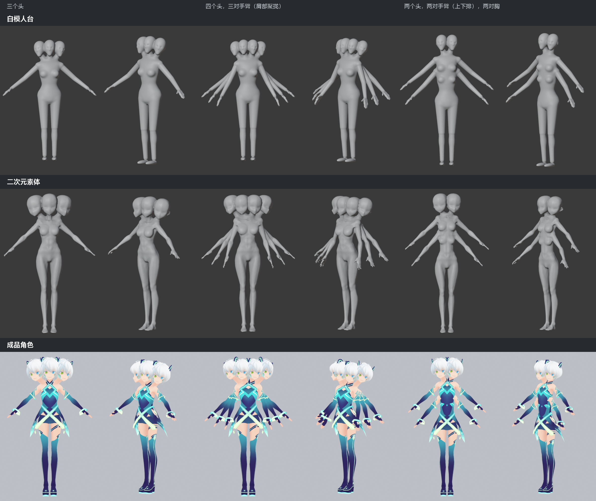
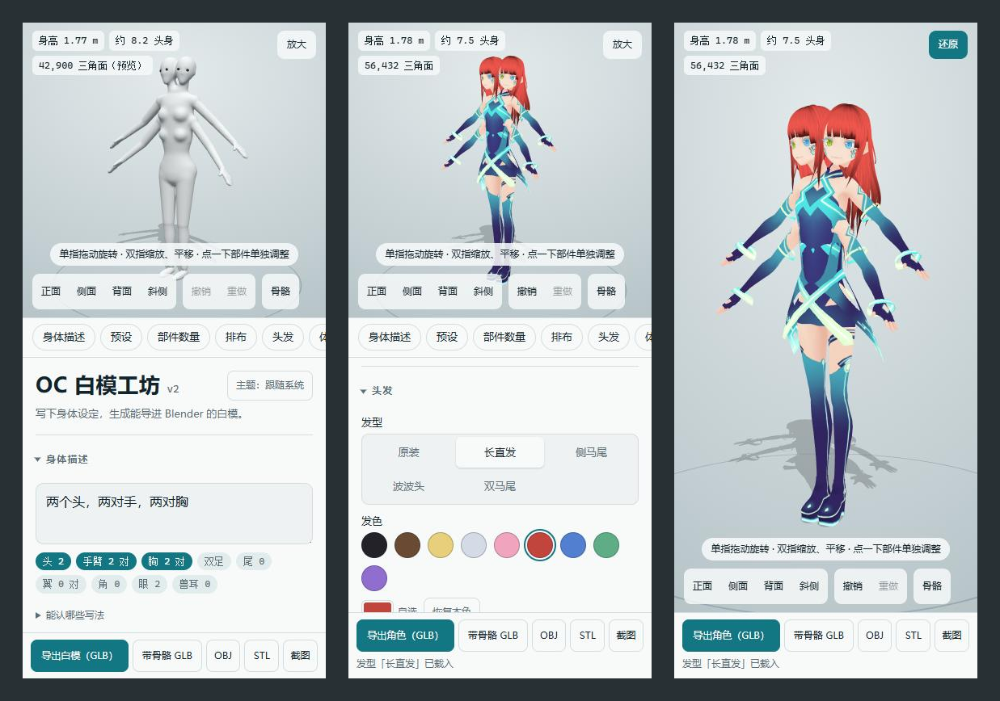
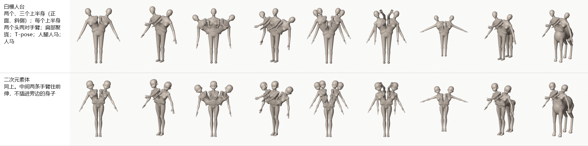
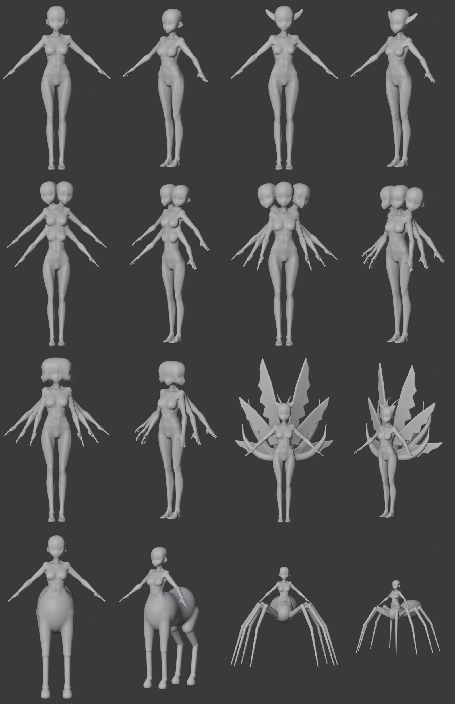
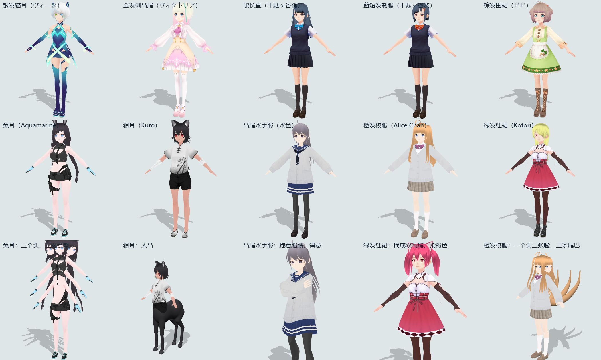
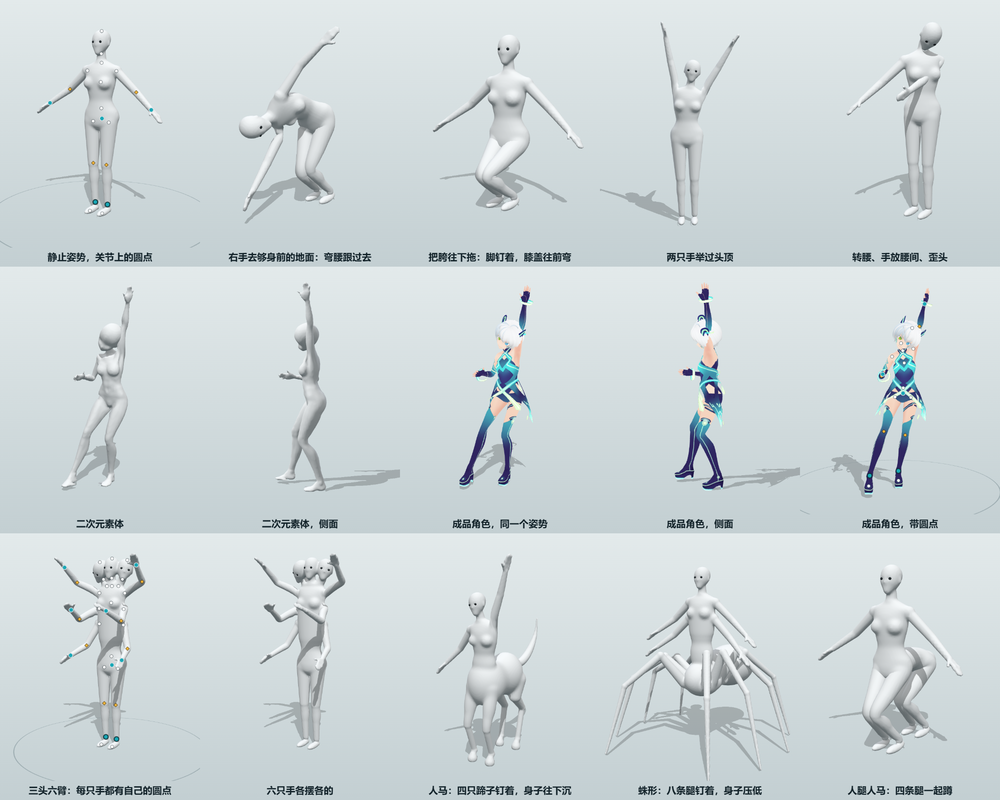

# OC Base Mesh Workshop v2

[中文](README.md) · [English](README.en.md) · [日本語](README.ja.md)

A base mesh generator for multi-limbed characters. Write one sentence describing the body ("two heads, two pairs of arms, two pairs of breasts", "Asura", "nine tails, six wings") and you get a base mesh you can import into Blender: a single closed mesh you can start sculpting right away, with a skeleton and weights if you want them. Once the body is set, you can also drag the joints right here to pose it.



- **Three body styles**: Mannequin, Anime body, and Ready-made (ten ready-made VRoid characters; you can also load your own VRM).
- **Parts**: 1–3 upper bodies, 1–5 heads, 0–4 pairs of arms, 0–4 pairs of breasts, 1–12 legs, plus tails, wings, horns and animal ears; lower bodies such as centaur, arachne (spider body) and humantaur.
- **Adjusting**: body-shape sliders; move, rotate and scale any single part; undo / redo.
- **Posing**: drag the joints to pose; 60 ready-made poses and 16 hand gestures; Ready-made characters also get expressions and gaze.
- **Export**: GLB (optionally with bones and weights), VRM, OBJ, STL, and screenshots with a transparent background.
- **Where to use it**: in a desktop browser, packaged as an exe, as an Android installer, or put online and opened on a phone.

The instructions are written for Blender beginners on Windows, with a menu path or key for every step.

- [Install and run](#install-and-run)
- [Interface](#interface)
- [Shape](#shape)
- [Three body styles](#three-body-styles)
- [Manual tweaks](#manual-tweaks)
- [Pose](#pose)
- [Export](#export)
- [Import into Blender](#import-into-blender)
- [Using it with Tripo](#using-it-with-tripo)
- [FAQ](#faq)
- [Known limitations](#known-limitations)
- [Assets and attribution](#assets-and-attribution)
- [Development](#development)

## Install and run

1. Install [Node.js](https://nodejs.org/): on the download page pick the LTS version (20 or later) and click "Next" through the installer.
2. Open a terminal in this folder: in File Explorer go into the folder, type `pwsh` in the address bar and press Enter.
3. Install the dependencies before the first run (only once; needs an internet connection):

   ```powershell
   npm install
   ```

4. Start it:

   ```powershell
   npm run dev
   ```

   Your browser opens http://localhost:5173 automatically. When you're done, go back to the terminal and press `Ctrl + C` to stop.

After that you only need steps 2 and 4 each time.

### Without Node.js

| You want | Command | You get |
| --- | --- | --- |
| An exe to send to others | `npm run pack` | In `release`: `OC白模工坊.exe` (about 13 MB; double-click to use, no installation, no internet needed), the user guides (`使用说明.txt` in Chinese, `Guide-en.txt` in English, `ガイド-ja.txt` in Japanese), and a zip that bundles them together |
| An Android installer | `npm run apk` | `OC白模工坊.apk` in `release` (about 17 MB, Android 10 or later) |
| Put it online and open it on a phone | `npm run build` | The `dist` folder is a purely static website; upload it to a host such as GitHub Pages, Cloudflare Pages or Netlify and it works, on iPhones too |

- The exe is not digitally signed, so the first double-click may show "Windows protected your PC": click "More info", then "Run anyway". The other person needs Windows 10 / 11 and one of Edge, Chrome or Firefox.
- To install the Android package you need to allow installing apps from unknown sources. It requests no permissions; exported files are saved in the "OC白模工坊" folder inside the phone's Downloads folder.
- Building the Android package needs a JDK (environment variable `JAVA_HOME`) and the `build-tools` and `platforms` from the Android SDK (environment variable `ANDROID_HOME`); you don't need Android Studio. The signing key `tools/android/sign.keystore` is generated the first time you build. Don't lose it: without it, a new package can't be installed over an old one.
- Just trying it at home: put the phone and the computer on the same Wi-Fi, run `npx vite preview --host` on the computer, and open the `http://192.168.….…:4173/` address it prints in the phone's browser.
- Repackage after you change the workshop.

## Interface



- **The left side is the 3D view**. The "Shape / Pose" switch at the top left chooses what you are doing; below it are the readouts for height, heads tall and triangle count, and orange text after them is a warning. Left-drag to rotate, scroll to zoom, right-drag to pan, click a part to select it. At the bottom left are the view buttons (Front / Side / Back / 3/4), Undo / Redo, and "Bones" to show the skeleton.
- **The right side is the settings panel**: Body description, Presets, Part counts, Layout, Hair, Body shape, Manual tweaks, Mesh, Camera & lighting, Reference images, and Config. Click a section's title to fold it. The export buttons are pinned to the bottom of the panel.
- **Language**: the interface is available in Chinese, English and Japanese. Use the language drop-down at the top right (to the left of the theme button). The first time you open it, it follows the browser's language; adding `?lang=en` (or `zh`, `ja`) to the address also works.
- **Tour**: it appears automatically the first time you open the workshop and can be skipped; to see it again, click "Tour" under the title.
- **Phone in portrait**: the 3D view is the top half and the settings the bottom half, and the whole page scrolls together. Drag with one finger to rotate; pinch with two fingers to zoom and drag with two fingers to pan.

## Shape

### Writing a description

Type the body description into the "Body description" box; the model updates by itself about 0.3 seconds after you stop typing. In the row of tags below it, the ones that light up are the parts it recognized, and "What it understands" shows how each piece was recognized.

| What to write | Examples |
| --- | --- |
| Part + number + counter | `two heads`, `three pairs of arms`, `nine tails`, `four horns`, `6 eyes`, `three faces`, `two torsos` |
| No such part | `no tail`, `no horns`, `flat chest` |
| Idioms and keywords | `Asura`, `kitsune`, `seraph`, `centaur`, `humantaur`, `spider girl`, `cat ears`, `Geryon` |
| English tags | `four_arms` `multiple_tails` `centaur` `humantaur` `three_faces` `1boy` |
| Height and head-to-body ratio | `165 cm`, `1.7 m`; `eight heads tall` |
| Gender and pose | `male`, `boy`, `girl`; `T-pose`, `A-pose` |
| Hairstyle and hair color | `twin tails`, `ponytail`, `long hair`, `bob cut`; `blonde hair`, `silver hair`; `twintails` `blonde_hair` |
| How the legs are arranged | `legs side by side`, `tandem legs`, `gathered legs`, `side by side hips` |

<details>
<summary>The Chinese phrasings from the original examples also work</summary>

- Part + number + counter: 「两个头」 (two heads), 「三对手臂」 (three pairs of arms), 「九条尾巴」 (nine tails), 「每个头四只角」 (four horns per head), 「6 只眼睛」 (6 eyes), 「三张脸」 (three faces), 「两个上半身」 (two upper bodies)
- No such part: 「没有尾巴」 (no tail), 「无角」 (no horns), 「平胸」 (flat chest)
- Idioms and keywords: 「三头六臂」 and 「三面六臂」 (three heads / faces, six arms), 「九尾」 (nine tails), 「六翼」 (six wings), 「阿修罗」 (Asura), 「半人马」 (centaur), 「人腿人马」 (humantaur), 「蜘蛛女」 (spider girl), 「猫耳」 (cat ears), 「革律翁」 (Geryon)
- Height and head-to-body ratio: 「身高 165」 (height 165), 「八头身」 (eight heads tall)
- Gender and pose: 「男性」 (male), 「少年」 (boy), 「少女」 (girl); 「T-pose」, 「双臂平举」 (arms stretched out sideways), 「A-pose」
- Hairstyle and hair color: 「双马尾」 (twin tails), 「马尾」 (ponytail), 「长直发」 (long straight hair), 「波波头」 (bob cut); 「金发」 (blonde hair), 「银色长发」 (long silver hair), 「黑长直」 (long straight black hair)
- Leg arrangement: 「腿左右并排」 (side by side), 「胯部聚拢」 (gathered at the pelvis), 「横排多胯」 (pelvises side by side), 「前三后三」 (three front, three back)

</details>

### Presets and part counts

- **Presets**: 12 ready-made combinations; click one to switch to it.
- **Part counts**: 1–3 upper bodies, 1–5 heads, 0–4 pairs of arms, 0–4 pairs of breasts, 1–12 legs, 0–9 tails, 0–3 pairs of wings, and for each head 0–4 horns, 1–6 eyes and 0–2 pairs of animal ears. With several upper bodies, heads, arms, breasts and wings are counted per upper body.
- After you click a preset or change a count, the description box is rewritten as one canonical sentence so you can keep editing it.

### Layout

- **Multiple heads**:
  - "Clustered" (default): in the style of anime multi-headed characters, the body is still one person's and the heads huddle face to face, each with its own neck. With four or five heads, each head is a little smaller.
  - "1 head, N faces": like Asura's "three faces, six arms" in Buddhist statues, there is only one head and one neck, and the extra faces each look to a different side.
  - "Wide torso": only takes effect with the Anime body, two heads, and a "Pelvis row" of two pelvises; the two heads each keep a neck and shoulders, and merge into one torso two people wide.
- **Multiple pairs of arms**: "Stacked along the torso" (each extra row lengthens the torso by one section) or "Gathered at shoulders" (the extra arms grow from behind the shoulders, and from the front they look like layered fans).
- **Legs** are counted individually, so an odd number is fine. With three or more legs there are several arrangements. With "Auto", 4 legs make a centaur, 6 or more make an arachne, and an odd number goes "Side by side":
  - Centaur, arachne: the upper body sits on a horse body or a spider body (these two only come in pairs of legs, so an odd number gets one extra leg).
  - Humantaur: a sideways section of human waist behind the body, followed by another human pelvis and legs.
  - Tandem: the pelvis is stretched out, and several pairs of human legs are packed front to back.
  - Side by side: everything below the waist is widened, and the legs stand in an evenly spaced row.
  - Gather at pelvis: the pelvis stays as wide as one person's, the pelvises sit one against the next, and the legs spread outward more and more toward the bottom.
  - Pelvis row: several complete pelvises stand in a row, two legs each.
  - For Humantaur and Tandem you can choose how many legs each pelvis carries ("three front, three back").
- **Multiple upper bodies** (1–3): two or three upper bodies branch off the waist of one pelvis, standing side by side and fanning out to both sides, like Geryon in Greek myth. Each upper body gets its own set of heads, arms, breasts and wings as set, and the middle arms reach forward.
- **Multiple tails** fan out to both sides from the tail root.
- **Hands**: "Separate fingers" (default) is a ready-made hand with each finger separate; "Joined fingers (mitten)" is a single palm plus a thumb, only suitable as a rough starting point.



### Body shape

- **Body style**: Mannequin (default), Anime body, Ready-made; see the next section.
- **Gender**: Female (default) or Male; only affects the Mannequin.
- **Pose**: A-pose (default) or T-pose. T-pose is handier when you want to rig bones or give the model to an image generator as a reference.
- **Sliders**: height, heads tall, build, shoulder width, bust size, waist width, hip width, limb thickness, arm length, leg length, tail fluffiness and tail length. Pushed to either end they give very exaggerated cartoon proportions. When arms or legs are lengthened, the hands and feet are not stretched along with them; leg length does not change the height (the whole figure is scaled proportionally).
- Extra rows of arms, centaurs and arachnes make the actual height greater; go by the readout at the top left.

### Hair

All three body styles can wear four ready-made hairstyles: long straight, side ponytail, bob and twin tails (taken from VRoid's old CC0 samples).

- The Mannequin and the Anime body are bald by default. Once you pick a hairstyle, the hair is turned into a colorless shell and fused with the head into one piece, so it can still be sculpted directly. The hair has no bones of its own and moves with the head as a whole.
- Ready-made characters wear their original hair by default; you can swap it for one of these four and also dye it. When several heads are clustered, each head can be dyed separately.
- **Length** (60%–150%) controls the part hanging below the tip of the nose; **Volume** (97%–120%) scales the whole hairstyle up or down.

### Mesh

- **Fused (one piece)** (default): all parts are fused into one closed mesh with smooth transitions at the joins. "Blend radius" sets how wide the transition is.
- **Separate parts (v1)**: every part is its own object; they overlap and are not fused.
- On screen you see a coarser preview, which is swapped for a finer one once you stop; the export computes a fine mesh separately.

### Undo and saving

- Undo / Redo: the buttons at the bottom left, or `Ctrl + Z` / `Ctrl + Y`. The undo history is cleared when you refresh the page; the settings themselves stay.
- All settings (including manual tweaks and the pose you set) are saved automatically in this browser.
- "Save config" in the "Config" section saves a separate `oc_config.json`, and "Load config…" reads it back.

## Three body styles

### Mannequin

The default style. It is assembled from large volumes part by part and fused into one piece; the face has only eye sockets, a raised nose and a chin. A good starting point for sculpting.

### Anime body

The head, torso, breasts, arms and legs are replaced with the shape of a ready-made anime girl base body: slender limbs, a pointed-chin head, hands with fingers and feet with toes. It is still a colorless base mesh without clothes. The first time you switch to it, about 6 MB of data is loaded.



- Multiple heads, arms and breasts, tails, wings, all kinds of lower bodies, manual tweaks, bones and every export format work as usual, and the export is still one closed mesh.
- The body-shape sliders widen or narrow the base body from its original shape; gender and hand style have no effect on it.
- **Bust size** 0.3–2.3: toward smaller it gradually flattens; toward larger it blends between two breast shapes, this base body's small one and another base body's large one.
- Hands and feet are ready-made meshes that are sewn on at the wrists and ankles after fusing, so fingers and toes stay separate at any precision.
- **Models exported with this style must be credited when you share them**; see [Assets and attribution](#assets-and-attribution).

### Ready-made

What you see and export is a ready-made anime character with hair, clothes, a face and textures. Extra heads, arms and breasts are made by copying her own piece (clothes and textures included) and attaching it; extra legs are made by copying her pelvis and legs and spreading them out; beast bodies, tails, wings, horns and animal ears are separate single-color parts.



Below "Body style" there is a row of portraits; click one to switch. Switching characters changes only the person: part counts, body shape, hairstyle, pose and expression are carried over as they are. Each character is 9–14 MB and is only loaded when you select it.

| Name on the portrait | Original name | Author | License |
| --- | --- | --- | --- |
| Silver cat: silver hair, cat ears (default) | ヴィータ | VRoid Project (pixiv) | CC0 |
| Blonde: blonde hair, side ponytail | ヴィクトリア・ルービン | VRoid Project (pixiv) | CC0 |
| Long black: long straight black hair | 千駄ヶ谷篠 | VRoid Project (pixiv) | CC0 |
| Blue hair: short blue hair, uniform | 千駄ヶ谷渋 | VRoid Project (pixiv) | CC0 |
| Brown hair: short brown hair, apron | ビビ | VRoid Project (pixiv) | CC0 |
| Rabbit ears: black braids, rabbit ears | Preset Only Rabbit - Aquamarine | 七百屋 (なおしま) | VRoid Hub terms |
| Wolf ears: short black hair, wolf ears | Kuro (Preset Nekomimi Girls) | 七百屋 (なおしま) | VRoid Hub terms; no sexual use |
| Sailor suit: ponytail, sailor uniform | 水色（ポニーテルの女の子） | 白い白米 | VRoid Hub terms |
| Orange: long orange hair, school uniform | Alice Chan | edisonlee55 (yuna0x0) | CC BY-SA 4.0 |
| Red skirt: green hair, red skirt | Kotori | Fox Jump | CC BY |

**Loading your own VRM**: pick a VRM file with "Load your own VRM…" below the portraits (0.x and 1.0 both work; one made in VRoid Studio works best) and it becomes the eleventh character; multiple heads, multiple arms, posing, expressions and hairstyle swaps all work as usual. The file is stored only in this device's browser, so on another device you need to pick it again. For VRMs made in other software, bones are matched using the humanoid bone table, and skin, clothes and hair are matched by VRoid's material names; when the matching is incomplete, the notes in the panel will tell you.

How it differs from the base meshes:

- The pieces overlap and are not fused: the export is not one closed mesh, so it isn't suited to direct sculpting or 3D printing.
- Build, gender, hand style, eye count and removing the arms have no effect; the "Mesh" section doesn't apply either.
- Shoulder width, waist width, hip width, limb thickness and arm length stretch the body together with its clothes, and the patterns distort if you push them far.
- Manual tweaks follow the bones, and parts moved far away stretch like rubber where they join the body. Its tweaks are recorded separately from the base meshes'.

### Adult parts (off by default)

The "Show adult parts" switch under "Part counts" is off by default and is remembered only on this computer and in this browser; it does not travel with the config file. Once it is on, the Mannequin and the Anime body can get penises (0–6 per pelvis, side by side, stacked, fanned or in a grid) and a scrotum; Pose has its own set of handles for them, and a rigged export gives each one three bones. The asset requires attribution; see [Assets and attribution](#assets-and-attribution).

## Manual tweaks

When the automatic placement isn't what you want, you can adjust a single part: a particular arm, a head, a tail, a horn…

1. **Select a part**: click it on the model (or choose it in the drop-down list in the "Manual tweaks" section). It gets a cyan overlay and a gizmo appears at the joint.
2. **Adjust**: drag the gizmo on the model (switch between Move / Rotate / Scale in the panel), or type an offset (cm), angle (degrees) or size (multiplier) in the panel.
3. Click empty space or press `Esc` to finish adjusting.

- Directions: X is the character's own left, Y is up, Z is forward. Rotation and scaling are around the joint (an arm around the shoulder, a leg around the hip).
- With "Also adjust the opposite side" on, left/right pairs of parts change together, mirrored.
- The torso carries the neck, heads, arms, breasts and wings; a head carries the eyes, horns and ears. The feet always stay on the ground.
- Tweaked parts are listed under "Tweaked". "Reset this part" resets only the selected part, and "Reset all" clears every tweak; clicking a preset also clears them (you can undo).
- If you push too far (pulling an arm away from the body), the mesh breaks apart and the top left shows "The mesh has split into N pieces".

## Pose

Click "Pose" at the top left of the 3D view and a set of handles lights up on the joints; drag them to pose the figure. Click "Shape" to go back and keep editing the body. What you see and export in "Shape" is always the rest pose; what you see and export in "Pose" is the posed figure. All three body styles can be posed.



**Handles**: drag one and the handle follows the mouse; click it and a rotation ring appears, which turns the segment from that joint outward.

| Handle | Where | What dragging it does |
| --- | --- | --- |
| Large cyan circle | Hands, feet, pelvis | Drag a hand or foot and the elbow or knee bends by itself; if it can't reach, the body follows. Drag the pelvis and the whole figure moves while the feet stay pinned in place |
| Yellow diamond | Elbows, knees | The hand or foot stays put and the elbow (knee) swings to the side you drag toward |
| Small white circle | Waist, chest, neck, head, shoulders, hip joints, toe tips | Rotates that bone: bend over, tilt the head, shrug, stand on tiptoe |
| Small circle at an end | Tail tips, wing tips; on Ready-made characters, hair tips, skirt hems and sleeve cuffs | The whole chain bends toward it |

**The "Pose" section**:

- **Show which handles**: when there are so many handles that they get in the way, fold away the groups you don't need. The finger group and the hair-and-hems group are folded by default.
- **Keep in place**: by default the feet stay planted on the ground and the hands follow the body; select a hand or foot to pin or release it on its own ("Keep this in place when dragging elsewhere").
- **"Left → Right" / "Right → Left", "Flip horizontally", "Drop to ground"**.
- **Drape**: after lying down, bending over or sitting, click it and a Ready-made character's hair, skirt and sleeves fall under gravity and stop outside the body and the ground when they touch them. Tick "Drape tails too" to let the tail hang as well.
- **"Save pose" / "Load pose…"**: saves a pose as `oc_pose.json`, which can be applied to other characters and other body styles (matched by bone name).

**Hand gestures**: the two hands, the left hand, the right hand, or one particular pair of arms; 16 ready-made gestures (Fist, Peace, OK, Thumbs up…), one slider for each of the five fingers; turn on the "Fingers" handles to drag the fingertips directly.

**Expression & gaze** (Ready-made characters only): seven expressions, closing one eye, mouth shapes and fangs; gaze sliders and "Look at camera". Several heads can each have their own expression.

**Pose library**: 60 poses (8 soft standing poses, plus standing, walking, running, jumping, crouching, sitting, lying down, punching, sword swinging…). Click one to apply it and drop the figure to the ground; "Random pose" picks one at random. Before you click you can choose:

- which parts it is applied to (head, torso, left and right arms, legs); parts you leave unticked stay as they are;
- which pair of arms it is applied to (several pairs of arms can each take a different pose);
- the strength, 10%–100%.

Centaurs and arachnes only take the pose from the waist up; extra arms follow the first pair on the same side.

A few rules:

- Bone lengths don't change; there are no joint limits, and nothing stops clipping.
- For base meshes (the Mannequin, and the Anime body with arms gathered at the shoulders or with several upper bodies), once you let go the mesh is re-fused to match the pose (in under a second, and a second or two later it is swapped for a finer one). While you drag you see a preview where the shoulders bulge and skin is stretched between the arms; go by what you see after you let go.

### Camera, lighting and reference images

These only affect how things look on screen and in screenshots, not the exported model:

- **Camera & lighting**: which side you look from, FOV (10°–80°), the direction and height of the main light, and the ground shadow.
- **Reference images**: put your own front and side design sheets upright behind the model and adjust the body shape and pose against them. When you pick an image it is aligned automatically to the same height as the model, and a white paper background is cut out to transparency; you can adjust size, position and opacity, or lay it over the model to compare outlines. Images are stored only in this browser.

## Export

The export section is at the bottom of the panel. After you click, wait for the line below it to say it's done; the file is in your browser's download folder.

| Button | File | What's in it | When to use it |
| --- | --- | --- | --- |
| "Export base mesh (GLB)" | `oc_basemesh.glb` | Mesh | For sculpting; the most common choice |
| "Rigged GLB" | `oc_basemesh_rigged.glb` | Mesh + skeleton + weights | When you want to pose or animate right away |
| "VRM" | `oc_basemesh.vrm` | Mesh + skeleton + weights + humanoid bones, T-pose | For VTuber software, VRoid Hub and Unity |
| "OBJ" | `oc_basemesh.obj` | Mesh, quad faces kept | When you want quad faces, or the other software doesn't read GLB |
| "STL" | `oc_basemesh.stl` | Mesh | 3D printing |
| "PNG" | `oc_basemesh.png` | The current view, transparent background | To show someone, or as a reference for an image-generation model |

Files from a Ready-made character are named `oc_character…` and include textures (except OBJ and STL).

- Units are meters. GLB and OBJ are Y-up and face +Z, and Blender converts them automatically on import; STL is written Z-up directly, and slicers usually read it as millimeters, so scale it up 1000×.
- Exporting from "Shape" gives the rest pose; exporting from "Pose" gives the posed figure. A posed base mesh is still one closed mesh, and the STL can be printed as is.
- **VRM**: a small dialog pops up for a name, an author and the license terms. The export is VRM 0.x and the rest pose is a T-pose; only the first pair of arms, the first head and the first pair of legs go into the humanoid bone table, and extra parts just follow the body; tails are spring bones and will sway. Ready-made characters bring along the original character's textures, expressions and swaying hair and skirts, and the license follows the original character's terms. Separate-parts mode, bodies with no arms, and bodies with only one leg can't be exported.
- Assets that require attribution (see "Assets and attribution" below) are written into the file automatically when you export.

## Import into Blender

1. Open Blender and choose **File → Import → glTF 2.0 (.glb/.gltf)**, then select `oc_basemesh.glb`. For OBJ it is **File → Import → Wavefront (.obj)**, and for STL **File → Import → STL (.stl)**; use the default settings for all of them.
2. The model sits at the world origin with its feet on the ground. Press Numpad `1` to switch to the front view.

- In fused mode there is only one object, `OC_BaseMesh`, a single closed mesh with scale 1. Select it and switch the mode at the top left to Sculpt Mode, and you can sculpt right away.
- It's usually over a hundred thousand triangles, and a few hundred thousand with many parts. If that's too dense, add a Decimate modifier or use Remesh.
- In separate-parts mode every part is its own object (`Torso`, `Head_01`, `Arm_02_L`…). To merge them into one: click the torso, press `A` to select all, press `Ctrl + J` to join, then add a Remesh modifier (Voxel, size around `0.01`) and apply it.
- The textures of a Ready-made character only show when you switch the viewport to Material Preview or Rendered.

### Rigged files

After importing `oc_basemesh_rigged.glb` you get an armature `OC_Rig` with the mesh parented under it, carrying an Armature modifier and weights. The bones come in as little spheres; if you'd rather see octahedral bones, tick "Disable Bone Shape" in the import options on the right (in the bones / skin section).

The bones are named after VRM / Unity Humanoid conventions; `_L` / `_R` are the character's own left / right:

| Part | Bones |
| --- | --- |
| Spine | `Hips` → `Spine` → `Chest` → `UpperChest` → `Neck` → `Head` |
| Arms | `Shoulder_L` → `UpperArm_L` → `LowerArm_L` → `Hand_L` |
| Fingers | Three segments each: `Thumb1_L` → `Thumb2_L` → `Thumb3_L`; `Index`, `Middle`, `Ring` and `Little` work the same way |
| Legs | `UpperLeg_L` → `LowerLeg_L` → `Foot_L` → `Toes_L`; legs on the center line have no `_L` / `_R` |
| Extra parts of the same kind | They get a number: the second pair of arms is `UpperArm_L.002`, the second head is `Head.002`, the second pair of legs is `UpperLeg_L.002` |
| Tails | 5 segments each: `Tail_01_01` … `Tail_01_05` |
| Wings, animal ears | `Wing_01_L`, `Ear_01_L` |
| Lower body behind | `LowerBody_01`, `LowerBody_02` … (centaur, humantaur, tandem, gathered at the pelvis); an arachne's abdomen is `Abdomen` |
| Several upper bodies | Each upper body has its own spine chain: `Spine_L`, `Chest_L` …, and the right one has `_R` |

**Checking the weights**: select the armature, press `Ctrl + Tab` to enter Pose Mode, click a bone and press `R` to rotate it and see whether the mesh follows; when you're done, press `A` to select all and `Alt + R` to clear the rotations. Or switch the mesh to Weight Paint mode and click the bone names under Vertex Groups to see the colors (red means it follows completely).

- The weights are computed automatically: good enough for checking poses, but proper animation needs touching up.
- When a joint bends hard it collapses: tick **Preserve Volume** in the mesh's Armature modifier, which makes it look like what you get when posing in the workshop. This setting can't be saved into the GLB, so you tick it yourself.
- If creases form on the inside of a joint, add a Corrective Smooth modifier below the Armature modifier to smooth them out.

## Using it with Tripo

The base mesh has no face, hair or clothes; those still have to come from Tripo. Where the base mesh can help:

1. **As a body reference for image generation**: with multi-limbed bodies, an image-generation model easily gets the number of arms and where they attach wrong. Switch to T-pose, take one screenshot each from "Front", "Side" and "Back", and hand them over together with the character design, telling it to follow only the body structure and not to copy the white, featureless look.
2. **As a scaffold for placing parts in Blender**: Tripo generates one part at a time, so you have to duplicate and place extra arms and heads yourself. Import a base mesh in separate-parts mode, where every arm and every head is its own object, scale Tripo's parts and line them up with the matching positions (`G` to move, `R` to rotate, `S` to scale), and then `Ctrl + A` → All Transforms.
3. **Giving a multi-limbed character a skeleton and weights**: Tripo's auto-rigging only has the standard humanoid skeleton. You can transfer the weights of the rigged base mesh to Tripo's body:
   1. Import `oc_basemesh_rigged.glb`, align Tripo's body onto the base mesh, then `Ctrl + A` → All Transforms.
   2. Select the body and choose **Add Modifier → Edit → Data Transfer**: set Source to `OC_BaseMesh`, tick Vertex Data, enable Vertex Groups, set Mapping to Nearest Face Interpolated, click Generate Data Layers, and then apply the modifier.
   3. Click the body first, then `Shift`-click the armature `OC_Rig`, and press `Ctrl + P` → Armature Deform (not the one with "Automatic Weights").
   4. Try a few poses. Places where the clothes are far from the body (skirt hems, wide sleeves) have to be fixed by hand.

   These steps have been tried in Blender with other meshes, not with a real Tripo model.
4. **Upload straight to Tripo**: use `oc_basemesh.glb`, the one without bones. This hasn't been tried with an actual upload; go by the limits stated on its page for the face count.

## FAQ

**The terminal says "'npm' is not recognized as an internal or external command".** Node.js wasn't installed properly, or you didn't reopen the terminal after installing it.

**The browser didn't open automatically, or it opened a port other than 5173.** Look at the address after `Local:` in the terminal and open that in your browser.

**When switching to the Anime body or a Ready-made character, a message says it can't reach the workshop program.** The page is still open, but the `npm run dev` window or the exe window has been closed. Open the program again and go back to this page; it will retry by itself.

**The left side is empty and says the 3D view could not start.** WebGL is not enabled in your browser. Switch to a recent Edge or Chrome, or turn on the browser's "hardware acceleration".

**The model lags a beat behind the sliders, or the CPU suddenly maxes out.** The fused mesh is computed in the background on several threads, so with many parts you wait a fraction of a second to a second, and the CPU goes idle again when it's done. For a more responsive feel, switch to "Separate parts (v1)", pose it, and then switch back.

**"The mesh has split into N pieces" shows up after the readouts.** Some part isn't connected to the body, most likely pulled away by a manual tweak. Move it back, or click "Reset all".

**I want to start over.** Click "Standard humanoid" in the presets; the body-shape sliders you have to drag back yourself. To wipe everything, press `F12` to open the console, type `localStorage.clear()`, press Enter, and refresh the page.

## Known limitations

- **The face is very simple**: the Mannequin has only eye sockets, a nose and a chin; on the Anime body the eyes are two shallow dishes and the mouth is a shallow line. In the browser the eyes are only position markers and are not in the exported mesh. A base mesh is a starting point for sculpting, not a finished piece.
- **The weights are computed simply**: good enough for checking poses, but animation needs touching up. A "Rigged GLB" holds the rest-pose mesh with weights, so places where joints turn a lot come out stretched; for a finished posed figure, export the GLB / OBJ / STL without bones.
- **Posed joints look like those of a ball-jointed doll**: each segment of an arm or leg turns as a whole, with a round filler at the joint and no muscle shapes. Where parts overlap (an arm passing through the body), they merge into one piece when re-fused. In a few poses a hand can't be sewn on and sits separately in its old place, and the export tells you the mesh is in several pieces.
- **Posing doesn't prevent clipping and has no joint limits.** "Drape" is solved in a single step, not a cloth simulation, so strands of hair can pass through each other.
- **The extra parts are fairly rough**: extra necks, the shoulders of the second and later rows, beast bodies and the section of waist in the middle of a humantaur are all just large volumes, to be sculpted further in Blender.
- **A Ready-made character is not a base mesh**: the pieces overlap and are not fused, the body shape is forced by stretching, and beast bodies are in a different style from her. Expressions are baked into the mesh on export and can't be dragged again as shape keys.
- **There are only four ready-made hairstyles**, and you can't edit them strand by strand.
- **Things that haven't been tried**: an exported VRM has only been checked in Blender's VRM add-on, not opened in software like VSeeFace or Warudo; no model has actually been uploaded to Tripo; the Android package has only been tried on an emulator, and the phone web layout has only been simulated on a computer; none of it has been tried on a real phone.

## Assets and attribution

All the ready-made assets used in the workshop allow redistribution. Download links, licenses and checksums of the originals are recorded in [`assets/source/README.md`](assets/source/README.md), and the list of Ready-made characters is in `src/character/roster.ts`.

**Attribution required** (it is already written into exported files automatically; please keep it when you pass them on):

| When used | Attribution |
| --- | --- |
| Anime body | Foot mesh © Fox Jump (Kotori), CC BY; the torso contours were informed by Fly_jkey's "Woman", CC BY 4.0 |
| Ready-made character "Orange" | Alice Chan © edisonlee55, CC BY-SA 4.0 (anything you modify and redistribute must also be released under CC BY-SA 4.0) |
| Ready-made character "Red skirt" | Kotori © Fox Jump, CC BY |
| Adult parts | The penis and scrotum come from "DJP Male Base Mesh Mark 03" © Death Joe Productions, CC BY 4.0 |

**No attribution required**: the Anime body, the first five Ready-made characters and the four hairstyles come from VRoid Studio's old samples (pixiv, CC0); the ready-made poses come from Quaternius's Universal Animation Library 1 and 2 (CC0); the breast shape and torso contours also drew on Death Joe Productions' base body and Blender's official Human Base Meshes (CC0). The three characters Rabbit ears, Wolf ears and Sailor suit follow the terms their authors set on VRoid Hub: modification, redistribution and commercial use are allowed, and no attribution is needed (Wolf ears must not be used for sexual depictions; the author of Sailor suit additionally forbids use for NFTs, politics and religion).

## Development

```powershell
npm run dev        # dev server
npm test           # unit tests (Vitest)
npm run typecheck  # type check
npm run build      # build into dist
npm run pack       # build the exe and zip, placed in release
npm run apk        # build the Android package, placed in release
npm run accept -- <output folder>   # acceptance images, see docs/accept/README.md
```

Run the `.ts` scripts in `tools/` with `node tools/run.mjs tools/<script>.ts`, and `.mjs` ones directly with `node tools/<script>.mjs`. The asset-processing scripts normally don't need to be run, and the original assets (`assets/source/`) are not in the repository:

| Script | Produces |
| --- | --- |
| `build-anime-body.mjs` → `build-torso.ts` → `build-chest.ts --write` | The Anime body, `public/anime/body.bin` (run in this order) |
| `build-hand.ts`, `build-foot.ts` | The ready-made hands and feet |
| `build-hair.mjs` | Hair |
| `build-characters.ts` | The slimmed-down Ready-made characters, `public/character/*.vrm` |
| `build-poses.ts`, `build-soft-poses.ts` | The ready-made poses |
| `build-genital.ts` | Adult parts |

Things that exist only on the dev server (they are not in the built web page, the exe or the apk):

- **Clipping check**: after the parameters stop changing, it automatically checks whether parts clearly poke into other parts; if so, an orange "dev notice" appears at the top left, and the list is in the browser console.
- **Monitoring and test interface**: `npm run agent -- model|eval|shot|logs` reads the running page; see [docs/agent-monitor.md](docs/agent-monitor.md).
- **Notes**: "Annotate" at the bottom left of the 3D view lets you draw red circles and saves them into `notes/` (not in the repository); view them with `npm run agent -- notes latest`.

**Conventions**: units are meters, Y is up, the character faces +Z; `_L` / `_R` are the character's own left / right. Parsing, placement, meshing, skeletons and file writing are all pure functions that don't touch the UI; the UI lives only in `src/main.ts` and `src/view/`.

| Path | Contents |
| --- | --- |
| `src/model/` | The `BodySpec` data model, presets, manual tweaks, undo / redo |
| `src/parser/` | Text ↔ part counts |
| `src/geometry/` | Placement (`layout.ts`, the rules for multiple heads and arms in `bodyPlan.ts`, the Anime body in `animeLayout.ts`), heads, hair, the clipping check, and the meshes for separate-parts mode |
| `src/sdf/` | Distance-field fusion: compiling the field, extracting the mesh with Surface Nets, background and helper threads, re-fusing after posing, sewing hands and feet onto the body |
| `src/anime/`, `src/hair/` | The Anime body, the ready-made hands and feet, adult parts, and the hair worn by base meshes |
| `src/character/` | Ready-made characters: reading VRM, assembly, hairstyle swapping and dyeing, expressions, tweaks, beast bodies, writing GLB / VRM |
| `src/rig/` | Skeleton and automatic skinning |
| `src/pose/` | Posing: pose data, full-body IK, handles, fingers, the ready-made poses |
| `src/io/` | Reading and writing GLB, OBJ, STL and VRM, downloads |
| `src/view/` | The 3D viewport, the gizmo, the posing handles |
| `src/dev/` | The monitoring interface and notes, available only on the dev server |
| `tools/` | Asset processing, packaging (exe, apk), acceptance images, the command line for the monitoring interface |
| `tests/` | Unit tests |
| `docs/` | Screenshots, comparison images, and the plans for several large changes (`rework-plan.md`, `vrm-plan.md`, `genital-plan.md`, `perf-plan.md`) |
