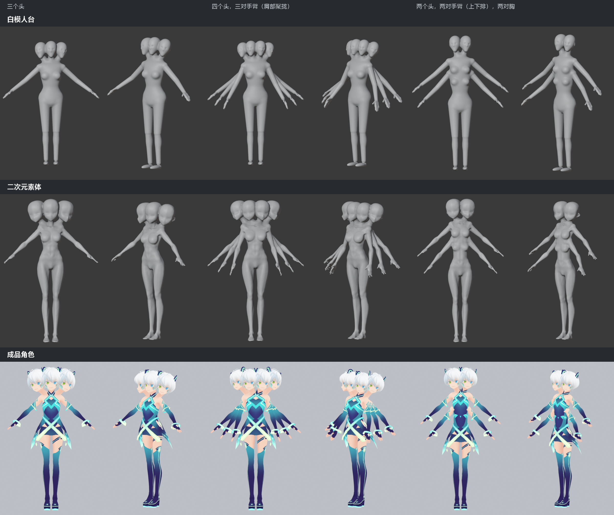
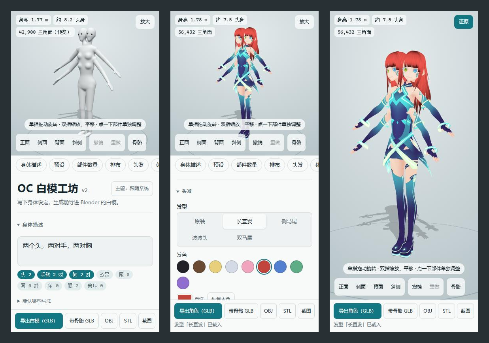
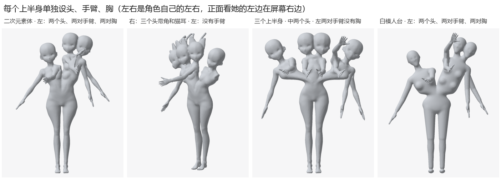
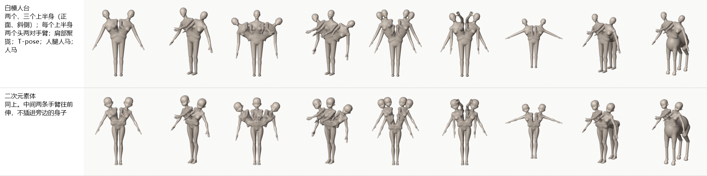
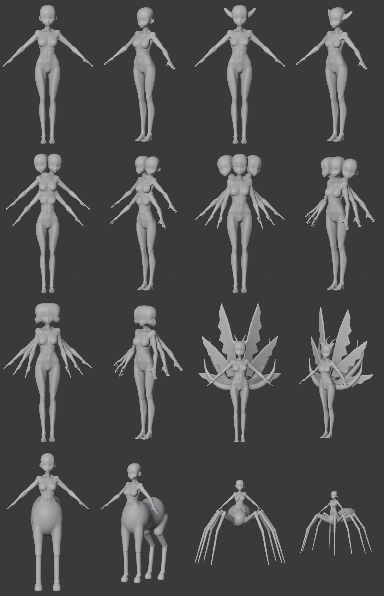
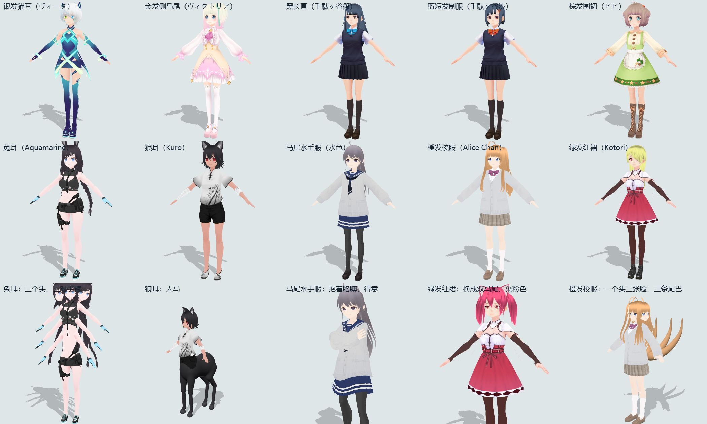
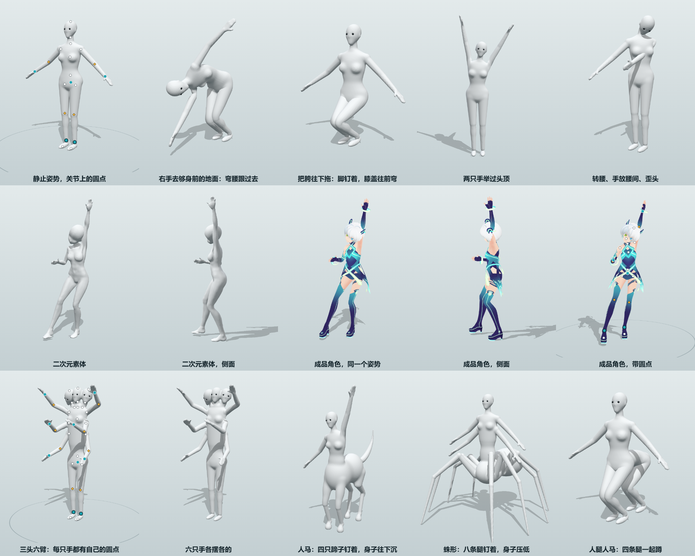

# OC素体工房 v2

[中文](README.md) · [English](README.en.md) · [日本語](README.ja.md)

多肢体キャラクター向けのベースメッシュ生成ツールです。体の設定を一文書くだけで（「頭2つ、腕2対、胸2対」「阿修羅」「九尾 六枚翼」）、Blenderに読み込めるベースメッシュができあがります。ひとつながりの閉じたメッシュなので、そのままスカルプトを始められ、必要ならスケルトンとウェイトも付けられます。体が決まったら、そのまま関節をドラッグしてポーズを付けることもできます。



- **3種類のボディスタイル**：マネキン素体、アニメ素体、完成キャラ（既製のVRoidキャラクター16体：女子10体・男子6体。上半身が複数あるときは上半身ごとに別のキャラクターにできます。自分のVRMも読み込めます）。
- **パーツ**：上半身1〜3個、頭1〜5個、腕0〜4対、胸0〜4対、脚1〜12本、尻尾・翼・角・ケモミミ。ケンタウロス、アラクネ（蜘蛛型）、ヒューマンタウロスなどの下半身も用意しています。
- **調整**：体型スライダー、任意のパーツを個別に移動・回転・拡大縮小、元に戻す／やり直し。
- **ポーズ**：関節をドラッグして付けます。プリセットポーズ60種、ハンドジェスチャー16種。完成キャラは表情と視線も操作できます。
- **書き出し**：GLB（ボーンとウェイト付きも可）、VRM、OBJ、STL、背景透過のスクリーンショット。
- **使える場所**：PCのブラウザ、exeにパッケージ化したもの、Android用のインストールパッケージ（APK）、またはWebに公開してスマホで開く方法。

この説明は「Blender初心者でWindowsを使っている人」向けに書いていて、各手順にメニューの場所やキーを添えています。

画面の言語は中国語・英語・日本語から選べます。右上のテーマボタンの左にあるドロップダウンで切り替えます（初回はブラウザの言語に合わせて表示されます。アドレスの末尾に `?lang=ja` を付けても切り替わります）。この説明では、画面上のボタンや項目名を、日本語表示のときの名前で書いています。

- [インストールと起動](#インストールと起動)
- [画面の見かた](#画面の見かた)
- [造形](#造形)
- [3種類のボディスタイル](#3種類のボディスタイル)
- [手動微調整](#手動微調整)
- [ポーズを付ける](#ポーズを付ける)
- [複数のキャラ（シーン）](#複数のキャラシーン)
- [書き出し](#書き出し)
- [Blenderに読み込む](#blenderに読み込む)
- [Tripoと併用する](#tripoと併用する)
- [よくある質問](#よくある質問)
- [既知の制限](#既知の制限)
- [素材とクレジット表記](#素材とクレジット表記)
- [開発](#開発)

## インストールと起動

1. [Node.js](https://nodejs.org/) をインストールします。ダウンロードページで LTS 版（20以上）を選び、画面の指示どおり「次へ」で進めてください。
2. このフォルダーでターミナルを開きます。エクスプローラーでこのフォルダーを開き、アドレスバーに `pwsh` と入力して Enter を押します。
3. 起動の前に、依存パッケージをインストールします（最初の1回だけで済みます。ネット接続が必要です）：

   ```powershell
   npm install
   ```

4. 起動します：

   ```powershell
   npm run dev
   ```

   ブラウザが自動で開き、http://localhost:5173 が表示されます。使い終わったらターミナルに戻って `Ctrl + C` を押すと停止します。

2回目以降は、手順2と4だけで使えます。

### Node.jsを入れずに使う方法

| やりたいこと | コマンド | できるもの |
| --- | --- | --- |
| 人に渡すためのexe | `npm run pack` | `release` フォルダーに、`OC白模工坊.exe`（約13 MB。ダブルクリックで使え、インストールもネット接続も不要）、使い方ガイド（中国語の `使用说明.txt`、英語の `Guide-en.txt`、日本語の `ガイド-ja.txt`）、それらをまとめた zip ができます |
| Android用のインストールパッケージ | `npm run apk` | `release` フォルダーに `OC白模工坊.apk`（約17 MB、Android 10以上）ができます |
| Webに公開してスマホで開く | `npm run build` | `dist` フォルダーが静的なWebページになります。GitHub Pages、Cloudflare Pages、Netlify などのホスティングにアップロードすれば使えます。iPhoneでも動きます |

- exeにはデジタル署名がないため、初回のダブルクリックで「Windows によって PC が保護されました」と表示されることがあります。「詳細情報」→「実行」の順にクリックしてください。相手の環境は、Windows 10 / 11 と、Edge・Chrome・Firefox のいずれかが必要です。
- APKをインストールするときは、「提供元不明のアプリ」を許可する必要があります。権限は一切要求せず、書き出したファイルはスマホの「ダウンロード」フォルダー内の「OC白模工坊」に保存されます。
- APKをビルドするには、JDK（環境変数 `JAVA_HOME`）と、Android SDK の `build-tools`、`platforms`（環境変数 `ANDROID_HOME`）が必要です。Android Studio は不要です。署名鍵 `tools/android/sign.keystore` は最初のビルド時に生成されるので、なくさないでください。なくすと、新しいAPKを古いAPKに上書きインストールできなくなります。
- 自宅だけで試すには：スマホとPCを同じWi-Fiにつなぎ、PCで `npx vite preview --host` を実行して、表示された `http://192.168.….…:4173/` をスマホのブラウザで開きます。
- 工房を変更したら、パッケージを作り直してください。

## 画面の見かた



- **上部のツールバー**：左側の「造形 / ポーズ」で、どちらの作業をするかを切り替えます。その隣が元に戻す / やり直しです。右側には身長・頭身・三角ポリゴン数の表示（後ろにオレンジ色の文字が出たら、問題があるという警告です）、「書き出し」ボタン、「⋯」メニュー（言語、テーマ、ガイド、ソースコードのリンク）があります。
- **左側が3Dビュー**です。左ドラッグで回転、ホイールでズーム、右ドラッグで移動、パーツをクリックすると選択できます。左下には、視点（正面 / 側面 / 背面 / 斜め）とボーンの表示があります。
- **右側が設定パネル**です。パネルの左端にセクションのアイコンが縦に並びます。体の説明、プリセット、パーツの数、配置、髪、体型、手動微調整、メッシュ（ポーズ中はポーズ、手、表情、ポーズライブラリに変わります）、その下に両方で共通のカメラとライト、参考画像、設定ファイルです。押したセクションだけがパネルに表示されます。パーツを選ぶと「手動微調整」に切り替わり、選択を解除すると元のセクションに戻ります。各セクションの長い説明はふだん隠れていて、パネル右上の「説明」で表示できます。
- **ガイド**：初回に開いたときに自動で表示されます。最初に言語を選び、そのあと主な場所を順番に案内します。3Dビュー、パーツの個別調整、ポーズのステップでは、その場でモデルを操作して試せます。スキップもできます。もう一度見たいときは、タイトルの下の「ガイド」をクリックしてください。
- **スマホの縦画面**：上半分が3Dビュー、下半分が設定で、ページ全体がいっしょにスクロールします。指1本のドラッグで回転、2本指のピンチでズーム、2本指のドラッグで移動します。

## 造形

### 説明を書く

「体の説明」の入力欄に体の設定を書くと、入力を止めて約0.3秒後にモデルが自動で更新されます。下に並ぶタグのうち、点灯しているものが認識されたパーツです。「認識できる書き方」を開くと、各部分がどのように認識されたかを確認できます。

| 書き方 | 例 |
| --- | --- |
| パーツ + 数 + 助数詞 | 「頭2つ」「腕3対」「尻尾9本」「頭ごとに角4本」「目6つ」「顔3つ」「上半身2つ」「左の上半身は頭2つと腕2対」 |
| あるパーツをなくす | 「尻尾なし」「角なし」「貧乳」 |
| 熟語とキーワード | 「三面六臂」「九尾」「六枚翼」「阿修羅」「ケンタウロス」「ヒューマンタウロス」「蜘蛛女」「猫耳」「ゲリュオン」 |
| 英語タグ | `four_arms` `multiple_tails` `centaur` `humantaur` `three_faces` `1boy` |
| 身長と頭身比 | 「身長165」「8頭身」 |
| 性別とポーズ | 「男性」「少年」「少女」；「Tポーズ」「両腕を水平に」「Aポーズ」 |
| 髪型と髪色 | 「ツインテール」「ポニーテール」「ロング」「ボブ」；「金髪」「銀髪ロング」「黒髪ロング」；`twintails` `blonde_hair` |
| 脚の並べ方 | 「脚を左右に並べる」「脚を骨盤に集める」「骨盤を横に並べる」「前3後3」 |

### プリセットとパーツの数

- **プリセット**：12種類の既製の組み合わせです。クリックするとその内容に切り替わります。
- **パーツの数**：上半身1〜3個、頭1〜5個、腕0〜4対、胸0〜4対、脚1〜12本、尻尾0〜9本、翼0〜3対、頭ごとに角0〜4本・目1〜6個・ケモミミ0〜2対。上半身が複数あるときは、頭・腕・胸・翼が上半身ごとにこの数ずつ付きます。また、数の上に「編集する上半身」の行が出ます。左・右（3つのときは中央も）を選ぶと、頭・腕・胸・角・目・ケモミミはその上半身だけが変わります（左右はキャラクター自身の左右）。「全部同じ」で増減するとすべての上半身が変わり、個別に設定したものも同じ値に戻ります（数字の後ろに「*」が付いている行は、個別に設定した上半身があるという意味です）。
- プリセットをクリックしたり数を増減したりすると、説明欄が標準形の日本語の一文に書き換えられるので、そのまま続きを編集できます。

### 配置

- **複数の頭**：
  - 「ひとかたまり」（デフォルト）：アニメの多頭キャラの描き方に倣い、体は一人分のまま、顔と顔を寄せ合って一かたまりにします。頭ごとに自分の首があります。頭が4〜5個のときは、1個あたりの大きさがひと回り小さくなります。
  - 「頭1つ・顔複数」：仏像の阿修羅の「三面六臂」のように、頭と首は一つのままで、増えた顔がそれぞれ別の方向を向きます。
  - 「幅広の胴」：アニメ素体で、頭が2つ、かつ「骨盤横並び」（横に2組の骨盤）のときだけ有効です。2つの頭にそれぞれ首と肩があり、二人分の幅のひとつながりの胴になります。
- **複数対の腕**：「胴に沿って上下に並べる」（段が増えるごとに胴が少し長くなります）か、「肩に扇形に集める」（増えた腕が肩の後ろから生え、正面から見ると層になった扇形に見えます）。
- **脚**は本数で数え、奇数も可能です。3本以上のときは次の並べ方があります。「自動」では、4本ならケンタウロス、6本以上ならアラクネ（蜘蛛型）、奇数なら左右に並べる配置になります：
  - ケンタウロス、アラクネ：上半身が馬の体、蜘蛛の体に乗ります（この2種類の脚は対でしか増やせないため、奇数のときは1本多くなります）。
  - ヒューマンタウロス：後ろに横向きの人のウエストがひと続き付き、その先に人の骨盤と脚がもう一組付きます。
  - 前後連結：骨盤を長くのばし、何対かの人の脚を前後に詰めて並べます。
  - 左右に並べる：ウエストから下を横に広げ、脚を等間隔で横一列に並べます。
  - 骨盤に集める：骨盤の幅は人ひとり分のまま、何組かの骨盤を一組ずつぴったり寄せて並べ、脚は下へ行くほど一対ずつ外側に広がります。
  - 骨盤横並び：何組かの完全な骨盤を左右一列に並べ、それぞれに脚が2本付きます。
  - ヒューマンタウロスと前後連結では、骨盤ごとの脚の数を選べます（「前3・後3」など）。
- **複数の上半身**（1〜3個）：1組の骨盤の上で、ウエストから上が2〜3個の上半身に分かれ、左右に並んで両側へ開きます。ギリシャ神話のゲリュオンのようなイメージです。（アニメ素体は左右にまっすぐ並びます。2つのときは内側がくっつき、3つのときは間が空いて、骨盤のすぐ上からそれぞれ別のウエストになります。）各上半身には、設定に従って頭・腕・胸・翼が1組ずつ付き、中央の腕は前方に伸びます。頭・腕・胸・角・目・ケモミミは上半身ごとに個別に設定できます（「パーツの数」参照）。上半身2つと骨盤横並び2組の組み合わせは通常1つの幅広の胴にまとまりますが、左右で数が違うときは、それぞれの上半身がまっすぐ立ちます。

  
- **複数の尻尾**は、付け根から左右に扇形に広がります。
- **手**：「指を分ける」（デフォルト）は既製の手で、指が1本ずつ分かれています。「指をまとめる（ミトン形）」は、手のひら全体に親指を足した形で、大まかな出発点にしかなりません。



### 体型

- **ボディスタイル**：マネキン素体（デフォルト）、アニメ素体、完成キャラ。次の節を参照してください。
- **性別**：女性（デフォルト）または男性。マネキン素体にだけ効きます。
- **ポーズ**：Aポーズ（デフォルト）またはTポーズ。ボーンを入れたいときや、画像生成AIに渡す参考用のモデルにしたいときは、Tポーズのほうが扱いやすいです。
- **スライダー**：身長、頭身、体格、肩幅、バスト、ウエスト幅、ヒップ幅、手足の太さ、腕の長さ、脚の長さ、尻尾の毛量と長さ。両端まで動かすと、かなり誇張されたデフォルメ体型になります。腕や脚を伸ばしても、手や足は変形しません。脚の長さは身長を変えません（全体が比率に合わせて拡大縮小されます）。
- 腕を何段も付けたり、ケンタウロスやアラクネにしたりすると、実際の身長は高くなります。上部の表示を基準にしてください。

### 髪

どのボディスタイルでも、既製の4種類の髪型を付けられます：ロング、サイドテール、ボブ、ツインテール（VRoid Studio旧版のCC0サンプルから取ったものです）。

- マネキン素体とアニメ素体は、デフォルトでは髪なし（坊主頭）です。髪型を選ぶと、髪は色のない一枚のシェルになり、頭と融合してひとつながりになるので、そのままスカルプトできます。髪には専用のボーンがなく、全体が頭に付いて動きます。
- 完成キャラはデフォルトで元の髪です。この4種類に替えたり、色を染めたりできます。複数の頭を一かたまりに寄せているときは、頭ごとに別々に染めることもできます。
- **長さ**（60%〜150%）は、鼻先より下に垂れる部分を調整します。**ボリューム**（97%〜120%）は、髪全体の拡大・縮小です。

### メッシュ

- **融合（ひとつながり）**（デフォルト）：すべてのパーツを融合して、1枚の閉じたメッシュにします。境目はなめらかにつながります。「融合の丸み」で、つなぎ目の広さを調整します。
- **パーツ分け（v1）**：各パーツが独立したオブジェクトになり、互いに差し込まれたまま融合しません。
- 画面には粗いプレビューが表示され、操作を止めると細かいものに切り替わります。書き出し時には、別途精細なメッシュを計算します。

### 元に戻す操作と保存

- 元に戻す / やり直し：左下のボタン、または `Ctrl + Z` / `Ctrl + Y`。ページを再読み込みすると履歴は消えますが、設定そのものは残ります。
- すべての設定（手動微調整や付けたポーズも含む）は、このブラウザに自動で保存されます。
- 「設定ファイル」セクションの「設定ファイルを保存」では先にファイル名を聞かれ（デフォルトは `oc_config`、次回は前回の名前）、`.json` として保存できます。「設定ファイルを読み込み…」で読み戻せます。

## 3種類のボディスタイル

### マネキン素体

デフォルトのスタイルです。パーツごとに大きなボリュームを組み立て、融合してひとつながりにします。顔には目のくぼみ、鼻の出っ張り、あごしかありません。スカルプトの出発点に向いています。

### アニメ素体

頭・胴・胸・腕・脚が、既製のアニメ風少女素体の形になります。細長い手足、とがったあごの頭、指のある手、つま先のある足です。色も服もないベースメッシュのままです。初めて切り替えるときは、約6 MBのデータを読み込みます。



- 複数の頭・腕・胸、尻尾、翼、各種の下半身、手動微調整、ボーン、すべての書き出し形式がそのまま使えます。書き出しもひとつながりの閉じたメッシュです。
- 体型スライダーは、素体の元の形を広げたり絞ったりする形で効きます。性別と手のスタイルは効きません。
- **バスト** 0.3〜2.3：小さくするほど徐々に平らになり、大きくすると、素体の小さい胸と別の素体の大きい胸という2種類の胸型の間で徐々に変化します。
- 手と足は既製のメッシュで、融合のあと、手首と足首に縫い合わせます。そのため、どの精度でも指とつま先は分かれています。
- **書き出したモデルを配布するときは、クレジット表記が必要です。**[素材とクレジット表記](#素材とクレジット表記)を参照してください。

### 完成キャラ

表示・書き出しされるのは、髪・服・顔・テクスチャ付きの既製アニメキャラクターです。増えた頭・腕・胸は、そのキャラ自身の該当部分（服とテクスチャ込み）をコピーして接続したもの、増えた脚は、そのキャラの骨盤と脚をコピーして並べたものです。獣の体、尻尾、翼、角、ケモミミは、別に作った単色のパーツです。



「ボディスタイル」の下に顔アイコンが並んでいます。クリックしたキャラクターに切り替わります。キャラクターを選び直すと、入れ替わるのは本人だけで、パーツの数、体型、髪型、ポーズ、表情はそのまま引き継がれます。1体あたり9〜14 MBで、選んだキャラクターだけが読み込まれます。

| アイコンの名前 | 元の名前 | 作者 | ライセンス |
| --- | --- | --- | --- |
| 銀髪猫耳：銀髪・猫耳（デフォルト） | ヴィータ | VRoidプロジェクト（pixiv） | CC0 |
| 金髪サイド：金髪・サイドテール | ヴィクトリア・ルービン | VRoidプロジェクト（pixiv） | CC0 |
| 黒髪ロング：黒髪のロングストレート | 千駄ヶ谷篠 | VRoidプロジェクト（pixiv） | CC0 |
| 青髪制服：青髪のショート・制服 | 千駄ヶ谷渋 | VRoidプロジェクト（pixiv） | CC0 |
| エプロン：茶髪のショート・エプロン | ビビ | VRoidプロジェクト（pixiv） | CC0 |
| うさ耳：黒髪の三つ編み・うさ耳 | Preset Only Rabbit - Aquamarine | 七百屋（なおしま） | VRoid Hubの条件 |
| 狼耳：黒髪のショート・狼耳 | Kuro（Preset Nekomimi Girls） | 七百屋（なおしま） | VRoid Hubの条件。性的表現への使用は不可 |
| セーラー服：ポニーテール・セーラー服 | 水色（ポニーテルの女の子） | 白い白米 | VRoid Hubの条件 |
| オレンジ髪：オレンジのロングヘア・制服 | Alice Chan | edisonlee55（yuna0x0） | CC BY-SA 4.0 |
| 赤スカート：緑髪・赤いスカート | Kotori | Fox Jump | CC BY |
| グラデ髪の男子：オレンジから紫の短髪、シャツにベスト | 桜田史利矢 | VRoidプロジェクト（pixiv） | CC0 |
| 黒髪短髪の男子：黒の短髪、フード付きジャケット | HairSample_Male | VRoidプロジェクト（pixiv） | CC0 |
| 黒髪礼服の青年：黒髪・赤い目、礼服 | プリセット/黒髪青年 | sin | VRoid Hub の条件。改変したものは元のモデルがあることを明記（書き出し時に自動で記載） |
| 白シャツの少年：黒髪、白シャツ | 汎用少年キャラFritz | 霧太郎 | VRoid Hub の条件。政治・誹謗中傷への利用は禁止 |
| モノクロパーカー：白黒、黒のパーカー | モノクロ男性【シンヤ】 | 中森あか | VRoid Hub の条件。犯罪目的の利用は禁止 |
| 茶髪ニットベスト：茶髪、ニットベスト | マロン | ピカピカ | VRoid Hub の条件。性的表現は禁止 |

**上半身ごとのキャラクター**（男女の結合双生児など）：上半身が2つ以上あると、顔アイコンの下に「上半身ごとのキャラクター」の行が出て、左・右（3つのときは中央も）にそれぞれドロップダウンがあります。選んだキャラクターがその上半身（頭・髪・腕・服）になり、腰と脚は顔アイコンで選んだキャラクターのままです。「体と同じ」は変更なしです。「編集する上半身」で個別に設定した数とも併用できます（たとえば男子側だけ腕2対）。差し替えた上半身は背骨から頭までの長さで拡大縮小し、2つの頭がほぼ同じ高さになります。その顔には表情がなく、VRM書き出しではその髪は揺れません。

**自分のVRMを読み込む**：顔アイコンの下にある「自分のVRMを読み込み…」でVRMファイルを選びます（0.x、1.0のどちらも使えます。VRoid Studioで作ったものが最適です）。17番目のキャラクターになり、複数の頭、複数の腕、ポーズ、表情、髪型の変更が通常どおり使えます。ファイルはこの端末のブラウザ内にだけ保存されるので、端末を替えたら選び直しが必要です。ほかのソフトで作ったVRMは、ボーンをヒューマノイドボーンの対応表で、肌・服・髪をVRoidのマテリアル名で判別します。判別しきれないときは、パネルの説明文でお知らせします。

マネキン素体との違い：

- 各パーツは互いに差し込まれているだけで、融合しません。書き出されるのはひとつながりの閉じたメッシュではないので、そのままのスカルプトや3Dプリントには向きません。
- 体格、性別、手のスタイル、目の数、腕をなくすことは効きません。「メッシュ」セクションも効きません。
- 肩幅、ウエスト幅、ヒップ幅、手足の太さ、腕の長さは、体を服ごと引き伸ばすので、大きく動かすと柄が歪みます。
- 手動微調整はボーン単位でパーツを分けて動かします。遠くへ動かすと、体とつながっている部分がゴムのように伸びます。この微調整は、ベースメッシュ側とは別に記録されます。

### 成人向けパーツ（デフォルトはオフ）

「パーツの数」セクションにある「成人向けパーツを表示」スイッチは、デフォルトでオフです。この端末のこのブラウザにだけ記録され、設定ファイルには含まれません。オンにすると、マネキン素体とアニメ素体に、陰茎（骨盤ごとに0〜6本。左右に並べる、上下に重ねる、扇形、グリッド）と陰嚢を追加できます。「陰茎の状態」で勃起時と平常時をワンクリックで切り替えられます（本数・配置・大きさ・微調整はそのままで、平常時はひと回り小さく、前下方に垂れます）。ポーズ用にも専用のハンドルが出て、ボーン付きで書き出すと1本につき3節のボーンが付きます。スイッチをオフにしても隠すだけで、もう一度オンにすると本数、大きさ、並べ方、付けたポーズが元どおりに戻ります。この素材にはクレジット表記が必要です。[素材とクレジット表記](#素材とクレジット表記)を参照してください。

## 手動微調整

自動で配置された位置が気に入らないときは、パーツを1つだけ選んで調整できます：特定の腕、特定の頭、特定の尻尾、特定の角など。

1. **パーツを選ぶ**：モデル上でクリックします（または「手動微調整」セクションのドロップダウンから選びます）。シアン色がかぶさり、関節にギズモが現れます。
2. **調整する**：モデル上でギズモをドラッグします（パネルで「移動 / 回転 / 拡大縮小」を切り替えます）。または、パネルに位置（センチメートル）、角度（度）、大きさ（倍率）を入力します。
3. 何もない所をクリックするか、`Esc` を押すと、調整を終了します。

- 方向：Xはキャラクター自身の左手側、Yは上、Zは前です。回転と拡大縮小は関節を中心に行われます（腕は肩、脚は股関節を軸にします）。
- 「反対側（右腕など）も同時に調整」がオンのとき、左右対になっているパーツがいっしょに（鏡像で）変わります。
- 胴体は首・頭・腕・胸・翼を連れて動き、頭は目・角・耳を連れて動きます。足は常に地面に付いたままです。
- 調整したパーツは「微調整済み」に並びます。「このパーツをリセット」は選択中のものだけ、「すべてリセット」はすべての微調整を消します。プリセットをクリックしたときも消えます（元に戻せます）。
- やりすぎる（腕を体から引き離すなど）とメッシュが分かれ、上部の表示に「メッシュがN個に分かれています」と出ます。

## ポーズを付ける

ツールバー左側の「ポーズ」をクリックすると、関節にハンドル（丸や菱形の点）がいくつも点灯します。それをドラッグしてポーズを付けます。「造形」をクリックすると戻り、続けて体を編集できます。「造形」で見えるもの・書き出すものは常に静止ポーズで、「ポーズ」で見えるもの・書き出すものは付けたポーズの状態です。3種類のボディスタイルすべてで、ポーズを付けられます。



**ハンドル**：ドラッグすると、その点がマウスに追従します。クリックすると回転リングが現れ、その関節から先の一節が回ります。

| ハンドル | 場所 | ドラッグすると |
| --- | --- | --- |
| シアンの大きな丸 | 手、足、骨盤 | 手や足をドラッグすると、ひじやひざは自然に曲がり、届かないときは体が付いてきます。骨盤をドラッグすると全身が動き、足は元の位置に固定されたままです |
| 黄色のひし形 | ひじ、ひざ | 手足は動かさずに、ひじ（ひざ）をドラッグした側へ回します |
| 白い小さな丸 | ウエスト、胸、首、頭、肩、股関節、つま先 | その骨を回します：前かがみ、首かしげ、肩すくめ（遠くまで引くと上半身ごと傾く）、つま先立ち |
| 先端の小さな丸 | 尻尾の先、翼の先、完成キャラの毛先・スカートの裾・袖口 | ひと続きの全体がその方向へ曲がります |

**「ポーズ」セクション**：

- **表示するハンドル**：ハンドルが多くて邪魔なときは、使わないグループを畳めます。指、髪と服の裾の2グループは、デフォルトでは畳まれています。
- **固定**：ほかの場所をドラッグしても動かさないものを選びます。足はデフォルトで地面に固定、手はデフォルトで体に付いて動きます。手や足を選んで、個別に固定したり解除したりもできます。
- **複数の腕**：腕が2対以上あるとき「一緒に動く」を選ぶと、どの組をドラッグしても、ほかの組がそれに合わせて動きます（左右は別々、同じ上半身の腕はずらしたまま）。別々に動かすときは「別々」を選びます。
- **左 → 右 / 右 → 左、左右反転、地面に下ろす**。
- **自然に垂らす**：横になる、前かがみになる、座るなどしたあとに押すと、完成キャラの髪、スカートの裾、袖が重力に従って垂れ、体や地面に触れたらその外側で止まります。「尻尾も垂らす」にチェックを入れると、尻尾もいっしょに垂れます。
- **ポーズを保存 / ポーズを読み込み…**：ファイル名を聞かれ（デフォルトは `oc_pose`）、`.json` として保存し、ほかのキャラクターやほかのボディスタイルにも適用できます（ボーン名で対応づけます）。

**ハンドジェスチャー**：両手、左手、右手、または腕の特定の1対を選べます。既製のジェスチャーが16種類あり（グー、ピース、OK、サムズアップ…）、5本の指にはそれぞれスライダーがあります。「指」のハンドルをオンにすると、指先を直接ドラッグできます。

**表情と視線**（完成キャラのみ）：7種類の表情、片目つぶり、口の形、牙。視線スライダーと「カメラ目線」。複数の頭は、それぞれ別の表情にできます。

**プリセットポーズ**：60種類（やわらかい立ちポーズ8種に加え、立つ、歩く、走る、跳ぶ、しゃがむ、座る、寝る、パンチ、剣を振る…）。クリックすると適用され、地面に下ろされます。「ランダムなポーズ」でランダムに1つ選びます。クリックする前に、次を選べます：

- どの部位に適用するか（頭、胴、左右の腕、脚）。チェックを外した部位は今のままです。
- 腕をどの対に適用するか（複数対の腕は、それぞれ別のポーズにできます）。
- 強さ 10%〜100%。

ケンタウロスとアラクネでは、ウエストより上にだけ適用されます。増えた腕は、同じ側の1対目に合わせて動きます。

いくつかの決まり：

- 骨の長さは変わりません。関節の可動域の制限はなく、めり込みも防ぎません。
- ベースメッシュ（マネキン素体、および腕を「肩に扇形に集める」にしたり上半身を複数にしたりしたアニメ素体）は、手を離すと、付けたポーズに合わせてメッシュが再融合されます（1秒かからず、さらに1〜2秒で、より細かいものに切り替わります）。ドラッグ中に見えているのはプレビューなので、肩が盛り上がったり、腕の間の皮が引っ張られたりしますが、手を離したあとの状態が正です。

### カメラ、ライト、参考画像

画面とスクリーンショットの見た目にだけ影響し、書き出すモデルには影響しません：

- **カメラとライト**：見る方向、パース（10°〜80°）、メインライトの方向と高さ、地面の影。
- **参考画像**：自分で描いた正面・側面の設定画を、モデルの後ろに縦向きに敷き、それを見ながら体型を調整したりポーズを付けたりできます。画像を選ぶと、自動でモデルと同じ高さに合わせられ、白い紙の背景は透明に抜かれます。大きさ、位置、不透明度を調整でき、モデルの上に重ねて輪郭を比べることもできます。画像はこのブラウザ内にだけ保存されます。

## 複数のキャラ（シーン）

パネルの「シーン」タブで、1 つのシーンに複数のキャラを置けます。キャラごとに設定もポーズも別々です。

- **新しいキャラ**はデフォルトの素体を、**今のキャラを複製**は今のキャラをポーズごと追加します。どちらも右側に立ちます。「シーンを開く…」で 1 体分の設定ファイルを選んでも追加されます。
- 編集できるのは一度に 1 体です。パネル・元に戻す・ポーズは編集中のキャラにだけ効きます（元に戻す履歴はキャラごと）。ほかのキャラはその場に固定され、ポーズを付けた姿で表示されます。変更した直後は灰色のシルエットで、裏で作り終わると差し替わります。
- シーン内のほかのキャラか、3D ビュー左上の名前をクリックすると切り替わります。
- **配置**：足元のリングをドラッグすると移動、リングの前の小さな球をドラッグすると向きが変わります（Shift を押しながらだと 15° 刻み）。「シーン」の左右・前後・向きのスライダーでも動かせます。「全体を表示」「編集中を表示」でカメラに収める範囲を切り替えます。
- **シーンを保存**で全キャラと立ち位置を 1 つのファイルに保存します。「シーンを開く…」でシーンファイルを選ぶと、今のキャラがすべて置き換わります（先に確認します）。
- **書き出し**：キャラが複数いると、書き出しパネルに「編集中のキャラ / シーン全体」が出ます。シーン全体では各キャラを書き出し用の精度で作り直し（ポーズを付けたものはポーズのまま）、GLB ではキャラごとに 1 グループずつそれぞれの位置に置きます。ボーン付き GLB はキャラごとにアーマチュアが 1 つ、OBJ・STL はまとめて書き出します。VRM は編集中の 1 体だけです。スクリーンショットはもともと画面全体です。
- キャラの数に上限はありません。多いと重くなります。
- **キャラ同士は融合しません**：どれだけ近づけても別々のメッシュで、めり込むだけです。めり込むと読み取り欄に相手と場所が出て、「シーン」の「めり込まない位置まで離す」で離せます。ポーズ付けでは手足がほかのキャラに当たると表面で止まります（「シーン」で切れます）。
- **2 人のポーズ**：「シーン」の「相手」を選んで、手をつなぐ・肩を組む・背中合わせ・ハイタッチ・向かい合って両手をつなぐ・ハグを押します。編集中のキャラはその場のまま、相手が隣に来て、2 人そろってポーズが変わり、手が相手に届きます。2 人とも 1 回の「元に戻す」で戻せます。追加の腕はそのままで、1 組目の腕を使います。

## 書き出し

ツールバー右側の「書き出し」を押して、形式を選びます（スマホの縦画面では右側の丸いダウンロードボタンです）。押したら、完了のメッセージが出るまで待ってください。ファイルはブラウザのダウンロードフォルダーに保存されます。

| ボタン | ファイル | 中身 | 使いどころ |
| --- | --- | --- | --- |
| ベースメッシュを書き出し（GLB） | `oc_basemesh.glb` | メッシュ | スカルプト用。いちばんよく使います |
| ボーンGLB | `oc_basemesh_rigged.glb` | メッシュ + スケルトン + ウェイト | そのままポーズを付けたり、アニメーションを作ったりしたいとき |
| VRM | `oc_basemesh.vrm` | メッシュ + スケルトン + ウェイト + ヒューマノイドボーン、Tポーズ | VTuberソフト、VRoid Hub、Unity向け |
| OBJ | `oc_basemesh.obj` | メッシュ（四角形ポリゴンを保持） | 四角形ポリゴンが欲しいとき、または相手のソフトがGLBに対応していないとき |
| STL | `oc_basemesh.stl` | メッシュ | 3Dプリント |
| PNG | `oc_basemesh.png` | 今の視点のスクリーンショット、背景透過 | 人に見せる、画像生成AIに渡す身体の参考にする |

完成キャラのファイル名は `oc_character…` で、テクスチャが付きます（OBJ、STLを除く）。

- 単位はメートルです。GLB、OBJはY軸が上、顔は+Z向きで、Blenderに読み込むときに自動で変換されます。STLはZ軸上向きのまま書き出し、スライサーでは通常ミリメートルとして読まれるので、1000倍に拡大してください。
- 「造形」で書き出すと静止ポーズ、「ポーズ」で書き出すと付けたポーズの状態になります。ベースメッシュは、ポーズを付けたあともひとつながりの閉じたメッシュなので、STLはそのまま印刷できます。
- **VRM**：押すと小さなダイアログが開くので、名前・作者・ライセンスを入力します。書き出されるのはVRM 0.xで、静止ポーズはTポーズです。ヒューマノイドボーンの対応表に入るのは、1対目の腕、1つ目の頭、1対目の脚だけで、増えたパーツは体に付いて動きます。尻尾はスプリングボーンになり、揺れます。完成キャラは、元のキャラのテクスチャ、表情、揺れる髪とスカートを引き継ぎ、ライセンスは元のキャラの条件に従って書かれます。パーツ分けモード、腕のない体、脚が1本しかない体は書き出せません。
- クレジット表記が必要な素材（下の「素材とクレジット表記」を参照）は、書き出し時にファイルへ自動で書き込まれます。

## Blenderに読み込む

1. Blenderを開き、メニューの **ファイル → インポート → glTF 2.0 (.glb/.gltf)** で `oc_basemesh.glb` を選びます。OBJは **ファイル → インポート → Wavefront (.obj)**、STLは **ファイル → インポート → STL (.stl)** です。どれも初期設定のままで構いません。
2. モデルはワールド原点に立っていて、足は地面に付いています。テンキーの `1` で正面ビューに切り替えてください。

- 融合モードでは、オブジェクトは `OC_BaseMesh` の1つだけで、ひとつながりの閉じたメッシュ、スケールは1です。選択して、左上のモードを「スカルプトモード」に切り替えれば、そのままスカルプトできます。
- 三角形は、たいてい十数万個、パーツが多いと数十万個になります。重いと感じたら「デシメート」モディファイアーを足すか、「リメッシュ」を使ってください。
- パーツ分けモードでは、各パーツが別のオブジェクトになります（`Torso`、`Head_01`、`Arm_02_L`…）。1つにまとめたいときは、胴体をクリックし、`A` で全選択、`Ctrl + J` で統合してから、「リメッシュ」モディファイアー（ボクセル、サイズは `0.01` 前後）を追加して適用します。
- 完成キャラのテクスチャは、ビューを「マテリアルプレビュー」または「レンダー」に切り替えないと見えません。

### ボーン付きのファイル

`oc_basemesh_rigged.glb` を読み込むと、アーマチュア `OC_Rig` ができ、その下にメッシュが付いてきます。メッシュには「アーマチュア」モディファイアーとウェイトが設定されています。ボーンは小さな球として読み込まれます。八面体のボーン表示が良いときは、インポート時に右側の「ボーンとスキニング（Bones & Skinning）」で「ボーン形状を無効化（Disable Bone Shape）」にチェックを入れてください。

ボーンは VRM / Unity Humanoid の慣習に倣った名前で、`_L` / `_R` はキャラクター自身の左／右です：

| 部位 | ボーン |
| --- | --- |
| 背骨 | `Hips` → `Spine` → `Chest` → `UpperChest` → `Neck` → `Head` |
| 腕 | `Shoulder_L` → `UpperArm_L` → `LowerArm_L` → `Hand_L` |
| 指 | 1本につき3節：`Thumb1_L` → `Thumb2_L` → `Thumb3_L`。`Index`、`Middle`、`Ring`、`Little` も同様 |
| 脚 | `UpperLeg_L` → `LowerLeg_L` → `Foot_L` → `Toes_L`。中心線上の脚には `_L` / `_R` が付きません |
| 増えた同種のパーツ | 連番が付きます：2対目の腕は `UpperArm_L.002`、2つ目の頭は `Head.002`、2対目の脚は `UpperLeg_L.002` |
| 尻尾 | 1本につき5節：`Tail_01_01` … `Tail_01_05` |
| 翼、ケモミミ | `Wing_01_L`、`Ear_01_L` |
| 後ろの下半身 | `LowerBody_01`、`LowerBody_02` …（ケンタウロス、ヒューマンタウロス、前後連結、骨盤に集める）。アラクネの腹部は `Abdomen` |
| 複数の上半身 | 上半身ごとに背骨が1本ずつ：`Spine_L`、`Chest_L` …。右側のものには `_R` が付きます |

**ウェイトの確認**：アーマチュアを選び、`Ctrl + Tab` で「ポーズモード」に入ります。ボーンを1本選んで `R` で回し、メッシュが付いてくるかを見てください。確認が終わったら、`A` で全選択し、`Alt + R` で回転をクリアします。または、メッシュを「ウェイトペイント」モードに切り替え、「頂点グループ」でボーン名をクリックして色を見る方法もあります（赤は完全に追従します）。

- ウェイトは自動で計算したものなので、ポーズの確認には十分ですが、本格的なアニメーションには手直しが必要です。
- 関節を大きく曲げるとつぶれてしまいます。メッシュの「アーマチュア」モディファイアーで **「ボリュームを維持（Preserve Volume）」** にチェックを入れると、工房内で付けたポーズと同じ見た目になります。この設定はGLBに保存できないので、自分で入れてください。
- 関節の内側にしわができるときは、「アーマチュア」モディファイアーの下に「補正スムーズ（Corrective Smooth）」モディファイアーを足して、なじませてください。

## Tripoと併用する

ベースメッシュには顔・髪・服がないので、それらはTripoで生成する必要があります。ベースメッシュが役に立つ場面は次のとおりです。

1. **画像生成AIに身体の参考として渡す**：多肢体の体は、画像生成AIが腕の数や付く位置を間違えやすいです。Tポーズに切り替え、「正面」「側面」「背面」を順にクリックして、「PNG」で1枚ずつスクリーンショットを撮ります。それをキャラクター設定といっしょに渡し、身体の構造だけを参考にして、白くて顔のない見た目はそのまま真似しないように伝えてください。
2. **Blenderで配置用の足場にする**：Tripoは一度に1つのパーツしか生成しないので、増えた腕や頭は自分でコピーして配置する必要があります。パーツ分けモードのベースメッシュを読み込むと、各腕、各頭が独立したオブジェクトになっているので、Tripoのパーツを拡大縮小して、対応する位置に合わせます（`G` で移動、`R` で回転、`S` でスケール）。合わせたら `Ctrl + A` →「全トランスフォーム（All Transforms）」を実行します。
3. **多肢体キャラクターにスケルトンとウェイトを付ける**：Tripoの自動リギングは、標準的な人型のボーンしか作れません。ボーン付きベースメッシュのウェイトを、Tripoの体へ転送できます：
   1. `oc_basemesh_rigged.glb` を読み込み、Tripoの体をベースメッシュに重ねて合わせ、`Ctrl + A` →「全トランスフォーム（All Transforms）」を実行します。
   2. 体を選び、**モディファイアーを追加 → 編集 → データ転送（Add Modifier → Edit → Data Transfer）** を選びます。「ソース」に `OC_BaseMesh` を指定し、「頂点データ」にチェックを入れて「頂点グループ」を有効にし、「マッピング」は「最近接面の補間（Nearest Face Interpolated）」を選んで、「データレイヤーを生成（Generate Data Layers）」を押し、このモディファイアーを適用します。
   3. 先に体を選び、`Shift` を押しながらアーマチュア `OC_Rig` を選んで、`Ctrl + P` →「アーマチュア変形（Armature Deform）」を実行します（「自動のウェイトで」と付くものは選ばないでください）。
   4. ポーズをいくつか付けて確認します。服が体から離れている部分（スカートの裾、広い袖）は、自分で直してください。

   この手順は、Blender上で別のメッシュを使って試したものです。本物のTripoのモデルでは試していません。
4. **Tripoに直接アップロードする**：ボーンなしの `oc_basemesh.glb` を使います。実際にアップロードして試してはいません。ポリゴン数の上限は、Tripoのページの表示に従ってください。

## よくある質問

**ターミナルに「npm は認識されません」というエラーが出る。** Node.jsが正しくインストールされていないか、インストール後にターミナルを開き直していません。

**ブラウザが自動で開かない、または開いたページが5173ではない。** ターミナルの `Local:` の後ろに出ているアドレスを、ブラウザで開いてください。

**アニメ素体や完成キャラに切り替えると、「工房のプログラムに接続できません」と出る。** ページは開いたままですが、`npm run dev` または exe のウィンドウが閉じています。プログラムを開き直してこのページに戻ると、自動でもう一度試します。

**左側が空白で、3D表示を起動できなかったと出る。** ブラウザのWebGLが無効になっています。新しいEdgeかChromeに替えるか、ブラウザの「ハードウェアアクセラレーション」を有効にしてください。

**モデルがスライダーより少し遅れる、またはCPUが一瞬で使い切られる。** 融合メッシュはバックグラウンドの複数スレッドで計算するため、パーツが多いと0.数秒〜1秒ほどかかり、計算が終わると落ち着きます。もっと追従させたいときは、先に「パーツ分け（v1）」モードでポーズを決めてから、元に戻してください。

**表示の後ろに「メッシュがN個に分かれています」と出る。** 体につながっていないパーツがあります。たいていは手動微調整で引き離したものです。元の位置に戻すか、「すべてリセット」を押してください。

**最初からやり直したい。** プリセットの「標準ヒト型」をクリックします。体型スライダーは自分で戻す必要があります。完全に消したいときは、`F12` で開発者ツールのコンソールを開き、`localStorage.clear()` と入力して Enter を押し、ページを再読み込みしてください。

## 既知の制限

- **顔はとてもシンプル**：マネキン素体は目のくぼみ、鼻、あごだけで、アニメ素体の目は2つの浅い皿、口は1本の浅い線です。目はWebページ上では位置の目印にすぎず、書き出すメッシュには含まれません。ベースメッシュはスカルプトの出発点であり、完成品ではありません。
- **ウェイトは簡易計算**：ポーズの確認には十分ですが、アニメーションには手直しが必要です。「ボーンGLB」に入っているのは静止メッシュとウェイトで、関節を大きく回した所は引き伸ばされた見た目になります。ポーズを付けた状態の完成品が欲しいときは、ボーンなしのGLB / OBJ / STLを書き出してください。
- **ポーズを付けた関節は、球体関節人形のよう**：腕や脚は一節ごとにまるごと回り、関節には球が補われます。筋肉の造形はありません。差し込まれた箇所（腕が体を貫通する所）は、再融合のときにひとつに合わさります。まれなポーズでは手を縫い付けられず、元の位置に単独で重なります。その場合、書き出し時にメッシュがいくつかに分かれたと通知されます。
- **ポーズを付けるときは、めり込みを防がず、関節の可動域の制限もありません**。「自然に垂らす」は一手で計算するもので、布のシミュレーションではないため、髪同士は互いにすり抜けます。
- **増えたパーツは粗い**：増えた首、2段目以降の肩、獣の体、ヒューマンタウロスの中ほどのウエストは、大きなボリュームだけです。Blenderでさらに彫り込んでください。
- **完成キャラはベースメッシュではありません**：各パーツが差し込まれただけで融合せず、体型は力ずくで引き伸ばしたもので、獣の体はそのキャラと絵柄が違います。表情は書き出し時にメッシュへ焼き込まれるので、シェイプキーとして後から動かすことはできません。
- **髪は既製の4種類だけ**で、1束ずつ編集することはできません。
- **試していないこと**：書き出したVRMは、BlenderのVRMアドオンでしか確認しておらず、VSeeFaceやWarudoなどでは開いていません。モデルを実際にTripoへアップロードしたこともありません。AndroidのAPKはエミュレーターでしか、スマホ向けのWebページはPC上のシミュレーションでしか試しておらず、実機ではどちらも試していません。

## 素材とクレジット表記

工房で使っている既製の素材は、すべて再配布が許可されています。元ファイルのダウンロード先、ライセンス、チェックサムは [`assets/source/README.md`](assets/source/README.md) に、完成キャラの一覧は `src/character/roster.ts` に記録してあります。

**クレジット表記が必要なもの**（書き出したファイルには自動で書き込まれています。配布するときも、そのまま付けてください）：

| 使うとき | クレジット表記 |
| --- | --- |
| アニメ素体 | 足のメッシュ © Fox Jump（Kotori）、CC BY。胴体の起伏は Fly_jkey の「Woman」（CC BY 4.0）を参考にしています |
| 完成キャラ「オレンジ髪」 | Alice Chan © edisonlee55、CC BY-SA 4.0（改変したものを再配布するときも、CC BY-SA 4.0 にする必要があります） |
| 完成キャラ「赤スカート」 | Kotori © Fox Jump、CC BY |
| 完成キャラ「黒髪礼服の青年」 | プリセット/黒髪青年 © sin（VRoid Hub）。改変したものは元のモデルがあることを明記するよう作者が求めています |
| 成人向けパーツ | 陰茎・陰嚢は「DJP Male Base Mesh Mark 03」© Death Joe Productions、CC BY 4.0 から取ったものです |

**クレジット表記が不要なもの**：アニメ素体、最初の5体の完成キャラ、4種類の髪は、VRoid Studio旧版のサンプル（pixiv、CC0）から取ったものです。プリセットポーズは、Quaterniusの Universal Animation Library 1・2（CC0）から取りました。胸の形と胴体の起伏には、Death Joe Productions の素体と、Blender公式の Human Base Meshes（CC0）も参考にしています。うさ耳、狼耳、セーラー服の3体は、作者がVRoid Hubで設定した条件に従っています：改変可、再配布可、商用可、クレジット表記は不要です（狼耳は性的表現への使用が不可。セーラー服の作者は、NFT、政治、宗教への使用も不可としています）。

## 開発

```powershell
npm run dev        # 開発サーバー
npm test           # 単体テスト（Vitest）
npm run typecheck  # 型チェック
npm run build      # dist にビルド
npm run pack       # exe と zip にパッケージ化し、release に出力
npm run apk        # Android用のインストールパッケージにして、release に出力
npm run accept -- <出力先>   # 受け入れ用の画像。docs/accept/README.md を参照
```

`tools/` の `.ts` スクリプトは `node tools/run.mjs tools/<スクリプト>.ts` で、`.mjs` は直接 `node tools/<スクリプト>.mjs` で実行します。素材加工のスクリプトは普段は実行する必要がなく、素材の元ファイル（`assets/source/`）はリポジトリに入っていません：

| スクリプト | 生成されるもの |
| --- | --- |
| `build-anime-body.mjs` → `build-torso.ts` → `build-chest.ts --write` | アニメ素体 `public/anime/body.bin`（この順に実行します） |
| `build-hand.ts`、`build-foot.ts` | 既製の手、足 |
| `build-hair.mjs` | 髪 |
| `build-characters.ts` | 軽量化した完成キャラ `public/character/*.vrm` |
| `build-poses.ts`、`build-soft-poses.ts` | プリセットポーズ |
| `build-genital.ts` | 成人向けパーツ |

開発サーバーにしかないもの（ビルドしたWebページ、exe、APKには含まれません）：

- **めり込みチェック**：パラメーターの操作が止まると、パーツがほかのパーツに明らかに入り込んでいないかを自動で調べます。入り込みがあれば、上部の表示にオレンジ色の「開発ヒント」が1行増え、一覧はブラウザのコンソールに出ます。
- **監視・テスト用インターフェース**：`npm run agent -- model|eval|shot|logs` で、動いているページの状態を読み取れます。[docs/agent-monitor.md](docs/agent-monitor.md) を参照してください。
- **メモ**：3Dビュー左下の「注釈」で赤い丸を描くと、`notes/`（リポジトリには入りません）に保存されます。`npm run agent -- notes latest` で確認できます。

**約束事**：単位はメートル、Y軸が上、キャラクターは+Z向き。`_L` / `_R` はキャラクター自身の左／右です。解析、配置、メッシュ、ボーン、ファイルの書き出しは、画面に触れない純粋関数で、UIは `src/main.ts` と `src/view/` にだけあります。

| パス | 内容 |
| --- | --- |
| `src/model/` | `BodySpec` データモデル、プリセット、手動微調整、元に戻す / やり直し |
| `src/parser/` | 文章 ↔ パーツの数 |
| `src/geometry/` | 配置（`layout.ts`、複数の頭・複数の腕のルール `bodyPlan.ts`、アニメ素体 `animeLayout.ts`）、頭、髪、めり込みチェック、パーツ分けモードのメッシュ |
| `src/sdf/` | 距離場による融合：場のコンパイル、Surface Netsでのメッシュ抽出、バックグラウンドスレッドとヘルパースレッド、ポーズ後の再融合、手足を体に縫い付ける処理 |
| `src/anime/`、`src/hair/` | アニメ素体、既製の手と足、成人向けパーツ、素体に付ける髪 |
| `src/character/` | 完成キャラ：VRMの読み込み、組み立て、髪型の変更と染色、表情、微調整、獣の体、GLB / VRMの書き出し |
| `src/rig/` | スケルトン、自動スキニング |
| `src/pose/` | ポーズ：ポーズデータ、全身IK、ハンドル、指、プリセットポーズ |
| `src/io/` | GLB・OBJ・STL・VRMの読み書き、ダウンロード |
| `src/view/` | 3Dビューポート、ギズモ、ポーズ用のハンドル |
| `src/dev/` | 開発サーバーにだけある監視用インターフェース、メモ |
| `tools/` | 素材加工、パッケージング（exe、apk）、受け入れ用の画像、監視インターフェースのコマンドライン |
| `tests/` | 単体テスト |
| `docs/` | スクリーンショット、比較画像、および大きな変更のいくつかの計画書（`rework-plan.md`、`vrm-plan.md`、`genital-plan.md`、`perf-plan.md`）。文書は中国語です |
