# OC 白模工坊 v2

多肢体角色白模生成器。写一句身体设定（「两个头，两对手，两对胸」「阿修罗」「九尾 六翼」），得到一个可以导入 Blender 的白模：一整块封闭的网格，拿来就能雕刻；需要的话还带着骨架和权重。身体定好以后，还能直接在这里拖着关节给它摆姿势。

这份说明是按「Blender 新手、用 Windows」来写的，每一步都给出菜单路径或按键。

- [安装和运行](#安装和运行)
- [界面一览](#界面一览)
- [怎么用](#怎么用)
- [手动微调](#手动微调)
- [摆姿势](#摆姿势)
- [导出](#导出)
- [导入 Blender](#导入-blender)
- [配合 Tripo 使用](#配合-tripo-使用)
- [常见问题](#常见问题)
- [已知的限制](#已知的限制)
- [开发](#开发)

## 安装和运行

1. 装 [Node.js](https://nodejs.org/)：下载页上选 LTS 版，一路「下一步」装完（需要 20 以上的版本）。
2. 在这个文件夹里打开终端：用资源管理器进到这个文件夹，在地址栏里输入 `pwsh` 回车。
3. 第一次运行前装依赖（只需要做一次，要联网，大约一分钟）：

   ```powershell
   npm install
   ```

4. 启动：

   ```powershell
   npm run dev
   ```

   浏览器会自动打开 http://localhost:5173 。用完回到终端按 `Ctrl + C` 停止。

以后每次用只需要第 2、4 步。

### 不装 Node.js：打成一个 exe 发给别人

```powershell
npm run pack
```

跑完以后 `release` 文件夹里有三样东西：

- `OC白模工坊.exe`（约 13 MB）：双击就能用，不用安装，不用联网。它在本机开一个只有自己能访问的网页（http://localhost:5210/），再用默认浏览器打开；窗口里有说明，关掉窗口就退出。
- `使用说明.txt`：给拿到 exe 的人看的说明。
- `OC白模工坊-v2.zip`：上面两个压在一起，转给别人就发这个。

要知道的：

- 对方需要 Windows 10 或 11，以及 Edge、Chrome、Firefox 任意一个浏览器。
- exe 没有数字签名，对方第一次双击时 Windows 可能弹出蓝色的「Windows 已保护你的电脑」，要点「更多信息」→「仍要运行」。
- 打包用的是 Windows 自带的 C# 编译器，不用另外装东西。启动器的源码在 `tools/launcher/Launcher.cs`，两百来行。
- 改了工坊以后要重新 `npm run pack`，exe 里装的是打包那一刻的网页。

### 安卓手机：打成安装包（apk）

```powershell
npm run apk
```

跑完以后 `release` 文件夹里多一个 `OC白模工坊.apk`（约 17 MB）。发给用安卓手机的人，装上就能用，不用联网。

- 装的时候手机会拦一下「未知来源的应用」，要选允许（各家手机的说法不一样：允许安装、继续安装、仍然安装）。
- 需要安卓 10 或更新的系统。苹果手机、鸿蒙 NEXT 装不了。
- 应用没有申请任何权限，不联网。导出的模型和配置存在手机「下载」文件夹的「OC白模工坊」里，截图存在相册的「OC白模工坊」里。
- 它是给工坊的网页包了一层壳，显示用的是手机自带的浏览器内核（Android System WebView）。内核太旧（大约 2020 年以前的）会打不开或者样子不对，更新系统或这个组件就好。
- 新打的安装包可以直接盖在旧的上面装，设定还在。签名用的钥匙是第一次打包时生成的 `tools/android/sign.keystore`，别弄丢：丢了以后新包盖不上去，手机上得先卸掉旧的。
- 按返回键：放大着 3D 视图就先还原，选中着部件就先取消，都没有才退出。

打包要用的东西（不用 Android Studio，也不用 Gradle）：

- JDK，环境变量 `JAVA_HOME` 指向它；
- 安卓 SDK 里的两样，环境变量 `ANDROID_HOME` 指向 SDK：`build-tools`（任意一版）和 `platforms` 里任意一版（要其中的 `android.jar`）。

外壳的源码在 `tools/android`（一个 Java 文件加几个资源文件），打包脚本是 `tools/apk.ps1`。

检查过的和没检查过的：在一台安卓 15 的模拟器（浏览器内核是 110 版，偏旧）上装过、开过；白模、换发型、成品角色都显示正常，导出的 GLB 和截图取回电脑核对过是完整的；竖屏手机的版面是把页面限制成手机大小看的。键盘弹出时的版面、「自选」发色的取色框、「载入配置」的选文件、返回键，还没有在模拟器或真机上试过。

### 苹果手机，或者不想装东西：放到网上

手机不能运行 exe，而且 exe 开的网页只有那台电脑自己能访问，手机连不上。
工坊打包以后是一个纯静态的网页：`npm run build` 生成的 `dist` 文件夹，里面全是相对地址，放在哪都能用。把它放到手机打得开的地方，用手机浏览器打开就行。

- **放到网上，发一个网址**：把 `dist` 整个文件夹传到任何一个静态网页托管（GitHub Pages、Cloudflare Pages、Netlify、itch.io 的网页游戏之类），得到一个网址。谁拿到网址谁就能用，不用装东西，苹果、安卓都行。
- **只在自己家里试**：手机和电脑连同一个 Wi-Fi，电脑上运行 `npx vite preview --host`，手机浏览器打开它印出来的那个 `http://192.168.….…:4173/`。第一次运行时 Windows 防火墙会问要不要放行，要选允许；用完按 `Ctrl + C` 关掉。

要知道的：

- 「成品角色」每个角色 9–14 MB，选到哪个才下载哪个；换发型每种 1–2 MB。用流量的话留意一下。「白模人台」不用另外下载。
- 导出的文件落在手机浏览器的下载文件夹里。在 QQ、微信里直接点开网址的话，它们自带的浏览器常常存不了文件，要选「在浏览器中打开」。
- 手机上只在电脑里模拟过版面和手势，没有拿真机一台台试过。

## 界面一览

**左边是 3D 视图。**

- 左上角的两个大标签「造型 / 摆姿势」：现在在做哪一件事。「造型」是定身体（下面说的设定面板都是它的）；「摆姿势」是拖着关节摆姿势，见[摆姿势](#摆姿势)一节。每次打开都从「造型」开始。
- 标签下面的读数：实际身高、头身比、面数。读数后面出现橙色的字，是在提醒有问题（比如「网格分成了 2 块」）。
- 鼠标：左键拖动旋转，滚轮缩放，右键拖动平移；在部件上点一下是选中它。
- 左下角的按钮：
  - 「正面 / 侧面 / 背面 / 斜侧」切换视角。
  - 「撤销 / 重做」。
  - 「骨骼」把自动生成的骨架画出来（橙色的线），再点一下收起。
- 选中了部件时，这排按钮上面会多出一个青色的小牌子，写着选中的是谁，点上面的 ✕ 取消选择。

**右边是设定面板**，从上到下是：身体描述、预设、部件数量、排布、头发、体型、手动微调、网格、镜头和灯光、配置。

- 每一栏的标题都可以点，点一下折叠、再点一下展开。折叠的状态会记住。
- **导出按钮钉在面板最下面**，面板滚到哪里都够得着。
- 右上角的「主题」在跟随系统 / 浅色 / 深色之间切换。
- **新手引导**：第一次打开时自动出来，一步一步打亮界面上的几块地方（身体描述、预设、部件数量、身体样式、3D 视图、造型和摆姿势、视角和撤销、导出），旁边一张卡片说它是干什么的。随时可以点「跳过」（或者按 Esc），「上一步」「下一步」（或者 ← →）翻页；看完、跳过都会记住，以后不再自动出来。想再看一遍，点标题下面那句话右边的「新手引导」。手机竖屏上也一样。

  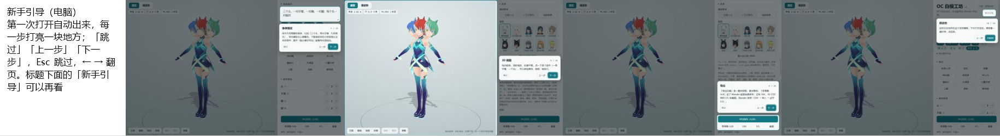

**在手机上**（竖着拿，或者把电脑上的窗口拉得又窄又高）版面换成上下两半，整页一起滚：

- 3D 视图钉在屏幕上半，往下翻设定的时候模型一直看得见。右上角的「放大」把它撑满整屏、把设定先收起来，再点一下「还原」。
- 3D 视图下面有一排栏目名（身体描述、预设、部件数量……，可以左右划），点一下跳到那一栏。
- 导出按钮缩成一行，钉在屏幕最下面。
- 手势：单指拖动旋转，双指捏合缩放、双指拖动平移，在部件上点一下选中它。
- 横着拿手机还是左右两栏，面板窄一些。
- 用手指点的屏幕（手机、平板、带触摸屏的电脑）上，按钮、加减号、滑块都大一圈。


手机没法运行 exe：安卓手机用安装包（见上面「安卓手机：打成安装包」），苹果手机要先把网页放到手机打得开的地方（见上面「放到网上」）。

## 怎么用

### 写描述

在「身体描述」的框里写身体设定，停笔约 0.3 秒后模型自动更新。下面那排标签里，亮起来的是从文字里认出来的部件。

| 写法 | 例子 |
| --- | --- |
| 部件 + 数字 + 量词 | 「两个头」「三对手臂」「九条尾巴」「每个头四只角」「6 只眼睛」「三张脸」 |
| 没有某个部件 | 「没有尾巴」「无角」「平胸」 |
| 成语和关键词 | 「三头六臂」「三面六臂」「九尾」「六翼」「阿修罗」「半人马」「人腿人马」「蜘蛛女」「猫耳」 |
| 英文标签 | `four_arms` `multiple_tails` `centaur` `humantaur` `three_faces` `1boy` |
| 身高和头身比 | 「身高 165」「八头身」 |
| 性别和姿势 | 「男性」「少年」「少女」；「T-pose」「双臂平举」「A-pose」 |
| 发型（三种样式都能戴）和发色（只有成品角色用得上） | 「双马尾」「马尾」「长直发」「波波头」；「金发」「银色长发」「黑长直」；`twintails` `long_hair` `blonde_hair` |

同一个部件说了好几遍时，中文带数字的写法优先，其次是英文标签，最后是关键词。点开「能认哪些写法」可以看到这句话里每一段是按哪一类认出来的。

### 预设、数量、排布

- **预设**：12 个现成的组合，点一下就换过去。
- **部件数量**：上半身 1–3 个，头 1–5，手臂 0–4 对，胸 0–4 对，腿 1–12 条，尾巴 0–9，翅膀 0–3 对，每个头的角 0–4、眼睛 1–6、兽耳 0–2 对。好几个上半身时，头、手臂、胸、翅膀是**每个上半身**各长这么多（见下面「好几个上半身」）。
- 点预设、加减数量以后，描述框会被改写成一句规范的中文，方便接着改。
- **多个头**有两种长法，在「排布」里选。写「三个头」「三头六臂」是第一种，写「三张脸」「三面六臂」「阿修罗」是第二种。
- 「**凑成一簇**」（默认）：照二次元里多头角色常见的画法来——身体还是一个人的身体，头凑成一簇。
  - 头和头脸贴着脸，互相压着一点，不是隔开排成一排。
  - 从上面看这一簇是一道往后弯的弧：中间的头是正的、最靠前；两边的往后退，脸稍微朝外，头往外歪一点（最外面的不超过 28°）。
  - 每个头有自己的脖子。脖子根并排挤在肩膀中间，脖子从那里斜着伸到自己的头下面。够不着的会长一点，最多长三成；还够不着，就把头挤得更紧（互相多压着一些），不再把脖子拉长。
  - 肩膀基本不加宽：三个头以内是本来的肩膀；四五个头时脖子根排不下，才稍微宽一点（最多三成）。
  - 四五个头时每个头小一圈（四个头是本来的九成二，五个头八成六）。左上角「头身比」的读数会跟着变大。四五个头的样子见 [docs/five-heads-before-after.png](docs/five-heads-before-after.png)。
  - 紧挨着别的头的那一侧不长人耳和精灵耳；那一侧的角和兽耳收拢着往上长，免得和隔壁的交叉。
- 「**一个头几张脸**」：佛像里阿修罗「三面六臂」的那种样子。只有一个头、一根脖子，身体和一个头时完全一样；多出来的脸长在这个头上，各朝一边。
  - 两张脸是一前一后；三张是正前、左、右；四张再加一张朝后；五张是绕一圈均匀分开。
  - 多出来的脸顺着它自己朝的方向往外挪出来一点，不然会整个埋在正面那个头里。所以三张脸的头比一张脸的宽一圈（白模人台上两边各宽出五厘米上下）。
  - 角和兽耳只长在这一个头上，不是每张脸一副；两边长着脸的时候不长人耳。眼睛是每张脸都有。
  - 骨骼只有一根 `Neck`、一根 `Head`，多出来的脸跟着头动。

  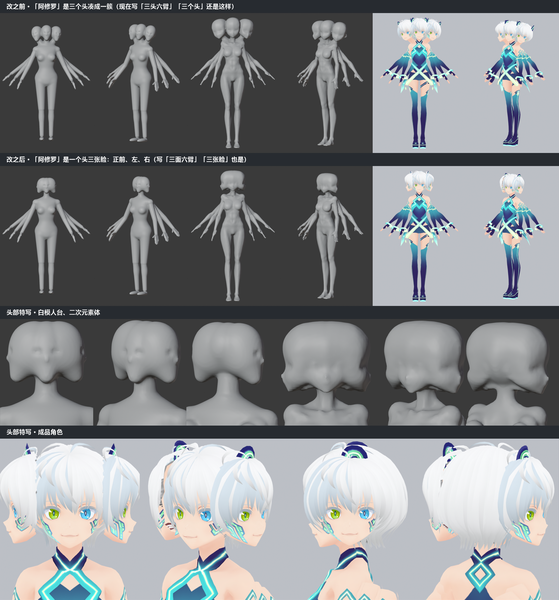
- **多对手臂**：
  - 「沿躯干上下排」：每多一排，躯干加长一截；每一排手臂在躯干侧面有自己的一副肩头，那一截躯干也宽到肩膀那么宽。
  - 「肩部扇形聚拢」：垂得最直、最贴身的那一对在本来的肩膀上，其余的从它后面长出来，一对比一对靠后、张得开，正面看是一层层的扇面；前胸是干净的，多出来的肩头在背后。张得最开的一对和只有一对手臂时差不多；胸大、胯宽的时候，贴身的那对会往外让一让。T-pose 时改成以水平为中心上下张开，举得高的在后面。
- 三种身体样式用的是同一套排法，对照图：

  
- **多条尾巴**从尾根往两边扇形散开，最多散到 54°（都在身后）；越靠外的往上翘得越低、往外多伸一点，背后看是一把扇面，中间的最高；多于三条时一高一低交替。三种身体样式一样。（以前最多散到 72°、每条都翘到肩膀那么高，尾巴多了外侧几条几乎是横着伸出去的：肩部聚拢往后摆的手臂会插进去，二次元素体腿左右并排时会穿进加宽的胯里，2026-10-30 改了。）

  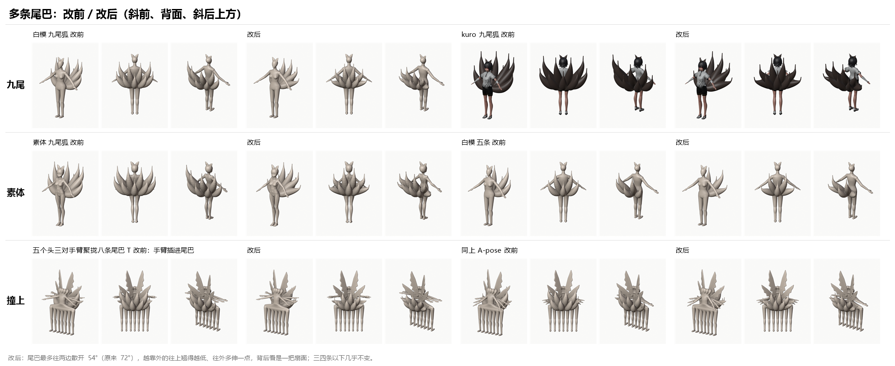
- **腿按条数算**（1–12 条，可以是单数）。三条以上时有几种排法：人马式、蛛形、人腿人马、前后串联、左右并排、胯部聚拢、横排多胯；选「自动」时 4 条是人马，6 条以上是蛛形，单数是左右并排。
  - 单数条人腿（白模人台）：多出来的那条长在中线上，不分左右。1 条是单足（胯正下方一条、胯收窄）；左右并排的正中一条；前后串联、人腿人马、胯部聚拢的在最后那副胯的正中（三条就是「前二后一」）。
  - 人马、蛛形的腿只能成对：单数时多补一条（「五条腿的人马」拼出来是六条）。
  - 人腿人马、前后串联可以选每副胯上并排几条腿（「排布」里的「每副胯上几条腿」，1–4 条）：6 条腿、每副 3 条就是「前三后三」；总数不是整数倍时最后那副少几条（5 条、每副 3 条是「前三后二」）。描述里写「前三后三」「每副胯三条腿」也认。

  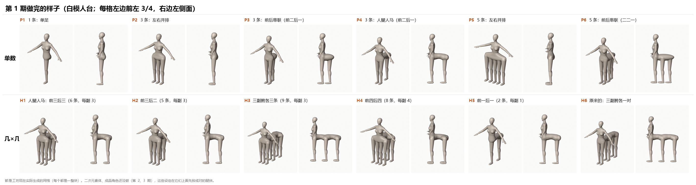
  - 人马：上半身坐在马身前端的背上。马身从前到后是前胸、腰身、后臀三团，腰身细一圈；前腿是直的，后腿的大腿往前鼓、飞节往后突，侧面看是一道折线；蹄子上窄下宽，底是平的。每多一对腿，马身加长一截。
  - 蛛形：头胸部向两侧放射出腿，后面拖着腹部；腿是一节一节的，关节略微鼓出来。

  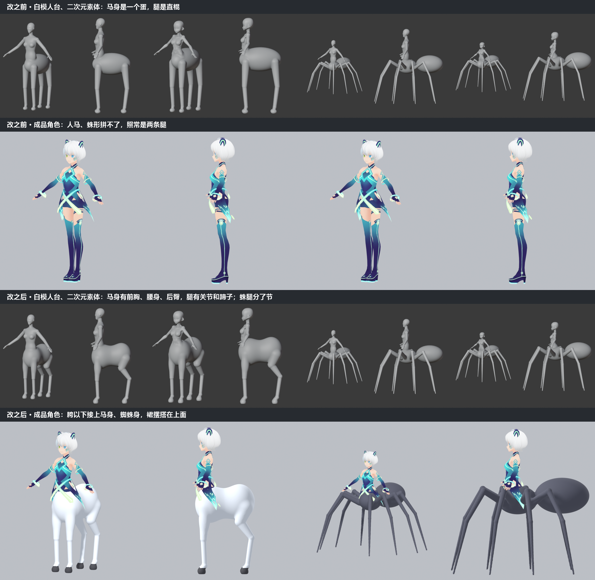
  - 人腿人马（humantaur）：像人马，但后半截不是马，全是人的身体。上半身照常站着，最前面一对腿就是本来的腿；身后横着一截人的腰，接着又一副胯、臀和一对一样的人腿，像一个人弯腰九十度、上半身并进前面那个人的后腰里。腿还是那么长，所以身高不变。每多一对腿，往后再接一截。写「humantaur」「人腿人马」就是它；选「自动」不会选到它，要在「排布」里点，或者在描述里写。
  - 前后串联：也是人腿前后排，但只是把骨盆拉长，几对腿挤在一起；人腿人马隔得远，中间有一截腰，后面有自己的胯和臀。
  - 左右并排：人腿不往后排，而是横着排成一排。上半身和腰还是一个人的，腰以下张宽，腿在下面等距排开；身高不变。照的是同人画里「四条腿的女孩」的画法（腰细、胯一下子宽出去、腿一条挨一条）。写「左右并排」「腿并排」就是它；选「自动」不会选到它。
  - 胯部聚拢：像手臂的「肩部聚拢」。胯还是一个人那么宽：几副胯一副紧贴着一副（白模人台、二次元素体隔七八厘米，成品角色隔腿长的十二分之一左右），后面几对腿的腿根藏在前一副底下；腿往下一对比一对往外散开，正面看是一层层的扇面。腿是斜着挪开的：每个高度整片平移，膝盖、脚踝还是水平的，脚平踩在地上。越往后的腿斜得越厉害，每往后一对多散开一点，相邻两对垂直于腿量总是隔那么远，到膝盖往下就分开；腿调粗了散得更开。单数时正中那条在最后那副胯上，前面几对各多散开半步，正面看左右对称。每副胯两条腿（不用「每副胯上几条腿」）。腿多了以后侧面看屁股往后厚一些，大腿根挤成一束；五六对时脚铺开一米多宽。写「腿胯部聚拢」「腿扇形聚拢」「胯部聚拢」就是它；选「自动」不会选到它。

  - 横排多胯（2026-10-31 新加）：几副完整的胯（各有自己的两瓣屁股、一道缝和胯下）左右排成一排，稍微叠着连成一整块，每副胯两条腿；上半身还是一个，坐在正中。和「左右并排」不一样：左右并排是一副加宽的胯、腿一条挨一条等距排开；横排多胯是一副一副的胯，腿两条两条成对，两副胯接上的地方背后也是一道缝。单数条时正中那副一条（3 条、7 条这种两边对数不一样多的，正中是三副各一条），左右对称。每副胯上的两条腿按这副胯自己的左右起名（`Leg_02_L` 是第二副胯的左腿），套现成的姿势时每副胯的左腿都照左腿摆、右腿照右腿摆。成品角色是把她自己的胯和腿（连裙子、鞋）复制几份左右排开，从腰往下渐渐挪开，几层裙摆叠着。写「横排多胯」「胯左右并排」「side by side hips」就是它（只写「腿横排」还是左右并排）；选「自动」不会选到它。

  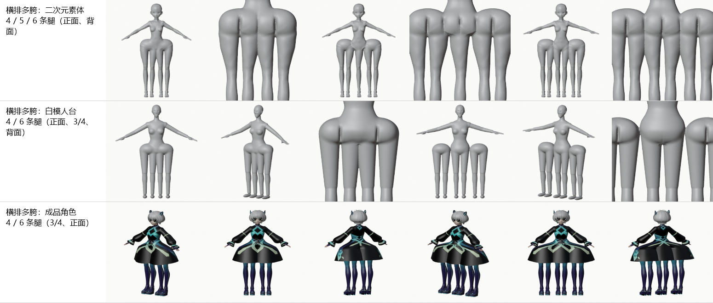

  **二次元素体横排两副胯（4 条腿）、一个上半身、两个头（凑成一簇）时**（2026-10-31，照他给的参考图）：不再是两个头挤在一个人那么窄的身子上、底下两副胯（像个花瓶），而是两个人从肩到胯并成一整块宽躯干——素体在两个头底下各放一份，两根脖子各在自己那一份上，头照原样大、各歪向对方一点；胸是一排四个（每份一对，外侧那对叫 `Chest_01`，里侧那对叫 `Chest_02`）；手臂都长在两边外侧（参考图是肩部聚拢）；腰腹是一整块，腰身照素体的收法、比胯和胸窄一点；往下渐渐分成两副完整的胯（各有屁股、胯下），腿就接在各自的胯上。距离场里新加了一种变形（`GridShape.twin`，见 `src/sdf/grids.ts`）：胯和脖子两份各是各的，腰到肩并成一整块，中间取样的地方随高度从「那一份自己的」渐渐挪到「一整块的」，始终是一张完整的表面。胸调大、胯调宽、手臂上下排、两排胸、加翅膀尾巴兽耳都照常；三个头、6 条腿、两个上半身、一个头几张脸还是原来的样子。

  **二次元素体横排两副胯（4 条腿）、两个上半身时**（2026-11-01）：每个上半身坐在自己那副胯上——胯就是两份素体自己的胯（和上面「并成一个宽躯干」腰以下那一截一样，各有屁股、胯下，正中一道沟），腿接在两份原来的位置上，不再垫那一大块横排的胯；每个上半身从自己那副胯的顶上接着长上去，往中间稍微靠一点（1.7 厘米），再往两边歪开。两个腰都是素体原样的腰，两侧都有弧度，中间那道 V 一直开到胯顶。以前胯是一个人的胯往上加宽、底下再垫一大块六十多厘米宽的胯，两个腰插在它顶上：腰胯一圈台子，腰侧一条直线下来。这时每副胯就是一个人的胯，「好几个上半身时胯再宽一成」不乘（「胯宽」滑块照常管用）。手动微调里原来那块 `LowerBody`（垫的那一大块）没有了，对它的微调不起作用。其他腿数、三个上半身还是原来的做法。

  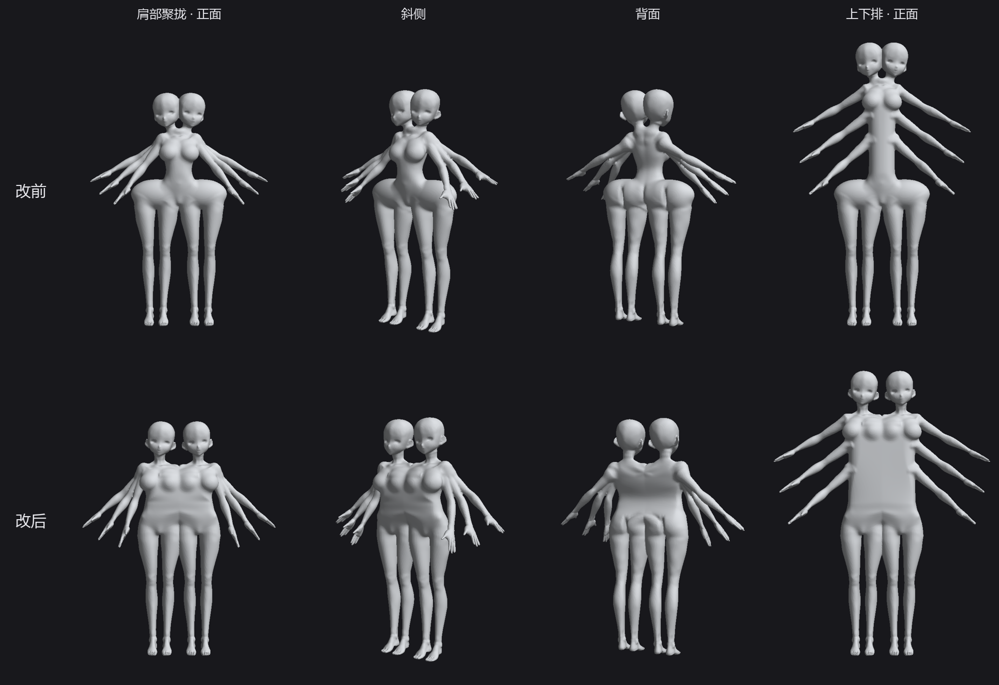

  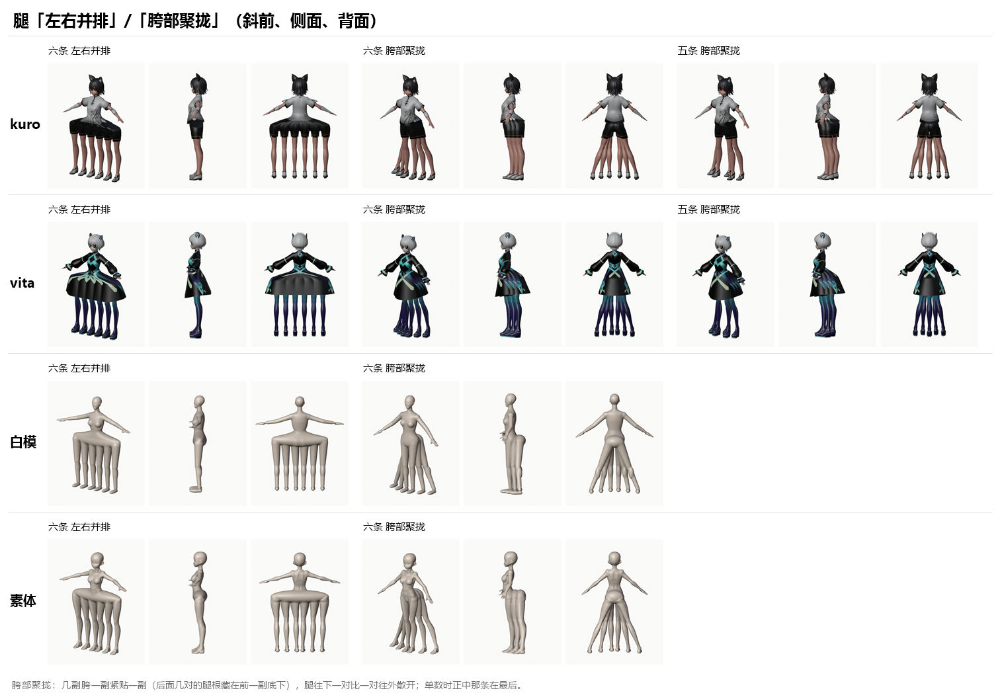

  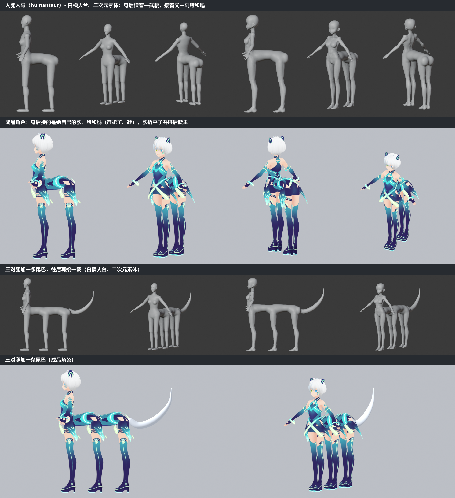

  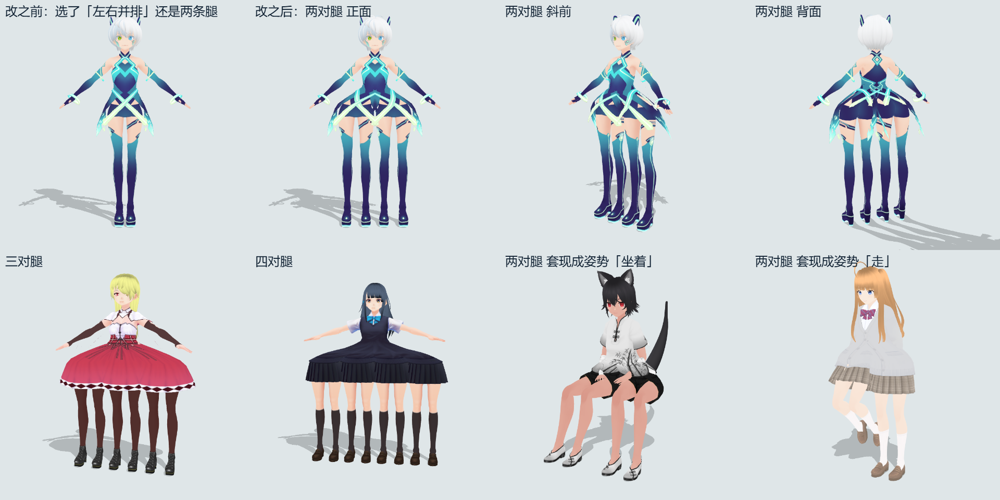

  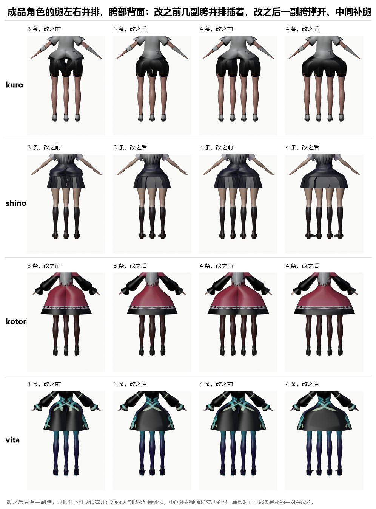

  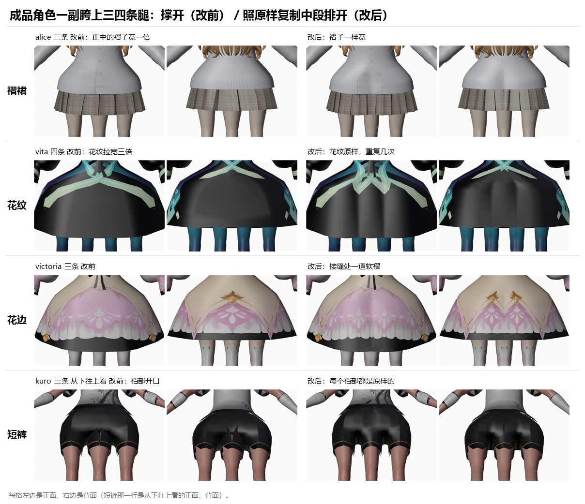

  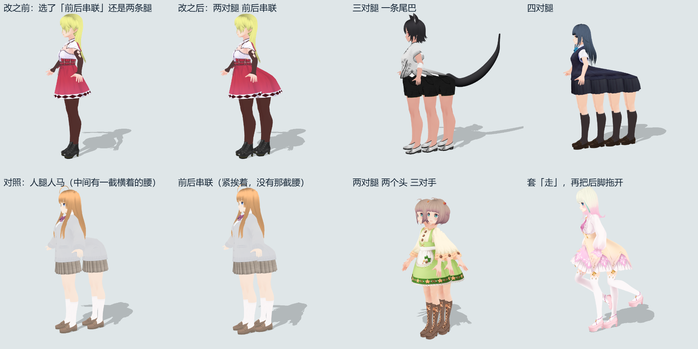
- **屁股缝**：两种白模的屁股中间有一道缝，上浅下深，下端收进胯下。照「胯」开：露在外面的屁股，一副胯上几条腿就几瓣，相邻两条腿中间往上一道缝——双足是平常的两瓣一道缝（单足也是），腿左右并排四条是四瓣三道缝，人腿人马「前三后三」最后那副胯是三瓣两道缝。前后排的（人腿人马、前后串联、胯部聚拢）前面那几副胯的屁股接着后面的腰、胯，不露在外面，缝开在最后那副胯上；人马、蛛形没有人的屁股。二次元素体双足时是把它自己那道浅缝挖深一些。分部件模式下没有缝（它是挖出来的，和眼窝一样只在融合模式里有）。成品角色穿着衣服，不动。

  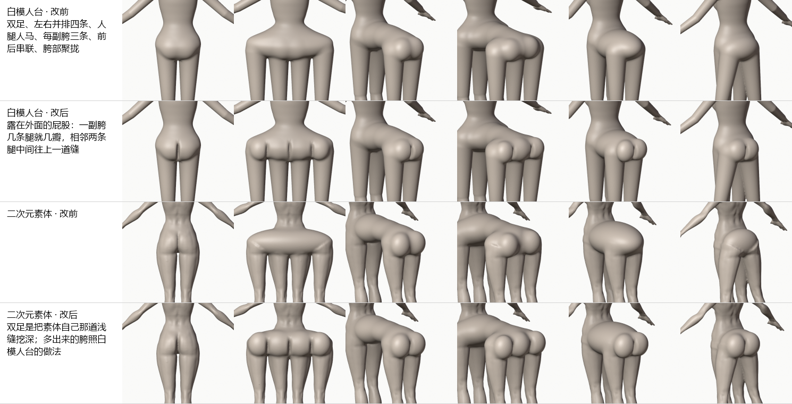
- **好几个上半身**（1–3 个，「部件数量」最上面一行）：一副胯和腿上，从腰往上长出两三个上半身，左右并排、往两边张开，正面看是 Y 字（三个时像一把扇子，希腊神话里「三个身子在腰上连着」的革律翁那样）。描述里写「两个上半身」「三个上半身」「双上半身」「革律翁」「two torsos」都认。
  - 每个上半身照设定各长一份头、手臂、胸、翅膀：设定是两个头、两对手臂，两个上半身就一共四个头、四对手臂。
  - 歪多少是自动定的：歪到相邻两个的肩膀、头之间空出十来厘米；头多的那一簇宽，就歪得开一些。
  - **胯是一副胯，几个上半身像树杈一样从它上面分出去**：屁股缝的顶上（髋关节那么高）以下还是一副胯（比一个人的宽一成，见下一条），往上每个上半身渐渐转开、挪开（二次元素体一直渐渐加到腋下，胸跟着一起分；白模人台到最下面那排胸的下面分足）；两个上半身是左右镜像，中间在正中合拢成一道 V，三个时中间那个不动、和两边的各留自己那一半。腰两侧是一条顺的线，没有一圈鼓包、没有台阶，屁股缝和一个上半身时一样。（以前是把胯从髋关节往上加宽、几个上半身整个歪着插进去，腰上鼓起一圈「游泳圈」、侧面一道台阶，2026-10-31 改了。）两种白模都这样；分部件模式下白模人台的上半身还是整个歪着插在胯上（分部件本来就是一块块插着的）。手动微调里把某个上半身挪高、转开，分出去的那一段跟着改：腰被拉长、拧过去，还和胯连着。

  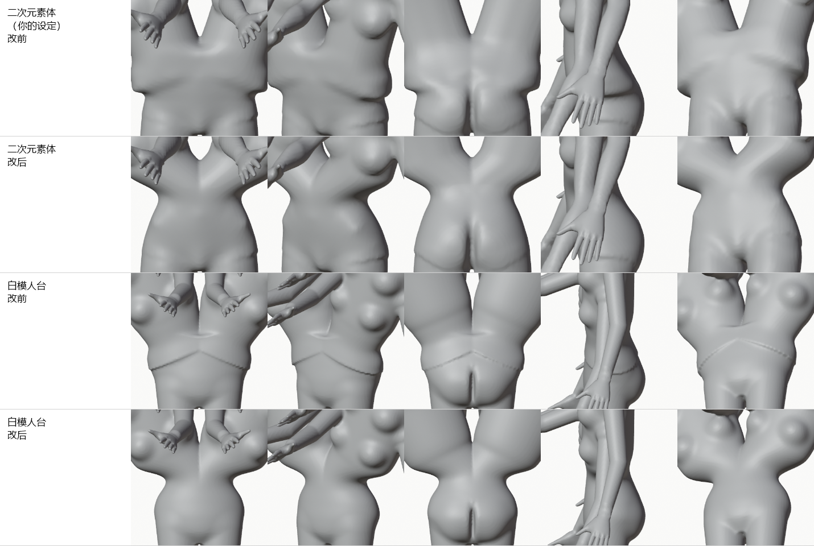
  - **照画里的画法**（2026-10-31 参考了革律翁的瓶画和塞浦路斯石雕、并排连体的示意图、几幅现代的革律翁插画）：画里几个上半身差不多直立、并排站在一副宽胯上，腰以下是一整块宽的，往上到肋骨那里才分开。所以好几个上半身时胯比一个人的宽一成（在「胯宽」滑块的基础上再乘 1.1，腿根跟着往外挪一点）；二次元素体的几个上半身先在低处往外挪开（腰是一整块宽的、两个腰在正中软软地并在一起），再往上一点才开始歪，歪得也少一些（往外挪得多，肩膀之间就空得开）。白模人台的腰很细，在那里往外挪会在腰两侧鼓出一圈，还是原来那样挪得少、歪得多，只是胯宽了一成。三个上半身时两边的还是要歪得很开（不然肩膀挤不下），和画里那种三个人并排的不一样。

  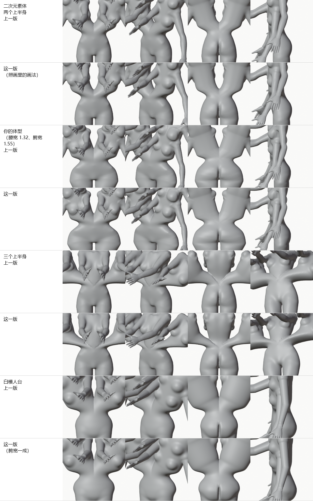
  - **二次元素体两个上半身从胯上就分开**（2026-10-31 改）：两个上半身各有自己的腰和肚子，中间那道 V 一直开到胯顶（以前到腰上、肚子上才分开，腰以下是一整块宽的肚子）。往两边挪开的那一段放在胯顶上下各 7 厘米里：腰往上已经挪开一个腰那么宽；胯的上半截也跟着往两边加宽同样多，外侧从胯到腰是一条连着的线，不起台阶；往外歪（转）还是一直渐渐加到腋下，肋骨顺着一道弧线张开。手动微调挪过两个上半身的，胯照它们实际挪了多少加宽；上下挪的那一份跟着转那一段走，接口处不错开。两个上半身各挪开一个腰宽，胯要比这更宽才收得出腰：胯宽 1 时外侧的腰身只收一点点，胯宽往大调（1.2 以上）腰身就出来了。三个上半身、白模人台还是在腰上分（三个时两边的要歪得很开，从胯上就分的话胯得有三个人那么宽；白模人台照这个做法胯顶会起一圈锯齿，还没弄好）。对比图：[docs/waist-bust.png](docs/waist-bust.png)横排两副胯（4 条腿）时又改成每个上半身坐在自己那副胯上（2026-11-01，见上面「横排多胯」），对比图：[docs/torsos-seat.png](docs/torsos-seat.png)
  - 两个上半身中间那两条手臂（里侧的）垂下来会插进旁边的身子里，所以改成往身体正前方伸（离垂直向下六十度上下，碰到胸、碰到同一个肩膀上的别的手臂就再往上抬一点）；外侧的照平常垂着。挨着旁边那个身子、实在长不下的不长：靠下几排的里侧的胸、翅膀，肩关节已经插进旁边身子里的手臂；肩部聚拢时一个里侧肩膀上最多留两条。
  - 骨骼：胯（`Hips`）是共用的；每个上半身有自己的一串脊柱，左边那个叫 `Spine_L`、`Chest_L`、`UpperChest_L`，右边的带 `_R`，三个时正中那个不带。头从右往左一个上半身一个上半身地数（`Head`、`Head.002` …）；外侧的手臂照平常起名，左右两个上半身的外侧手臂名字只差 `_L` / `_R`，里侧的排在后面几对——所以摆姿势时「左右对称」照到的正好是对面那个上半身上对应的那一条。部件叫 `UpperBody_L` / `UpperBody_R`（三个时还有 `UpperBody`），躯干 `Torso` 只剩腰以下那一截。
  - 摆姿势时每个上半身有自己的「腰」「胸」圆点（标着左、右）；套现成的姿势时，几个上半身的脊柱都照姿势摆，外侧的手臂照姿势摆，里侧的保持往前伸。
  - **成品角色**：把她腰以上（连头、头发、衣服、手臂、胸、后加的兽耳和角）整个复制一份，两份从腰那里往两边弯开——是照摆姿势那样「弯」出来的：腰那一圈一半跟着胯、一半跟着脊柱的地方顺着弯过去，裙子、胯、腿还是一份。名字、排法和白模一样（脊柱 `Spine_L`、头从右往左数、外侧手臂照原名）；两个上半身的衣服在腰上、背后中间是互相插着的（花纹在那一带交叉），和她别的复制出来的部件一样不融合。加翅膀时只留外侧那两只（里侧的两只会交叉在一起）。手动微调里胯是「躯干」，每个上半身各是一个部件（「上半身 左」「上半身 右」），手臂、头挂在自己那个上半身上。

  

  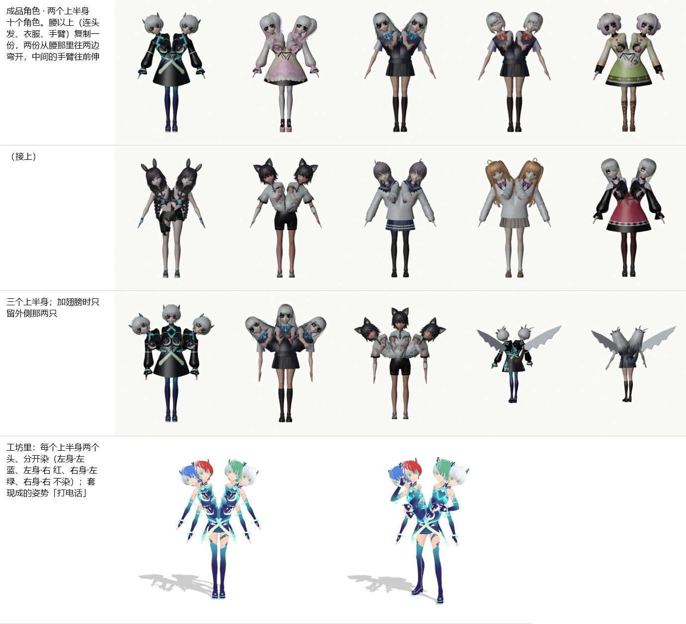
- **兽耳形状**：猫耳、狐耳、兔耳长在头顶，精灵耳长在人耳的位置；有兽耳时不再长人耳。
- **手**：「分指」（默认）是一只现成的手，五根手指一根根分开，握拳、比手势都摆得出来；「并指（手套形）」是一整片手掌加拇指，四指连成一片，只适合当粗略的起点。
  - 分指的手和二次元素体的手用的是同一只：VRoid Studio 旧版女性基础模型（CC0）上现成的手，连它自带的手指权重。它不像身体别的地方那样「融合」——融合是按一厘米上下的格子重新生成表面的，手指比格子还细、指缝更窄，过一遍格子就粘成一团，一弯就拉出尖刺——而是原样拿来，融合完以后在手腕处和身体缝成一整块。所以预览的精度下手指也是分开的，导出的还是一整块封闭的网格（手和缝合的那一圈是三角面，身体是四边面）。
  - 白模人台的手腕比这只手粗：前臂最后三厘米会收细一点接上去。手动把手腕挪进了别的部件里、那里没有一圈干净的开口时缝不上：手照样放上去、自己封好口，但和身体不相连，网格会多出一块（导出时会提醒）。

  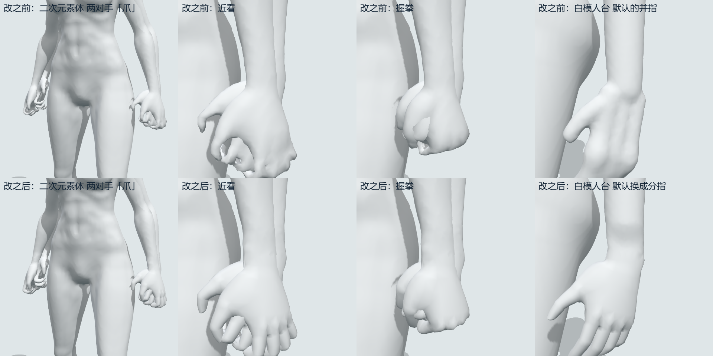

### 头发

三种身体样式都能戴头发，用的是同一批现成的头发：长直发、侧马尾、波波头、双马尾。它们不是画的也不是捏的，是从四个现成模型上取下来的（VRoid Studio 旧版的样例，pixiv 以 CC0 发布，见「成品角色」一节末尾的「头发的来源」）。

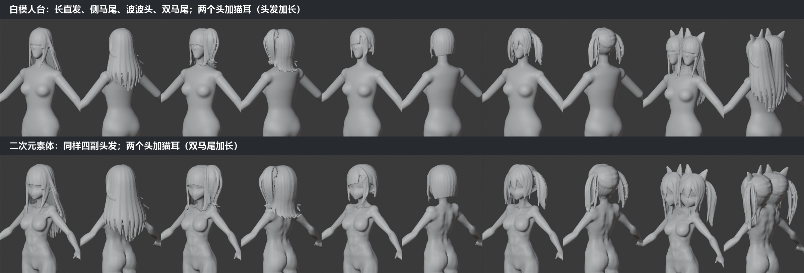

- **白模人台、二次元素体**：默认是光头（「发型」第一格）。选了发型，头发就转成没有颜色的白模戴在头上，和头融合成一整块，照样是一张封闭的网格，可以直接雕。第一次选某一种时要载入一两 MB 的数据，载入之前先光着头。
  - 头发是薄薄的一层：原来的头发是一片片面片，这里把离面片半厘米以内的地方当成实心，所以发丝之间细的缝被填上了，粗的走向（刘海、鬓角、发梢）都在。屏幕上的预览比较粗，头发会显得厚一些、糊一些，导出的精细网格才是它本来的样子。
  - 头发和头皮之间本来有空隙，融合以后封在里面的空腔会自动去掉，不会留下看不见的内壁。
  - 白模人台的头比素体的小一圈、窄一些，头发是照两个头的大小各个方向压过的。
  - 多出来的头各戴一副；一个头几张脸时只戴一副，朝两边的脸从头发里露出来。
  - 角和兽耳长在头发外面（根埋进头发一点）。双马尾原来自带的那副猫耳在白模上没有，要猫耳就自己加兽耳。
  - 头发没有自己的骨骼，整个跟着头动。分部件模式下它是单独的一块（`Head_01_Hair`），手动微调里可以单独挪、转、缩放。
- **成品角色**：默认是她原装的头发（「发型」第一格），可以换成这四种，也可以染色。详见「成品角色」一节的「换发型、染发」。
- **长度**（60%–150%）只管垂在鼻尖以下的那一段；**蓬松**（97%–120%）是整副头发以头为中心放大、缩小。三种样式都管用。
- **发色**只有成品角色用得上，白模没有颜色。几个头凑成一簇时可以**分开染**：「发色」下面多一排「染哪个头（正面看）」，点一个头（左、中、右……，格子里的小圆点是它现在的颜色；好几个上半身时是「左身 · 右」这样，先说哪个上半身，再说它上面哪个头）再点色块、自选或者「恢复本色」，就只染它；点「全部」再染，几个头一起换成这个颜色。加了兽耳的，兽耳跟着它长在的那个头。一个头几张脸只有一副头发，没有这一排。

  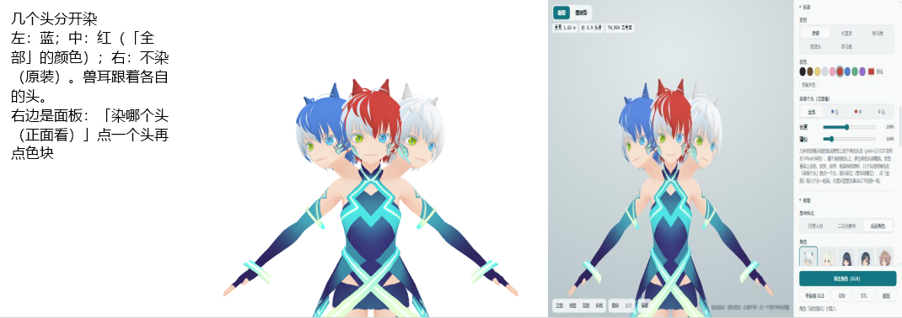
- 在描述里写「双马尾」「长直发」「波波头」「马尾」也认（发色见上面的表）。

### 体型

- **身体样式**：「白模人台」（默认）、「二次元素体」或「成品角色」（后两种见下面两节）。
- **性别**：女性（默认）或男性。男性肩更宽、腰更粗、胯更窄，脖子和四肢更粗，下巴更方，胸是扁平的胸肌。
- **姿势**：A-pose（手臂斜向下垂，默认）或 T-pose（手臂向两侧平举）。要绑骨骼、要给 Tripo 出图当参考时，用 T-pose 更方便。
- **滑块**：身高、头身比、体格、肩宽、胸部大小、腰宽、胯宽、四肢粗细、手臂长短、腿长短、尾巴蓬松和长度。
- **范围**：体格 0.7–1.5，肩宽 0.75–1.6，胸部大小 0.3–2.2，腰宽 0.7–1.6，胯宽 0.7–1.8，四肢粗细 0.5–2，手臂长短 0.5–2，腿长短 0.5–1.8，尾巴蓬松 0–3、长度 0.3–3（2026-10-31 放宽过；体格和四肢粗细是相乘的，最细到 0.35 倍、最粗到 3 倍）。拖到两头是很夸张的卡通身材：四肢很粗时大腿、膝盖贴在一起，很细时手脚也跟着小一点（不然一只原样大的手接在一根细棍上）。
- **手臂长短、腿长短**：每条手臂、每条腿顺着自己的方向拉长、缩短，手、脚不跟着变形，只跟着手腕、脚踝挪。**腿长短不改身高**：腿拉长了，整个人照比例缩小一点，还是设定的那么高（头、身子跟着小），三种身体样式都这样。
- 身高和头身比是按标准人形算的。多排手臂、人马、蛛形会让实际身高更高；四五个头时每个头小一圈，头身比会更大。都以左上角的读数为准。

### 二次元素体

在「体型」里把**身体样式**换成「二次元素体」，头、脖子、躯干、胸、手臂、腿就换成一个现成的二次元少女素体的形状：细长的四肢、尖下巴的头、带手指的手。它仍然是没有颜色的白模，没有衣服，头发要另外戴（见「头发」一节）。第一次切换时要载入约 6 MB 的数据，右下角会提示「正在载入」，载入之前先显示白模人台。


**照常能用的**：多个头、多对手臂（上下排和扇形都行）、多对胸、尾巴、翅膀、角、兽耳、人马、蛛形和人腿人马下身、A-pose 和 T-pose、手动微调、骨骼和蒙皮、全部导出格式。导出的仍然是一整块封闭的网格，骨骼的名字和白模人台一样。

**和白模人台不一样的地方**：

- 体型是在素体原来的样子上改的：**肩宽、腰宽**把躯干分段拉宽、压窄；**胯宽**是躯干和大腿根一起照离中线的远近按比例拉宽（腿和骨骼不挪；只对站着的那一对人腿起作用，人马、蛛形、单足、一副胯上三条以上腿时不变）；**四肢粗细**是手臂、腿绕着骨头变粗变细，肩头、手腕、脚踝处还是原样，手和脚照样接得上；**体格**是这几样一起变。四肢调得很粗时两条大腿内侧、膝盖会贴在一起。**性别、手的样式**对它不起作用，面板上会变灰。对比图：[docs/anime-shape.png](docs/anime-shape.png)。
- **胸部大小**两头都能调：往小拖，胸逐渐变平，拖到头是平胸；往大拖是把胸放大。往大拖过 1.1 以后渐渐换成**大胸的胸型**（1.6 换足）：素体自带的是一对小胸，照原样放大是一个放大的尖圆锥，前面平、上下一样厚，背面那块薄盖子还从锁骨上、腋下支出来，看着是个空壳；大胸的胸型（2026-10-31 晚换过）是从一个 CC0 的现成素体上取下来的胸（Death Joe Productions 的「CC0 Character Base Mesh Pack」里那个大胸的二次元素体，见 `assets/source/README.md`）：两个胸各是各的圆形体量，饱满、略微往下坠，胸下有一道褶，略微朝外；胸尖照原素材保留（2026-11-01 改的，见下面「按 DJP 原素材调整胸型」）。`node tools/run.mjs tools/build-bust.ts` 把它的左胸摆到素体上（照胸根等比缩到 0.85 倍——它的胸廓比素体宽一成半，这样胸和身子的比例照原样——往上提 3 厘米），量出胸实际凸出素体平胸躯干的那一片当底座，底座以内照原样，以外把它的表面往里压 2 厘米、沉到躯干里面（它的胸壁、上胸和素体的胸口前后差一厘米上下，留着的话胸口上会起伏、胸根上一道边），采样成和小胸一样的格子，追加进 `body.bin`（重新跑 `build-anime-body.mjs` 以后要再跑一遍它）。换成大胸的胸型时躯干上自带的那对小胸跟着抹平（不然从大胸的上坡里顶出来），胸和躯干圆滑地融的圆角收到 0.6 倍；大胸的胸型本身就照「胸调到 1.76 时正好是那个素体的胸原样大小」做（2.2 再大四分之一），那一块的放大倍数和滑块一样（以前另外再放大 1.25 倍，两个上半身挨着的那一侧放不下胸，见下面 11-01 的修复）。以前是工坊自己用三个椭球拼的，调得很大时两个胸并成一大块，中间只有一道缝，往两边一直糊到腋下。对比图：[docs/bust-large.png](docs/bust-large.png)（更早的一次：[docs/waist-bust.png](docs/waist-bust.png)）
- **两排以上的胸**（二次元素体，2026-11-01 改）：下排胸和第一排一模一样（一样大、离中线一样远，往小调时一样往胸口里沉），只是往下挪（以前往下每排小一成）。胸腔加长的那一段从「腰最细的那一截」挪到腰和胸之间、拉得缓一些（以前把腰拉成一根长筒，背上一块平板）；胸调大时上下两排隔得远一点（下一排上半截可以收在上一排底下），胸腔跟着加长几厘米。对比图：[docs/torso-detail.png](docs/torso-detail.png)
- **胸口、肚子、后背的起伏**（二次元素体，2026-11-01）：素体的躯干是 VRoid 旧版低模加密来的，轮廓好但表面几乎是光的。`node tools/run.mjs tools/build-torso.ts` 从四个精细人体素材（DJP 的两个二次元素体、Blender 官方 Human Base Meshes 的写实女性，都是 CC0；他在 Sketchfab 上下的 Fly_jkey「Woman」，CC BY 4.0，导出时自动署名）上取起伏：每个模型的躯干按「高度 × 绕身体竖轴的角度」展开成半径图，照裆、腰、腋下三个高度对齐到素体上、每个高度左右前后缩放到一样宽一样厚，减掉模糊过的样子就是起伏，四个平均（太窄的接缝、凹槽先抹掉）；素体换成「自己模糊过的样子 + 参考的起伏」。轮廓、身材比例不变（手臂、腿、脖子、胸照样接得上），多了脊柱沟、肩胛、腰窝、腹白线、肚脐窝、肋弓下沿、小腹两道斜线、锁骨一带的起伏。胸那一片、胸骨上窝、肩膀、脖子、腿根不搬（胸另外接；其余要和别的格子对得上，胸骨上窝往里推会在躯干和脖子之间露洞）。只在表面附近 2 厘米里叠，最多挪半厘米多一点。重跑 `build-anime-body.mjs` 以后要依次再跑 `build-torso.ts`、`build-bust.ts --small`、`build-bust.ts`。对比图：[docs/torso-detail.png](docs/torso-detail.png)
- **头身比**：滑块在默认的 7.5 时就是素体本来的比例（约 6.6 头身），往两边拖是在这个基础上放大、缩小头。
- **A-pose**：整条手臂绕肩关节放下来，手肘往前微弯。**T-pose** 是素体原样的直臂，接缝处也最干净。
- **耳朵**：素体自带一对人耳；加了兽耳或精灵耳以后，人耳会自动去掉。多个头时，紧挨着别的头的那一侧也不留人耳。
- **五官**：眼睛是两个往里凹的浅碟（边上陡、中间平，眼皮的边看得出来，一厘米多深），鼻子、嘴是素体自己的，嘴是一道浅浅的凹痕。屏幕上拖动时的粗网格看不清，停下来换成细的就看得出来。
- **多个头**：和白模人台一样凑成一簇（见「预设、数量、排布」；两个头配横排两副胯时例外，两个人并成一个宽躯干，见「横排多胯」）。素体的肩膀窄、头大：三个头以内肩膀是原样；四五个头时肩膀宽两到三成，是把胸口以上横着拉开一点，头也挤得比白模人台紧（这样最外面的脖子最多比本来的长三成）。三个头时正中间那根脖子没挪位置，用的是素体原装的；其余斜着伸出去的脖子是一根光溜的圆台，根部垫着一团软的接到肩膀上，没有肌肉造型（两个、四个、五个头时每根都是这样）。这些地方要进 Blender 再雕。
- **一个头几张脸**：脖子是素体原装的那根，身体和一个头时一样；每张脸用的都是去掉耳朵的头。素体的后脑勺大、脸小，朝两边的脸从正面看只露出鼻尖和下巴，头是明显变宽了。
- 第二排以后的手臂，肩头是一个垫在躯干侧面的球，没有锁骨、肩胛的造型。
- **肩部扇形聚拢**时和白模人台不一样：素体的身子薄，多出来的肩关节要是照白模那样一个个往背后排，肩头就整个悬在背后了。所以它们紧挨着本来的肩膀挤成一小簇，都留在身体里面。多出来的手臂从离肩关节三四厘米的地方切开（素体的手臂根部连着一片腋下的皮，边上是毛的，转个方向就支出来），切口上垫一个圆肩头把它包住。几条手臂只在根部互相圆滑地融成一片，伸出去十几厘米以后还是各是各的。「分部件」模式不做融合，看到的是手臂从一个球形的肩头里伸出来。

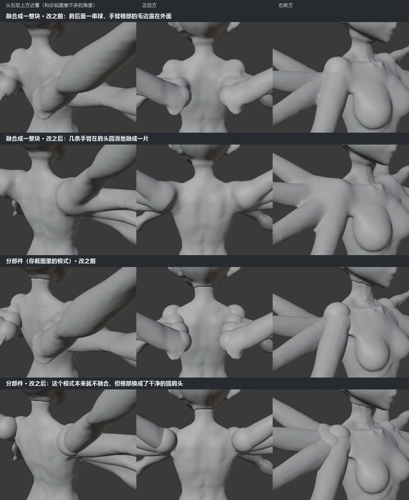
- 人马、蛛形的兽身和兽腿用的是白模人台的那一份：有大的体块和关节，没有肌肉的细节，和上半身的细节程度不一致。
- 人腿人马：前面一对腿是素体原装的，后面的腿是同一块形状往后挪；中间那截腰和后面那副胯是照素体的腰、胯的粗细另外捏的光滑体块，没有肚子、后背的肌肉起伏。
- 单数条腿、人腿人马每副胯几条腿也拼得了，排法和白模人台一样。中线上的那条腿用的是左腿那一份，绕髋关节转了两度多，让脚踝落在髋关节正下方（素体的腿本来是往脚并拢的）。
  - 单足：素体的胯是现成的，宽窄改不了，两个腿根是切开封了口的。所以胯底下留着原来两条腿最上面的一截（`Hip_L`、`Hip_R`，没有骨骼，跟着胯），中间那条腿从它们中间长出来，并且粗一圈（左右 1.3 倍、前后 1.12 倍，脚也跟着宽了）把中间填满。看上去胯底下是两瓣圆的，有点像穿着很短的短裤。
  - 人腿人马前面那副胯上三条以上：腿不在素体原来的位置上，胯底下垫一副和「左右并排」一样的胯把腿根包住。

  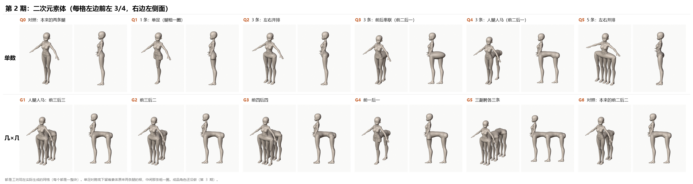
- **表面是磨过的**：素体模型的面数很低，顶点本身一高一低（原模型靠法线把它们「画」成光滑的），直接采样的话肚子上一棱一棱像腹肌、背上几道竖棱、肩头几个包。现在采样之前先把身子磨一遍（Taubin 平滑，起伏磨平、整体不缩；头不磨，五官还在），再细分成光滑的曲面。脖子比素体本来的粗一点（中段 1.15 倍）。第一排胸和躯干上自带的胸是同一张皮，在原位时直接拼上，不再鼓起一层、边上一圈棱；胸调大调小以后渐渐换成圆滑地融。没有聚拢的那对手臂肩头垫的那一块扁一点、往里往下挪了一点，肩膀上不再顶着一个球。
- **脚是现成的、带脚趾**：素体本来的脚是给穿鞋做的（像一只鞋楦，没有脚趾）。现在每条人腿接的是 Kotori（Fox Jump，**CC BY**）的左脚（右脚翻过来），连着它自带的脚、脚趾的权重；和手一样不过距离场，融合完以后在脚踝上面四厘米左右缝到腿上，所以粗网格下脚趾也是分开的。脚底照素体的脚底踩在地上；腿拉长缩短时脚不跟着变形；腿加粗（单足时那条粗一圈）时脚以脚底为中心跟着变大。人马、蛛形的兽腿不变。

  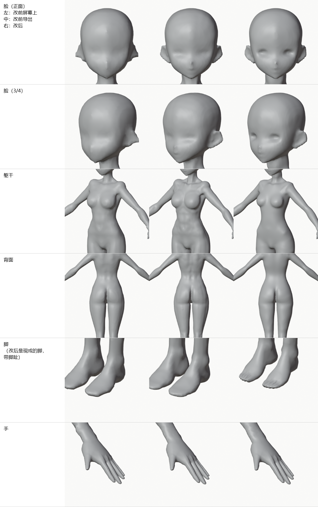

**素体的来源**：VRoid Studio 旧版（beta）自带的女性基础模型，pixiv 以 CC0 发布，可以随意使用和修改，不要求署名。原文件在 `assets/source/base_female/`，只取了皮肤（没有头发、衣服、贴图）；`node tools/build-anime-body.mjs` 把它磨平、细分、采样成 `public/anime/body.bin`。**脚**取自成品角色 Kotori（Fox Jump，CC BY，<https://fox-jump.itch.io/kotori-anime-character>）：`node tools/run.mjs tools/build-foot.ts` 从 `assets/source/kotori/` 里取下左脚，放大 1.08 倍摆到素体的脚踝上，写成 `src/anime/footMesh.json`。**二次元素体导出的模型带着 Kotori 的脚，发出去时请署名「脚部网格 © Fox Jump（Kotori），CC BY」**。

### 成品角色

在「体型」里把**身体样式**换成「成品角色」，显示和导出的就不再是白模，而是一个带头发、衣服、脸和贴图的现成二次元角色。能选十个（下面的「十个角色」），默认的是银色短发带蓝色挑染、左右眼不同色、一身蓝绿色的赛博风裙装、头上自带一副电子猫耳的那一个。第一次选到某个角色时要载入她的文件（9–14 MB），右下角会提示「正在载入」，载入之前先显示白模人台。

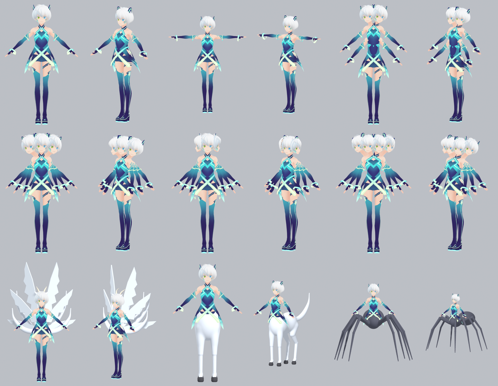

#### 载入自己的 VRM

十个角色下面有个「载入自己的 VRM…」：选一个 VRM 文件（自己在 VRoid Studio 里捏的最好），它就成了第十一个角色，头像是文件里自带的缩略图，多头、多臂、多腿、摆姿势、表情、换发型都照常能用。
- 文件只存在这台设备的浏览器里（IndexedDB），下次打开工坊还在；不随配置文件走：配置里只记「用的是自己的」，换了电脑、手机要重新选一次。
- VRM 0.x 和 VRM 1.0 都认（VRoid Studio 导出时两种都能选）。
- 别的软件做的 VRM：身体的骨骼照文件里的人形骨骼对照表认（髋、脊柱、胸、上胸、脖子、头、手臂、腿、手指），所以骨骼叫什么都行；但皮肤、衣服、头发是照 VRoid 的材质名（…_SKIN、…_CLOTH、…_HAIR）认的，认不全时多出来的头、并腿、换发型、染发可能不太对，说明里会提醒。
- 读不了的会说清楚是哪里不对：不是 VRM、缺工坊要用的人形骨骼（上面那几根缺一根都不行）、骨骼在静止姿势下带旋转（有的软件导出的是这样）。
- 说明里显示文件里写的作者和许可，导出的 GLB 里也写上；用它做的东西发出去时请照它的许可来。

#### 十个角色

「身体样式」下面多出一排头像，点哪个就换成哪个；下面那行小字写着她的原名、作者和许可。换角色只换人，别的设定都不动：部件数量、排布、体型、发型发色、摆好的姿势、表情和视线原样套到新角色身上。


| 选择框里的名字 | 原名 | 样子 | 作者 | 许可 |
| --- | --- | --- | --- | --- |
| 银发猫耳（默认） | ヴィータ | 银色短发、蓝色挑染、异色瞳，自带电子猫耳 | VRoid 项目（pixiv） | CC0 |
| 金发侧马尾 | ヴィクトリア・ルービン | 金发、粉色发梢、侧马尾，粉白洋装 | VRoid 项目（pixiv） | CC0 |
| 黑长直 | 千駄ヶ谷篠 | 黑蓝色长直发，学生制服 | VRoid 项目（pixiv） | CC0 |
| 蓝短发制服 | 千駄ヶ谷渋 | 深蓝色短发、红色发夹，学生制服 | VRoid 项目（pixiv） | CC0 |
| 棕发围裙 | ビビ | 棕色短发，绿色围裙裙 | VRoid 项目（pixiv） | CC0 |
| 兔耳 | Preset Only Rabbit - Aquamarine | 黑发麻花辫、兔耳，短上衣短裤 | 七百屋（なおしま） | VRoid Hub 条件 |
| 狼耳 | Kuro（Preset Nekomimi Girls） | 黑色短发、狼耳、小麦肤色，白上衣黑短裤 | 七百屋（なおしま） | VRoid Hub 条件；不许用于性表现 |
| 马尾水手服 | 水色（ポニーテルの女の子） | 灰紫色马尾，水手服加开衫 | 白い白米 | VRoid Hub 条件 |
| 橙发校服 | Alice Chan | 橙色长发，灰色开衫校服 | edisonlee55（yuna0x0） | CC BY-SA 4.0 |
| 绿发红裙 | Kotori | 黄绿色头发，白上衣红裙 | Fox Jump | CC BY |

- **许可不一样，发东西出去之前看一眼。** CC0 的五个随便用。「VRoid Hub 条件」是作者自己在 VRoid Hub 上设的：谁都能用、可改、可再分发、个人和公司商用都行、不用署名（白い白米在 BOOTH 上另写了不许用于 NFT、政治和宗教）。**Alice Chan 和 Kotori 要署名**：用她们导出的 GLB 里已经写上了署名（文件的 `asset.copyright`），导出时状态栏也会提醒；把图或模型发出去时请带上「Alice Chan © edisonlee55，CC BY-SA 4.0」/「Kotori © Fox Jump，CC BY」。Alice Chan 改过的东西再发出去也得用 CC BY-SA 4.0。
- **两种年代的文件都认。** 前五个和 Kotori 是旧版 VRoid（0.x）导出的，另外四个是正式版（1.x）导出的：骨骼、材质、表情的叫法不一样，读文件时已经对齐了，后面的功能不用分。正式版导出的那四个没有「> <」这种眼睛，表情栏里那一格会自己收起来。
- **兔耳、狼耳是戴在头上的配饰**，不是做在头发里的：换了发型还戴着（新头发里自带的猫耳就不要了）；多出来的头各戴一副；「一个头几张脸」只有正面戴；加了工坊自己的兽耳就摘掉。摆姿势时两只耳朵各有一个圆点（在「头发、衣摆」那一组里）。
- **染发**：有的角色头发的颜色是直接画在贴图里的（正式版导出的都是，比如兔耳、狼耳的黑发），光改底色染不浅。工坊在你第一次给她染发、换发型的时候，给这种贴图另做一张去掉颜色的浅色贴图（一两秒），黑发也能染成金发。
- 每个角色的文件 9–14 MB，一共 110 MB 上下：安装包和压缩包因此大了很多。选到哪个才读哪个；内存里最多留三个，再多的把最久没用的放掉，切回去时重新读（一秒以内）。

**它是怎么拼的**：

- 多出来的**头、手臂、胸**，是把她自己的头、手臂、胸那一片（连头发、袖子、贴图）复制一份，接到新的位置上。
- **多个头**：和白模人台同一套排法（见「预设、数量、排布」）——身体还是她本来的身体，头凑成一簇，脸贴着脸，头发互相搭着；中间的头是正的、最靠前，两边的往后退、脸稍微朝外、头往外歪一点。脖子根并排挤在肩膀中间。三个头以内肩膀不动；四五个头时肩膀宽两到三成（从胸口往上逐渐加宽，手臂跟着肩头往外挪，腰和胯不变），每个头也小一圈。她的头大、肩膀窄，所以四五个头时头挤得比白模人台紧，这样最外面的脖子最多比本来的长三成。
- 自己的头和复制出来的头都是让脖子、头的骨骼带着摆过去的：脖子斜过去，头再转到自己的朝向，脖子上的皮肤是顺着弯的。
- **一个头几张脸**：只有她自己的那一个头、一根脖子，骨架和一个头时一模一样。多出来的脸是把她的脸（耳朵往前的那一半，连刘海）复制一份，绕着头转到两边、后面，再往外挪到露出眼睛；它们没有自己的骨骼，整片跟着头。多出来的脸比正面那张小一圈（九成二）。
- **人马、蛛形**：她自己的腿去掉（鞋也去掉，裙子留着），胯坐在兽身前端的背上，裙摆搭在上面。兽身是照白模人台的做法另外捏的、融合成一整块的单色部件：马身跟头发一个颜色，蹄子是深色的；蜘蛛身是深色的甲壳。马背差不多齐着她的胯。原来挂在大腿上的裙摆骨骼改接到胯上；马腿、蛛腿、兽身后半截各有自己的骨骼，名字和白模人台一样。尾巴长在兽身的后端。
- **人腿人马（humantaur）**：她自己原样不动，身后接的是把她自己的腰、胯和腿（连裙子、长袜、鞋）复制的一份。复制出来的这一份，胯和腿原样立着，腰从腰椎那里往前折平、拉长，切口并进她的后腰里，像一个人弯着腰跟在后面。前后两副胯隔三十多厘米。它有自己的骨骼：`Hips.002`、`Spine.002`、`Chest.002`、`UpperLeg_L.002` … 一直到脚趾和裙摆，`Hips.002` 接在她的 `Hips` 上。三对、四对腿就往后再接一份（`Hips.003` 接在 `Hips.002` 上）。尾巴长在最后那副胯上。
- **腿前后串联**：也是把她自己的胯和腿（连裙子、长袜、鞋）复制几份，一副紧挨着一副排在身后，前后两副隔腿长的四分之一（二十多厘米）。和人腿人马不一样的是没有那截横着的腰：每一份从腰往下往后斜出去，到胯的关节斜完，后背就是从腰一路斜到最后那副胯——同人画里紧凑的那种人腿人马就是这么画的。后面每副胯有一根自己的骨骼，名字和白模人台一样：`LowerBody_01` 接在 `Hips` 上、从她的胯伸到第二副胯，`LowerBody_02` 接在 `LowerBody_01` 上 …；第二对腿 `UpperLeg_L.002` 接在 `LowerBody_01` 上。尾巴长在最后那副胯上。
- **腿胯部聚拢**：和前后串联一样把她自己的胯和腿复制几份接在身后，只是一副紧贴着一副（隔腿长的十二分之一左右，五六厘米），后面几对腿的腿根藏在前一副的屁股底下；拼好以后腿往外斜着散开：从髋关节往下斜着挪，到脚踝挪满，脚踝以下整个平移，鞋不变形、平踩在地上。往后每多一副，脚踝多往外挪十二厘米左右（一点六个髋关节离中线的距离；越往后的腿斜得越厉害，多挪的那一步也补大一点）。前面那一对照原样站着（单数时也散开半步）。骨骼和前后串联一样：`LowerBody_01`、`LowerBody_02` … 一节接一节，后面的腿接在上面。
- **单数条腿**：正中那条腿是把一副胯上的两条腿并成的——每条腿以自己的中轴为界，外侧那一半往中线挪过去，两条腿的外侧在中线上对上，拼成一条左右对称的腿；里侧那一半压扁在中线上，藏在并好的腿里面。不切开、不添面，短裤的裤腿、长袜、鞋都跟着并（短裤并成一条裤腿），裙摆不跟着腿走，不动。并好的腿骨骼不分左右：`UpperLeg` → `LowerLeg` → `Foot` …
  - 单足：她自己的两条腿并成一条。
  - 左右并排单数条：正中那条和别的中间的腿一样，是两条腿的里侧一半拼的（见下面「腿左右并排」），所有的腿还是等距的一排。
  - 前后串联、人腿人马单数条：最后那副胯上的两条腿并成一条。
- **人腿人马、前后串联每副胯几条腿**：一条的就是把那副胯上的两条腿并成一条。三四条的，和「腿左右并排」一样（见下面）：这副胯中间那一段照原样复制几份排开，她的两条腿挪到最外边，每两条腿之间都是一个原样的裆部，中间的腿是两条腿的里侧一半拼的；这副胯上的腿都改成笔直朝下。

  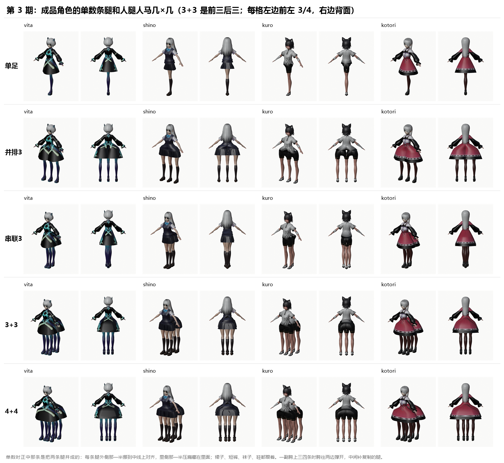
- **腿左右并排**：只有一副胯。她自己的胯中间那一段——两条大腿的里侧一半，加上中间的裆部——照原样复制几份，一份挨着一份排开，她的两条腿挪到最外边：每两条腿之间都是一个原样的裆部，中间的腿是一条腿的里侧一半和另一条腿的里侧一半拼的（两半在腿的正中接上；左右腿对称，切面对得上）。这一段从腰往下渐渐变宽：腰上是 0（腰还是一个人的腰），到胯的关节那么高是髋关节离中线那么远，腿上一直是这么宽。衣服没有被拉宽的地方，褶子、花纹、短裤的裆都是原样的，只是正中的花纹会重复几次；腰往下渐渐挪开的那一段是斜着挪的。接缝两边的明暗顺过去了，看上去是一道软褶。蝴蝶结、垂下来的飘带、扣子这种胯以上的小配件不切开，正中的整块留在原处；只有一边有的腿套、挂件整块跟着它那条腿。相邻的腿隔得一样远，就是她本来两条腿隔的那么远；她自己的腿是往脚并拢的，并排以后每条都改成笔直朝下，脚也是等距的一排。腿都接在 `Hips` 上，照位置起名：从中线往外，她左边的是 `UpperLeg_L`、`UpperLeg_L.002` …，右边的是 `UpperLeg_R`、`UpperLeg_R.002` …（和白模人台一样）。三对腿以上胯张得很宽，手臂会多抬起来一些。尾巴照常长在后腰正中。（以前的做法：先是每对腿复制一整副胯并排插在一起，胯中间有竖的折痕、屁股是几团；后来是把胯往两边撑开、中间补上复制的腿，小腹下面、臀缝那里的花纹和褶子被横着拉宽（四条腿时宽到三倍），kuro 短裤后面的裆部开口跟着变大，补的腿顶上露出一小条皮肤。2026-10-30 先后改掉）
- 手臂上下多排时，躯干跟着加长。
- **多对手臂**有两种排法。沿躯干上下排时，腰以上、胸以下那一段连衣服一起拉长，每排手臂在躯干侧面有自己的一副肩头（躯干在那里稍微鼓出来一点托着它）。复制出来的袖子根那一圈切口是收拢、退进躯干里的：宽松的开衫（sailor、alice）切口是斜的，腋下那一边离肩关节有八九厘米，不收的话整圈切口悬在躯干外面，看上去袖子是飘着的。

  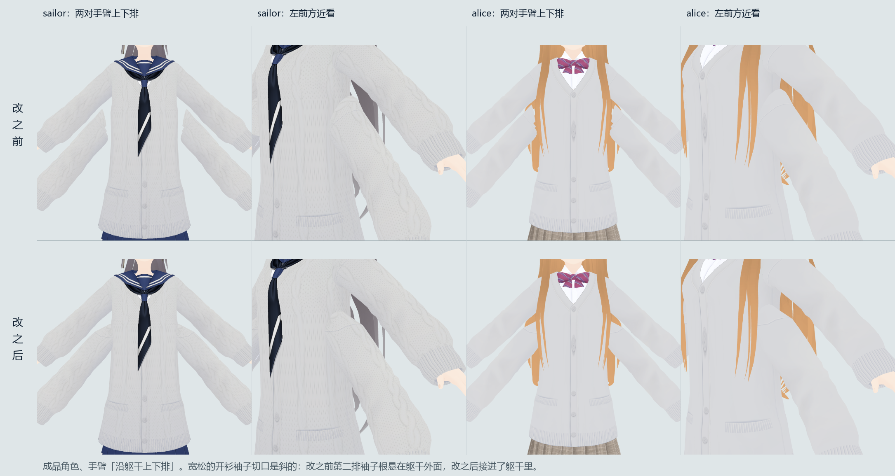

 肩部扇形聚拢时，她本来的那一对在最前面，垂得最直；多出来的从肩膀后面长出来，一对比一对靠后、张得开，正面看是一层层的扇面，胸前是干净的，多出来的肩头在背后。
- **A-pose**、手肘微弯、头的大小、胸部大小，是照模型自带的蒙皮让骨骼带着皮肤和衣服动，所以肩膀、袖口是顺着弯过去的。
- **尾巴、翅膀、角、兽耳**是照白模人台的做法另外捏的单色部件：尾巴和兽耳跟头发一个颜色（原装是银白；换了发型、染了发就跟着变），角是骨白色，翅膀是灰蓝色。角和兽耳的根埋在头发里。一个头几张脸时，角和兽耳只长在这一个头上。
- **她自带的猫耳**：不加兽耳时留着（多出来的头上也各有一副）；加了兽耳（猫耳、狐耳、兔耳、精灵耳都算），自带的那副会自动去掉，免得长两副。
- **身高**量到头顶，不算蓬起来的头发和猫耳（它们还要高出三四厘米）。

**换发型、染发**（面板上的「头发」一栏；白模人台和二次元素体戴头发见前面的「头发」一节）：

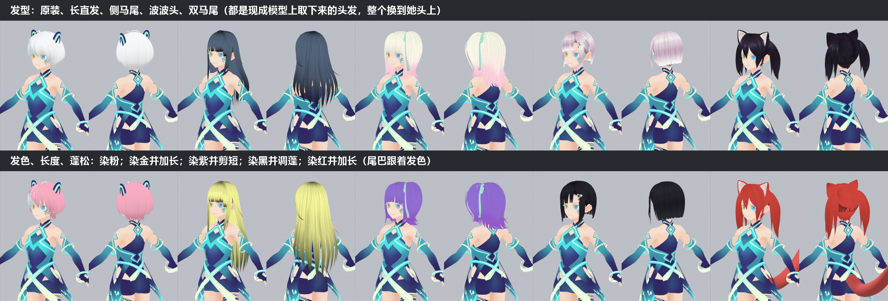

- **发型**有五种：原装（她自己的银色短发）、长直发、侧马尾、波波头、双马尾。后四种不是画的也不是捏的，是从别的现成模型上取下来的头发——和她同一批的 VRoid 样例，都是 pixiv 以 CC0 发布的，头型一样，所以对得上——整个换到她头上，连同它们自己的贴图和骨骼。第一次选某一种时要载入一两 MB 的文件，载入之前先显示原装的。
- 换了发型，她原装的头发连同做在头发里的那副电子猫耳一起拿掉。双马尾自带一副猫耳（原主人头发的一部分）；加了工坊的兽耳，它也会自动去掉。
- 多出来的头、多出来的脸都跟着换成新头发。
- **发色**：点一个常用的颜色，或者用「自选」挑一个；「恢复本色」回到这副头发本来的颜色。染的是头发本身，发夹、丝带、原装头发上那几缕蓝色的挑染保持原样。贴着头皮的那层底色、后加的尾巴和兽耳、人马的马身都跟着发色走。
- **长度**：只管垂在鼻尖以下的那一段，60%–150%。短发没有垂下来的部分，拖它没什么变化。
- **蓬松**：整副头发以头为中心放大、缩小，97%–120%。往小调的余地很少，再小头发就陷进头皮里了。
- 在描述里写也认：「金发」「银色长发」「黑长直」「双马尾」「马尾」「波波头」，英文标签 `blonde_hair` `twintails` `long_hair` `ponytail` 也一样。只在写了的时候改，改面板上的选项不会去动描述里的文字。

头发的限制：

- 发型就这五种，不能像 VRoid 那样一缕一缕地改。要加新的，得再找一个带头发的 VRoid 旧版模型（见下面「加一种发型」）。
- 染发是给材质换底色，贴图本身没变：原来画在贴图里的深浅、渐变还在。侧马尾发梢那截渐变染了以后还看得出一道深浅；波波头的贴图里有粉紫和蓝灰的发丝，染了以后这些发丝之间还有一点色差。
- 双马尾原来的黑色是直接画在贴图里的，染不浅，所以染它的时候借用了她原装头发的那张浅色贴图，发丝的纹理会比不染时平一些。
- 长度是把垂着的那一段上下拉开，贴图也跟着拉长；拉到 150% 时发丝的纹理会显得稀一点。头发的骨骼跟着一起挪了。
- 新头发不会自己避开身体：长直发垂在肩前的那几缕和肩膀、手臂有穿插，加长以后更明显。

**和白模不一样的地方**：

- **各块是互相插在一起的，不融合**。复制出来的手臂、头从衣服里直接穿出来，接缝处比较生硬；导出的不是一整块封闭的网格，不适合直接拿去雕刻或 3D 打印。
- 体型的滑块除了**体格**都管用：身高、头身比、胸部大小、肩宽、腰宽、胯宽、四肢粗细、**手臂长短**（肩到手腕拉长、缩短，手不变）、**腿长短**（大腿根到脚踝拉长、缩短，鞋不变，身高不变）。肩宽、腰宽、胯宽、四肢粗细、手臂长短是直接把她的身体连衣服一起拉宽、拉长的，调得多了，衣服上的花纹会跟着变形；胯宽调大时大腿根跟着往外，膝盖以下不动。性别、体格、手的样式不起作用。
- **眼睛数量、去掉手臂**还拼不了；设了的话左上角会有一条橙色提示，照常显示成两只眼睛、一对手臂。
- **腿前后串联也是几副胯互相插在一起的**：前一副的臀埋在后一副的小腹里，裙子是几条前后叠着。腰到胯那一段是往后斜出去的，衣服上的花纹跟着斜；四对腿时最后一副离腰很远，那一段斜得厉害，像拖着一条长裙摆。长头发会穿进斜下去的后背里。
- **单足、一副胯上只有一条腿时是并出来的**：并好的那条腿是两条腿的外侧拼的，大腿外侧的东西（绑带、花纹）两边都有，里侧的没了；鞋是两只鞋的外侧拼的。
- **一副胯上三条以上腿时，胯中间那一段是复制排开的**（左右并排、人腿人马和前后串联每副胯三四条）：正中的花纹会重复几次（vita 裙子上交叉的飘带、victoria 背后的花饰）；每两份接上的地方是一道浅凹，明暗顺过去了，看上去像一道软褶；五六条腿时这几道软褶都往腰上收拢，像一把扇子。中间的腿是两条腿的里侧一半拼的：大腿外侧的东西（rabbit 的腿套）它没有，左右不对称的衣服在它的正中对不上。这副胯上的腿都是笔直朝下的（她自己的腿本来往脚并拢）。四对腿并排时胯有一米多宽，手臂几乎平举。
- **人腿人马身后那截腰是拉长的**：她的腰短，折平以后够不着前面，所以腰那一段被拉长到两倍多，衣服上的花纹也跟着拉长了。腰折的地方（后面那副胯的上方）皮肤和衣服有一道折痕。切口是插在她后腰里的，没有缝合；她自己裙子背后的飘带搭在那截腰上，有一点穿插。
- **兽身和她不是一种画风**：兽身是单色的、照常受灯光影响，她是画好明暗的贴图。兽身和她是互相插在一起的：大腿根埋在兽身的前胸里，裙子背后的飘带有一截穿进了马背。兽身面数不少（马身约 5.7 万个三角面，蜘蛛身约 7.6 万；她自己才 2.7 万），第一次切到人马或蛛形时要现算，会顿半秒。
- **多出来的脸是半个壳**：只有脸和刘海，没有后脑勺，所以皮肤做成了两面都画的；从正下方、正后方凑近看，能看到壳的边和里面。它的刘海和正面那个头的头发互相穿插。它不带眼睛的骨骼，眼珠转不了（表情可以摆，见「表情和视线」）。
- **网格**那一栏对它不起作用。**手动微调**能用，部件是照骨骼分的，见「手动微调」一节；它的微调和白模人台、二次元素体的分开记，两边互不影响。
- 第二排胸是把衣服上胸口那一片复制到下面，隔着衣服不太显眼。
- 多个头是脸贴着脸的：蓬起来的头发互相穿插，两边的头有一部分藏在中间那个头的头发后面，从正面看不全。
- 四五个头时肩膀加宽的那两三成，是把胸口以上的衣服和皮肤横着拉开的：胸口的花纹会变宽一点，两边的胸也隔得开一点。
- 多出来的头，脖子是光着的，没有衣领：衣领是连衣裙的一部分，切不下来完整的一圈，所以不复制。她自己那个头的衣领还在；两个头、四个头时她自己的头也是歪着的，衣领会跟着扯斜一点。
- 复制出来的脖子根是插进肩膀里的（最底下那一圈收拢着藏在里面），没有和肩膀的皮肤缝在一起，凑近看有一道交线。
- 四五个头时头挤得很紧：五个头时相邻两个头的正中只隔六成上下的头宽，两边的头有小半张脸被前面的头挡住。这是为了不把脖子拉长（露在外面的脖子最多比本来的长三成；改成这样之前，五个头时最外面的脖子是本来的两倍多）。
- 加了很多尾巴、翅膀，或者四五个头时，拖滑块会有点卡（每次重拼大约 0.1 秒）。

**导出**：

| 按钮 | 文件 | 内容 |
| --- | --- | --- |
| 导出角色（GLB） | `oc_character.glb` | 带贴图，不带骨骼。约 6–9 MB（大部分是贴图）；人马、蛛形再多 1–3 MB |
| 带骨骼 GLB | `oc_character_rigged.glb` | 带贴图、骨架和权重。骨骼的名字和白模一样（`Hips`、`UpperArm_L`、`UpperArm_L.002`、`Head.002` …），另外还有她自带的手指、胸、袖子、裙子的骨骼，以及一缕缕头发的骨骼（`Hair_01_01`、`Hair_01_02` …；换了发型就是新头发的骨骼，名字还是这样编）。人马、蛛形时 `UpperLeg_L`、`LowerLeg_L`、`Foot_L` 这些是兽腿的骨骼 |
| OBJ、STL | `oc_character.obj` / `.stl` | 只有形状，没有贴图和骨骼 |

导进 Blender 的办法和白模一样（文件 → 导入 → glTF 2.0）。进去以后是一个物体 `OC_Character`，每种材质一个材质槽（后加的单色部件叫 `OC_Tail`、`OC_Wing`、`OC_Coat`（马身）、`OC_Hoof`（蹄子）、`OC_Chitin`（蜘蛛身）这一类；名字以 `_Both` 结尾的是多出来的脸用的「两面都画」的皮肤）；带骨骼的那个另有一副骨架 `OC_Rig`。看到的样子（比如 A-pose）就是它的静止姿势。视图要切到「材质预览」或「渲染」才看得到贴图（视图右上角那一排圆球里的第三、第四个）。

**角色的来源**：十个都是别人做好、允许再分发的 VRoid 模型，清单在 `src/character/roster.ts`（文件、原名、作者、许可、来源网页）。前五个是 pixiv 以 CC0 发布的 VRoid Studio 旧版（beta）样例；兔耳、狼耳、马尾水手服是作者放在 VRoid Hub 上、条件设成「可改、可再分发、可商用、不用署名」的；Alice Chan（CC BY-SA 4.0）和 Kotori（CC BY）来自 itch.io。原件在 `assets/source/`，每个的下载地址、许可说明和校验值记在 `assets/source/README.md`。工坊运行时读的是 `node tools/run.mjs tools/build-characters.ts` 加工出来的 `public/character/<名字>.vrm`：只把工坊用不到的贴图（法线、阴影色、缩略图 …）换成了 1×1 的占位图，每个小三分之一，网格、骨骼、表情和文件里的许可信息都原样留着。

**加一个角色**：把 VRM 0.x 文件放进 `assets/source/`；在 `src/model/spec.ts` 的 `CHARACTER_IDS` 里加一个名字，在 `src/character/roster.ts` 里加一段（文件、原名、作者、许可，角色自带的兽耳是哪种材质，染发时改哪种材质）；跑一遍 `node tools/run.mjs tools/build-characters.ts`；再放一张头像 `public/character/thumb/<名字>.jpg`（没有也行，选择框里只显示名字）。试过的是 VRoid 旧版（0.x）和正式版（1.x）导出的 VRM 0.x（骨骼叫 `J_Bip_C_Hips` 这一类、静止姿势不带旋转）；不是 VRoid 做的模型、VRM 1.0 的文件读不了。

**头发的来源**：四副头发取自 VRoid Studio 旧版的另外四个样例模型，pixiv 都声明以 CC0 发布：长直发是「千駄ヶ谷篠」（Sendagaya Shino），侧马尾是样例 4（β Ver AvatarSample_4），波波头是样例 1 的暗黑版（AvatarSample_D_Darkness），双马尾是发型样例（HairSample_Female）。原文件在 `assets/source/`，下载地址和许可说明记在 `assets/source/README.md`。工坊运行时不读这几个 VRM，读的是 `node tools/build-hair.mjs` 从里面取出来的两份东西：给成品角色用的头发文件（`public/character/hair/*.glb`，带贴图和骨骼，每个一两 MB），和给白模人台、二次元素体用的头发数据（`public/hair/*.bin`，没有贴图，存的是到头发面片的距离，每个 0.5–1.6 MB）。

**加一种发型**：把带头发的 VRoid 旧版模型放进 `assets/source/`，在 `tools/build-hair.mjs` 的 `HAIRS` 里加一行（名字、文件、染发时改哪种材质），跑一遍这个脚本（成品角色用的和白模用的两份会一起做出来）；再在 `src/model/spec.ts` 的 `HAIR_STYLES` 里加上同一个名字，在 `src/main.ts` 的 `HAIR_LABEL` 里给它起个中文名，在 `tests/hairShapes.ts` 的清单里也加上。头发是照两个头的大小之比缩放、照头的关节对齐的，所以要求原主人的头和她是同一种头型（VRoid 的头）。

### 网格

- **融合成一整块**（默认）：所有部件融合成一张封闭的网格，交界处是圆滑的过渡。「融合圆角」调过渡的宽窄，0 就是硬接。
- **分部件（v1）**：每个部件是独立的物体，互相穿插但不融合。
- 屏幕上显示的是较粗的预览（读数后面带「预览」）；拖滑块时可能先出现一版更粗的，停手以后变细。导出时会另外算一张精细的。

### 撤销、保存

- **撤销 / 重做**：左下角的按钮，或者 `Ctrl + Z` / `Ctrl + Y`。改描述、点预设、加减数量、拖滑块、手动微调、摆姿势都能撤销；连着拖同一个滑块算一步，拖一次圆点算一步。光标在文字框、数字框里时，`Ctrl + Z` 撤销的是刚打的字。刷新页面以后撤销记录会清空，设定本身还在。
- **自动保存**：所有设定（包括手动微调和摆的姿势）自动存在这个浏览器里，下次打开还在。
- **配置文件**：「配置」栏里的「保存配置」另存成一个 `oc_config.json`，「载入配置…」读回来。v1 的配置文件也能读。

## 手动微调

自动摆出来的位置不满意时，可以单独调某一个部件：某条手臂、某个头、某条尾巴、某只角……

1. **选中部件**：在模型上点一下它。它会罩上一层青色，关节处出现彩色的操纵杆，右边的面板自动翻到「手动微调」这一栏。点不准的话，在这一栏的下拉列表里选也行。
2. **调整**，两种办法都可以：
   - 在模型上拖操纵杆。面板里的「移动 / 旋转 / 缩放」切换操纵杆的样子；红、绿、蓝分别是 X、Y、Z 轴。
   - 在面板里直接填数字：位置（厘米）、角度（度）、大小（倍数）。
3. 点一下空白处、按 `Esc`，或者点青色小牌子上的 ✕，结束调整。

几条规则：

- **方向**：X 是角色自己的左手边，Y 朝上，Z 朝前。眼睛、角、耳朵长在头上，按那个头自己的方向算。
- **转动和缩放以关节为中心**：手臂绕肩膀，腿绕髋，尾巴绕尾根，头绕头的中心，躯干绕骨盆。
- **大小锁定比例**：开着时是整体放大缩小；关掉以后可以只改一个方向。手臂的 Y 是长短，X、Z 是粗细；其余部件一般是 X 宽、Y 高、Z 厚，面板下面的说明会跟着选中的部件变。
- **同时调整对侧**：开着时，左右成对的部件（`_L` / `_R`）一起改，对侧是镜像的样子。想让两边不一样就关掉它。
- **谁带着谁动**：躯干带着脖子、头、手臂、胸、翅膀；头带着眼睛、角、耳朵。挪头的时候脖子会跟着伸过去。腿、尾巴、兽身各自独立。
- **脚始终踩在地面上**：把腿改长、改短以后，整个人会跟着升高、降低，左上角的身高读数也跟着变。
- **挪腿时胯跟着变宽变窄**：腿左右并排、前后排、胯部聚拢时腿根上垫着的那副胯（下身里的椭球），照它盖着的那几条腿重新定宽窄：最外边的腿根离胯的两边原来留多宽，挪过以后还留那么宽。外侧的腿往里收，胯跟着收窄；往外挪，胯跟着放宽、把腿根包住。挪的是里面的腿、只转或缩放腿时胯不变。（成品角色是另一种做法，见下面。）对比图：[docs/tweak-hips.png](docs/tweak-hips.png)
- 调过的部件列在这一栏下方的「已微调」里，点名字就能选中。「还原这个部件」只还原选中的，「全部还原」清掉所有微调。
- 微调是按部件的名字记的（比如 `Arm_02_L`）。把手臂从 3 对减到 1 对，第 2、3 对的微调不会丢，加回来的时候还在。点预设会把微调全部清掉（可以撤销）。
- **能调多大**：位置最多挪 3 米，角度 ±180°，大小 0.05–10 倍（2026-10-31 放宽过）。
- 调得太狠（比如把手臂拽离身体）网格会断开，左上角会提示「网格分成了 N 块」，这时导出的就不是一整块了。
- **成品角色也能调**，部件和白模人台同名：躯干、脖子、头、手臂、胸、翅膀、腿、尾巴、兽耳、角。它不是一块块拼的，部件是照骨骼分的：
  - 一个部件就是一串骨骼（手臂从上臂起、腿从大腿根起），顶点照它跟着这串骨骼的权重挪。和身体连着的地方（肩膀、腿根、脖子）渐渐过渡，不会裂开；挪远了那一圈会拉长，像橡皮。
  - 复制出来的手臂（第二对起）连锁骨那一节整条都是它自己的，挪开就是整条拿下来，根上的切口会露出来。尾巴、翅膀、兽耳、角本来就是单独的一块，也是整块挪。角、第二对以后的胸没有自己的骨骼，照网格认。
  - 骨骼跟着挪，导出的模型、摆姿势、表情和视线都照挪过的样子。
  - **挪腿时胯跟着挪**：胯、短裤、裙子上不跟着腿的点，照离哪条腿的根最近来分，离这条腿近的整个跟着平移，和相邻那条腿中间那一带渐渐过渡；从髋关节往上到腰渐渐不跟，上身不动。腿左右并排时把外侧的腿往里收，胯跟着收窄，不会还撑在原来那么宽；往外挪就跟着变宽。只跟平移，转腿、缩放腿只动腿自己。对比图：[docs/character-tweak-hips.png](docs/character-tweak-hips.png)
  - 位置的单位是米（白模人台的是按标准人台换算的），第几对手臂的排法也不一样（成品角色的第一对是她本来那对），所以成品角色的微调单独记一份：切到白模人台、二次元素体时用它们自己那份，切回来还在。
  - 腿改长、改短以后整个人跟着升降，脚还踩在地上（和白模人台一样）；转腿、挪腿不管这个。点选按点中的那一点离哪个部件的顶点最近来认，胯、裙子这些不属于哪个部件的算躯干。

  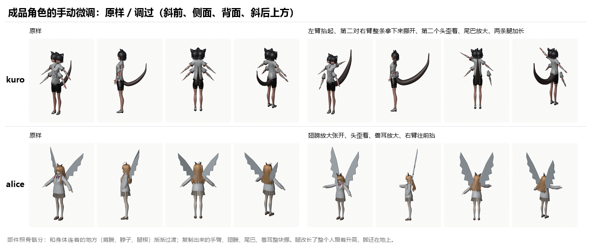

微调存在配置里的 `overrides` 字段，键是部件名：

```json
"overrides": {
  "Arm_02_L": { "rotation": [0, 0, 25], "scale": [1, 1.2, 1] },
  "Head_01": { "position": [0, 0.03, 0] }
}
```

`position` 的单位是摆位用的标准人台（1.76 m 上下）的米，面板上显示的厘米数已经按角色的实际身高换算过；`rotation` 是度；`scale` 是倍数。

## 摆姿势

身体定好以后，点 3D 视图左上角的「摆姿势」，模型的关节上会亮起一批圆点，拖它们就能摆姿势。点「造型」回去接着改身体。

两边各管各的：在「造型」里看到的、导出的一直是静止姿势（A-pose / T-pose）；在「摆姿势」里看到的、导出的是摆好的样子。三种身体样式（白模人台、二次元素体、成品角色）和两种网格模式都能摆。


**摆好以后，白模的身体是照姿势重新融合出来的**（白模人台都是；二次元素体是手臂选了「肩部聚拢」的，见下面）。拖着圆点的时候，屏幕上是静止的那张网格照权重跟着骨骼动——每一帧都跟手，但关节转得多的地方是「扯」出来的：肩头会鼓成一团，挨在一起的几条手臂之间扯着皮。手一松，后台就照摆好的姿势把各个部件的形状搬过去、重新融合成一张网格换上（不到一秒；再过一两秒换成更细的一张，部件多、姿势复杂时两三秒）。还在算的时候又动了姿势，旧的那张马上停下，新的一张不用排队等。这样肩膀、腿根和「造型」里一样是融合出来的，手臂是整条从肩膀里伸出来的，几条手臂各是各的。导出摆好姿势的 GLB / OBJ / STL，用的也是这样重新融合的网格。

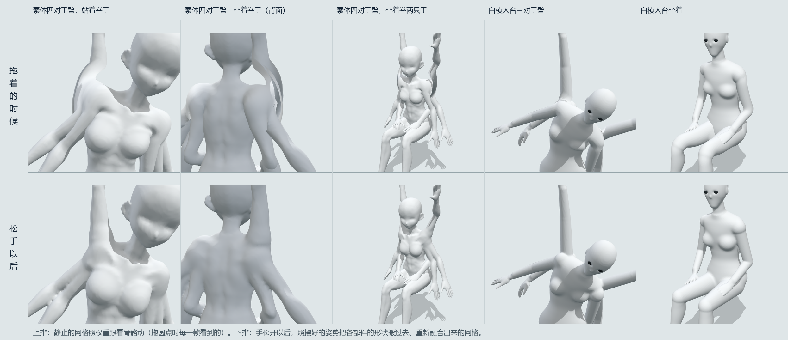

做法是照着「隐式蒙皮」（Implicit Skinning，SIGGRAPH 2013）的思路来的：皮肤是形状场的表面，骨骼带着走的是形状场，不是皮。

- 头、脖子、胸、耳朵这些整个跟着一根骨骼搬过去；手臂绕肩关节转、腿绕髋关节转也是整个部件在搬，和「造型」里 A-pose、T-pose 的做法一样。
- 手臂和腿在每个关节处切一刀，每一段整个跟着自己那节骨骼。关节弯了以后，凹的一侧两段叠在一起；凸的一侧两个切面之间张开一个楔形的口子，用切面的轮廓绕着关节扫过去补上——圆的手臂扫出来就是一个球形的关节。弯多少度都不瘪、不鼓。
- 躯干、兽身、尾巴不切开，整个顺着骨骼弯过去。
- 手还是那只现成的手，照它自带的权重摆好，再在手腕处缝上去。
- 手臂、腿只在根部（关节周围十几厘米）和身体圆滑地融合。手搭在腿上、手臂贴着身体，那是挨着，不会融出一圈圆角把它们粘在一起。
- 手腕插进了大腿、别的手臂里的话，前臂的断口和它们融成一片，手就没处缝了。这时把那只手腕周围空出一圈（挤进来的东西挖掉两个体素那么宽）再融合一遍；还有没缝上的，再挖一遍、挖开的边上圆个圆角（圆了以后有的缝得上、有的反而缝不上），哪遍缝上的多用哪遍。被挤的那一边（另一条前臂、大腿、胸口）会留一道贴着手腕的浅槽，手是缝着的，网格还是一整块。白模人台和二次元素体都这样。
- 两只手腕挨在一起（两只手握在一起、同一边垂着的两条手臂）：先试着两只一起切开；切开以后两截前臂的断口连成一圈的话，从两条前臂正中间加一道隔梁分成两圈，各接各的手。一只一只来、一起切都找不到开口的，把切口往手肘那边挪一点再找（最多八厘米），开口和手之间接一段管子。

二次元素体本来那对手臂是照平举的样子做的，根上连着一圈腋下的皮：手臂垂着、平举时它埋在肩膀里，肩膀就是「造型」里看到的那样；抬到比平举高十几度、或者往前往后摆过四十来度，这圈皮会翻出来，这时换成和别的手臂一样的做法——根部切掉，垫一个和手臂一样粗的圆肩头，像球形关节的人偶。所以手臂慢慢抬高，肩膀会在某个角度从本来的样子换成圆肩头。

**二次元素体只有手臂选了「肩部聚拢」（几条手臂挤在同一个肩膀上）的才重新融合。** 一个肩膀上只有一条手臂的（一对、沿躯干上下排），照权重弯出来的肩膀本来就比换成圆肩头的自然，不换，屏幕上和导出的都还是照权重弯的那一张。

**二次元素体的腿不在重新融合里摆。** 素体是照着现成的模型一块块采样出来的，腿根是一圈毛边，静止时和躯干的开口对得严丝合缝才看不出来——在距离场里不管怎么弯（分段、顺着弯、腿根留一截不动再扫过去补上），腿根都会和躯干错开，露出毛边、台阶或者多余的面。所以分两步：先让腿整个跟着胯去融合（腿和躯干像静止时那样合着，手臂、躯干、头照姿势摆好），再照蒙皮权重把腿搬到摆好的位置。权重是从「拖着的时候」那张网格上抄的（这时下半身和它是同一片表面），搬的办法也一样，所以腿和拖着时看到的一模一样，肩膀是重新融合的。白模人台的部件是一节一节的圆台，腿直接在距离场里摆。

拖着圆点时的那张预览、还有「带骨骼 GLB」，是照「蒙皮权重」弯的：每个顶点跟着哪几根骨骼动、各占多少，是程序自动分的。分的时候认的是表面连不连着，不是离得近不近——两条小腿的内侧挨得再近，手垂下来贴着胯，也是各动各的，不会把旁边的带歪。

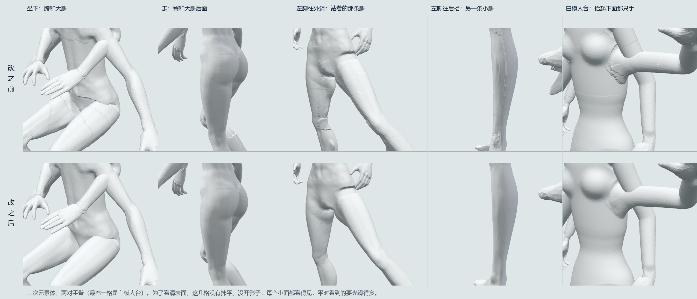

照权重弯，关节转得多也不瘪。手臂举过头顶要转一百多度；照最常见的办法（线性混合：把顶点搬到各根骨骼带它去的位置的加权平均），肩头那一圈一半跟着躯干、一半跟着手臂的点会被拉到正中间，整圈缩成薄薄的一片。两种白模用的是另一种办法（对偶四元数：混合的是「转多少、挪多少」，那些点只是绕着关节转了一个居中的角度），粗细不变；并且手臂是先平举着摆开、融合好、算好权重，再转回垂着的样子的，所以腋下不会连着一片皮，同一个肩膀上的几条手臂也只在肩头连着。

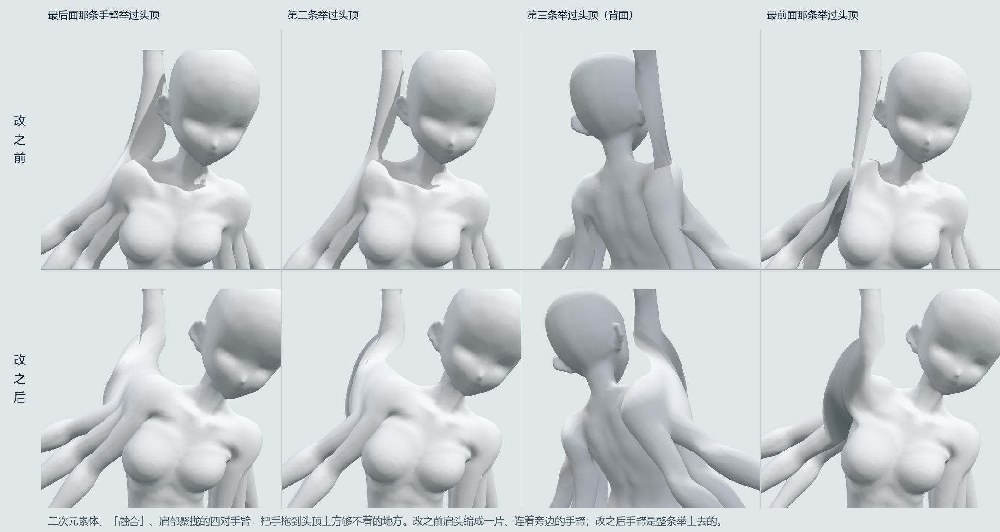

### 圆点怎么用

所有的圆点都是两条规矩：

- **拖**：这个点跟着鼠标（手指）走。
- **点一下**：出现彩色的旋转环，转的是「从这个关节往外的那一段」。点手腕转的是手，点手肘转的是前臂，点肩膀转的是整条手臂。绿色那一圈正好绕着骨头自己拧。点一下空白处、按 `Esc`，或者点左下角小牌子上的 ✕，把环收起来。

拖空白的地方还是转视角。圆点分这几种：

| 圆点 | 是哪里 | 拖它 |
| --- | --- | --- |
| 青色的大圆点 | 手、脚、胯 | **拖手、拖脚**：手肘、膝盖自己跟着弯。够不着的时候身体会跟过去——锁骨、脊柱先朝那边弯（聚在一个肩膀上的几条手臂，锁骨只帮一点点：它一转，这条手臂的肩头就被带离那一团共用的肩膀），脚钉着的话骨盆也跟着折（弯腰去够），最后胯才挪过去。身体帮着转的上限（2026-10-31 放宽过）：骨盆最多折 100°，每节脊柱 65°，锁骨 50°，所以手脚能拖得更远、身子弯得更开。**拖胯**：整个人跟着走，脚钉在原地，腿自己弯；腿伸直了还够不着，胯就到此为止。 |
| 黄色的菱形 | 手肘、膝盖 | 手脚不动，手肘（膝盖）绕着「肩 → 手」那根线转到你拖的那一边。想让手肘朝外、朝后、朝下，拖它。 |
| 白色的小圆点 | 腰、胸、脖子、头、头顶、肩、大腿根、脚尖 | 带着它的那节骨头转过去：拖头顶是歪头、点头，拖脖子根是含胸、挺胸，拖胸是弯腰（下面几节脊柱一起弯），拖腰是整个上身从胯那里倾过去，拖肩是耸肩，拖大腿根是送胯，拖脚尖是踮脚。 |
| 末梢上的白色小圆点 | 尾巴尖、翅膀尖、兽身的后端；成品角色的发梢、裙摆、袖口 | 这些是一串一串的，只在末梢有一个点。**拖它**：整串朝那边弯过去，先弯的是尖上那一截。**点一下**：转的是整串（绕根部），比如把整条尾巴甩到一边、把翅膀收起来。 |

- 多出来的手臂、腿、头，各有各的圆点，名字里带着第几个（「手 左 2」「头 3」）。人马的蹄子、蜘蛛的腿也是「脚」，同样钉得住、拖得动。
- 圆点在屏幕上一直是一样大的，隔着身体也看得见；截图里没有它们。
- 手指在「手势」一栏里摆（见下面的「手势」）。头发、裙摆不会自己垂下来，摆成什么样就是什么样。

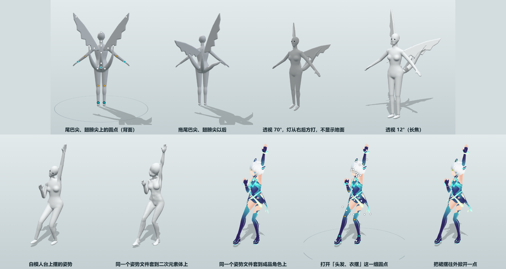

### 「姿势」栏

- **显示哪些圆点**：躯干、头、手臂、腿、手指、「尾巴、翅膀」、「头发、衣摆」七组，圆点太多挡着的时候把用不上的那几组先收起来。「手指」（每根手指的指尖一个）和「头发、衣摆」（成品角色的发梢、裙摆、袖口，有二三十个点）又小又密，平时是收着的，要用的时候再打开。
- **拖别处的时候留在原地的**：「脚」默认开着——拖手、拖胯、转身体的时候脚钉在地上；「手」默认关着——身体动了手跟着走。把「手」打开，手就留在原处（比如手扶着东西蹲下去）。选中某只手、某只脚的圆点以后，还可以单独钉它或者放开它；钉着的圆点外面多一圈深色的边。钉着的那条腿，你直接去拖它、转它的时候照样动。
- **左边 → 右边 / 右边 → 左边**：把一侧手脚的姿势照到另一侧，摆成镜像。是相对身体对称，不是相对地面：身子拧着的时候，两只手相对胸口还是一边一个样。
- **左右翻转**：整个姿势照镜子。
- **落到地面**：整个人上下挪一下，让最低的地方正好贴着地面（蹲下、抬脚以后人会悬空或者陷进地里，点它）。
- **还原这个关节 / 还原成静止姿势**：选中手、脚的圆点时还原的是整条手臂、整条腿，选中胯时连整个人的位置一起还原。
- **保存姿势 / 载入姿势…**：把现在的姿势单独存成一个 `oc_pose.json`（连同看的角度和透视），以后读回来，或者套到别的角色身上——换一种身体样式、换一套部件都行，按骨骼的名字对，对不上的跳过，姿势里没有的骨骼（多出来的手臂、尾巴）保持自己静止时的样子。整份配置文件也能当姿势文件载入，用的是里面的姿势。换了角色腿长不一样，脚会悬空或者陷下去一点，点一下「落到地面」。

几条规则：

- **每次拖动都从按下去那一刻的姿势算起**，和中间经过哪里无关：拖出去再拖回来，就回到原样。
- **骨头的长度不变**，拖多远都不会把手臂、腿拉长。
- **手跟着前臂转，脚保持原来的朝向**（抬腿时脚掌不会跟着小腿翻）。想改手、脚的朝向，点一下手腕、脚踝，用旋转环转。
- **没有关节的限位**，也不拦穿模：手肘可以反着弯，手可以伸进身体里。拖的时候圆点是在「过它自己、正对着镜头」的那个平面上走的，前后的远近要转个视角再调。
- **姿势不跟着静止姿势变**：摆过以后，在「造型」里把 A-pose 换成 T-pose、换身体样式、加减部件，回到「摆姿势」还是原来那个姿势——按骨骼的名字对，每根骨头朝着原来的方向。点预设不会清掉姿势。（还没摆过的时候，换 A-pose / T-pose 换的就是静止姿势本身。）

姿势存在配置里的 `posing` 字段，键是骨骼名（和「带骨骼 GLB」里的骨骼名一样）。姿势文件 `oc_pose.json` 里也是这一段，外加一段 `camera`（镜头在哪、看着哪、透视多大）：

```json
"posing": {
  "version": 3,
  "bones": {
    "Hips": [0, 0, 0, 1],
    "UpperArm_L": [0.0412, -0.0213, 0.3541, 0.9341],
    "Head.002": [0, 0.2955, 0, 0.9553]
  },
  "root": [0, -0.21, 0.03],
  "faces": {
    "Head": { "joy": 1 },
    "Head.002": { "angry": 0.8, "blink_l": 1 }
  }
}
```

- `bones` 里每一条是这根骨骼在世界里一共转了多少，四元数 `[x, y, z, w]`，轴是角色自己的轴（X 左手边、Y 上、Z 前）。上臂、前臂是从「T-pose、手肘朝后」算起的；手掌和手指是从「T-pose、手心朝下、五指并拢伸直」算起的；别的骨骼从各自的静止姿势算起。所以同一份姿势放到 A-pose 的身体上、T-pose 的身体上、另一个角色身上，手臂朝着同一个方向，手心朝着同一面，手指是同一个手势——哪怕两个角色静止时手指一个张着、一个并着。
- 摆过以后，身上的主要骨骼（脊柱、脖子、头、锁骨、四肢、手脚）每根都记；别的（手指、尾巴、翅膀、头发、裙摆）只记自己转过的。没记的骨骼跟着父骨骼走。
- `root` 是整个人（胯）挪了多少，以静止时胯离地的高度为 1，所以高个子、矮个子用的是同一份姿势。
- 把手臂从 3 对减到 1 对，第 2、3 对的姿势不会丢，加回来的时候还在。
- `faces` 是表情，只有成品角色用得上（见「表情和视线」）：哪张脸 → 哪种表情开到多少（0–1）。没有表情就没有这一项。视线不在这里：它是转眼睛的骨骼（`Eye_L`、`Eye_R`），和别的骨骼一样记在 `bones` 里。
- 以前的两版照样读得出来、照原来的意思摆，下次改姿势的时候自动换成新的记法：`"version": 2` 和现在只差在手掌上（那时手掌跟着前臂算，手心朝哪要看这副骨架静止时手是怎么接在前臂上的）；`"version": 1` 记的是「在这个身体的静止姿势上，相对父骨骼又转了多少」。

### 手势

「摆姿势」里的「手势」一栏管手指：

- **摆哪只手**：两只手、左手、右手。有两对以上手臂的时候多一行「哪一对手臂」（全部、第 1 对、第 2 对 …）。下面的手势和滑块只动选中的这几只手的手指，手掌、手臂不动。
- **16 个现成的手势**：放松、张开、并拢、握拳、握着东西、指、剪刀手、三、四、竖大拇指、OK、摇滚、六、手枪、爪、捏。点一下就摆上。手势不分左右手，右手摆出来的是左手的镜像。
- **六个滑块**：拇指、食指、中指、无名指、小指各弯多少（0% 伸直，100% 握到底），「张开」是四指并着还是张开。滑块显示的是选中的第一只手现在的样子。现成的手势不一定正好落在滑块摆得出来的形状上（比如「爪」是指根直着、后两节弯），一动滑块，那根手指就换成从指根到指尖匀着弯的样子。
- **直接拖指尖**：在「姿势」栏的「显示哪些圆点」里打开「手指」，每根手指的指尖上出现一个小圆点，把手放大了拖。整根手指跟着弯；后两节只朝手心那一个方向弯（最多弯 110–125°），不会被拖得往旁边折，往手背最多翘 25°。点一下指尖的圆点，旋转环转的是整根手指（绕指根）。
- 手势和别的姿势存在一起（`posing` 里的 `Index1_L`、`Thumb2_R.002` …）：撤销、左右对称、翻转、保存姿势、带着姿势导出，都带着它。
- 套一个「现成的姿势」，手势会换成那个姿势自己的（见下面「现成的姿势」）。

三种身体样式都能摆，效果不一样：

| 身体样式 | 手指 |
| --- | --- |
| 成品角色 | 用的是她自带的手指骨骼和权重，效果最好 |
| 二次元素体 | 素体模型上现成的手，骨骼放在它原来的关节上，权重也是它自带的 |
| 白模人台 · 分指（默认） | 和二次元素体是同一只手，照白模的手腕放大了一点；骨骼、权重也是它自带的 |
| 白模人台 · 并指 | 四指是连成一片的：握拳、张开、放松这类整只手一起动的像样，「剪刀手」「指」这种一根根分开的摆不出来——到「造型 → 排布 → 手」里换成「分指」 |

白模人台、二次元素体点进「摆姿势」以后，屏幕上的网格会在一两秒里换成更细的一张（左上角的读数从「预览」变成「精细」），身体弯起来更顺；手本来就是一根根分开的，不用等它。部件特别多的身体细不到和导出一样（顶点太多，拖圆点会卡），手机上也少细一些；导出的文件不受这个影响。

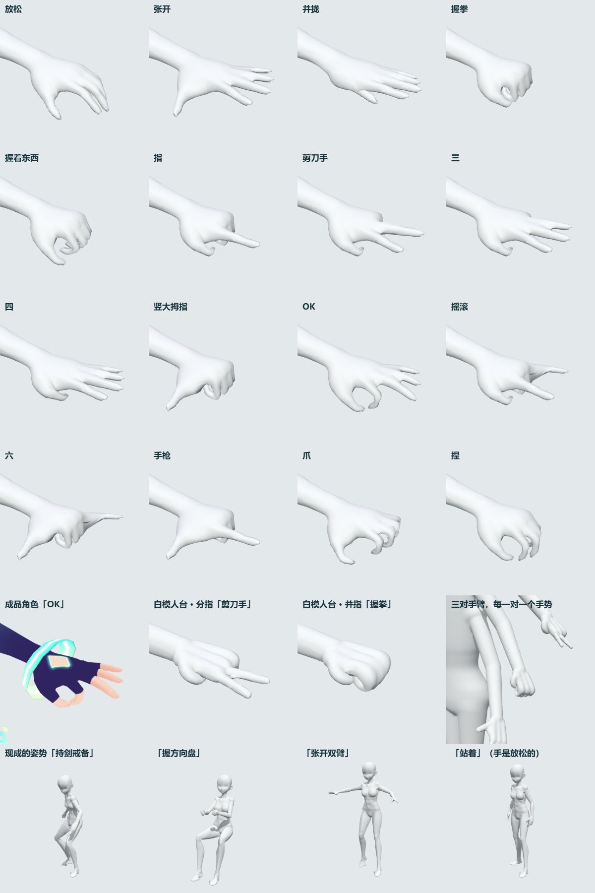

### 表情和视线

只有**成品角色**有（白模人台、二次元素体没有嘴和眼球）。在「摆姿势」里的「表情和视线」一栏：

- **哪张脸**：有几个头（或者一个头上有几张脸）的时候才出现——全部、头 1、头 2 …、脸 2 …。下面的东西只动选中的那几张脸，所以三个头可以一个笑、一个怒、一个哭。
- **表情**：自然、开心、得意、生气、难过、惊讶、`> <`。点一个，整张脸换成它（眉毛、眼睛、嘴一起）。「表情强度」把它调淡。
- **闭左眼 / 闭右眼**：单独闭一只眼。左、右是她自己的左右。
- **嘴型**：闭着、啊、衣、呜、诶、哦，「张多大」调开合。可以和表情叠着用（生气 + 哦）。
- **尖牙**：露出两颗小尖牙，张着嘴才看得见。
- **视线**：「左右」「上下」两个滑块转眼珠；**看镜头**让眼睛看向你现在看她的这个角度（转了视角要再点一次；镜头绕到脑后，眼珠就转到头）；**视线回正**。眼珠能转的范围是角色文件里定的，往外比往里多一些。
- **这张脸还原**：选中的脸的表情和视线一起还原。

表情是加在脸上的，头怎么转它都跟着；在「摆姿势」里截图、导出，脸上就是摆好的表情。套「现成的姿势」不会动表情和视线；「还原成静止姿势」会一起清掉。切回「造型」看到的是没有表情的脸。

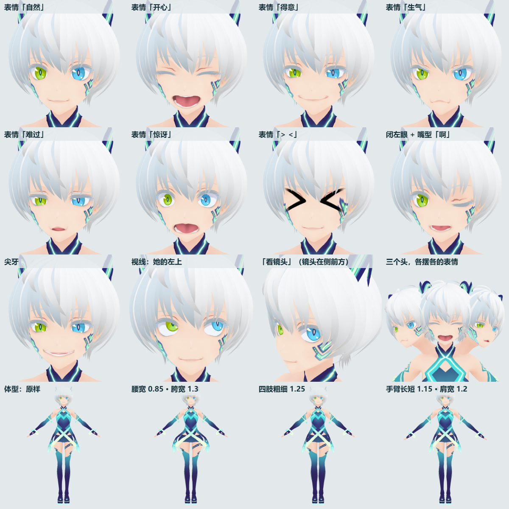

- 表情用的是角色文件里自带的那一套（VRM 的 blendshape）：数据里记的是规定的名字（`joy`、`angry`、`sorrow`、`fun`、`blink_l`、`blink_r`、`a`、`i`、`u`、`e`、`o` …），所以以后换别的角色，表情也套得上。文件里还有更细的（单独的眉毛、眼睛、嘴，一共四十来个），面板上没有全列出来；在配置文件的 `faces` 里直接写它的名字也行（比如 `"BRW_Angry": 1` 是只皱眉）。
- 同一个头上多出来的那几张脸，表情可以各摆各的，眼珠转不了（它们没有自己的眼睛骨骼）。
- 导出的文件里表情是「烘」在网格上的，不是 Blender 里可以再拖的形态键。

### 现成的姿势

「摆姿势」里的「现成的姿势」一栏有 60 个现成的姿势：最前面 8 个是柔和的站姿（自然站立、双手交叠身前、双手背在身后、叉腰、单手叉腰、挥手、比耶、托腮），后面是站着、抱着胳膊、打电话、走、优雅地走、跑、跳、蹲、坐、躺、出拳、举枪、挥剑……点一下就套到现在这个角色身上，并且自动落到地面；不满意接着拖圆点改。「随便来一个」随机挑一个。套上去算一步，可以撤销。

- **柔和的站姿**（2026-10-31 新加）：工坊自己摆的（不来自素材），在默认的二次元素体上用摆姿势的那套工具一步步摆出来：重心落在一条腿上，胯往一边歪、胸口和头往回歪一点；手放到身上的某个地方（胯两边、腰后、小腹前、脸旁、下巴底下），手心朝哪、手指指向哪、手势都摆好。「走」换成两脚一前一后迈开的那一帧（以前是一只脚往后抬的那一帧，不好认），新加「优雅地走」（小步、手贴着身子）。
- **套上去时手臂让开身体**（2026-10-31 新加）：胯调宽、胸调大以后，现成姿势里垂着的手会插进胯里，抱着的胳膊会插进胸里。套上去时一条条看：手臂插进身体比半厘米深的，整条绕肩膀往外转一点（插得最深的那一点沿身体表面退出来），最多转 40°。只有两种白模这样（成品角色的身体不是距离场拼的，量不了）。
- **多出来的手臂跟着原来的那条动**（2026-10-31 新加）：沿躯干上下排的几对、好几个上半身时里侧的手臂，以前保持静止的样子不动，现在跟着同一边第一对做同样的动作——上下排的相对自己静止时转得一样多（还是错开着，「张开双臂」两排一起张开、「抱着胳膊」上下两层各抱一层）；另一个上半身上的照搬朝向（每个上半身各做一整套）。跟着做碰到身体、碰到别的手臂的，往外让、往身前抬一点（最多 30°），还碰着就保持自己静止时的样子（好几个上半身时里侧手臂常常是这样：两个身子挨得近，「站着」「说话」这类做不下，「抱着胳膊」做得下）。

  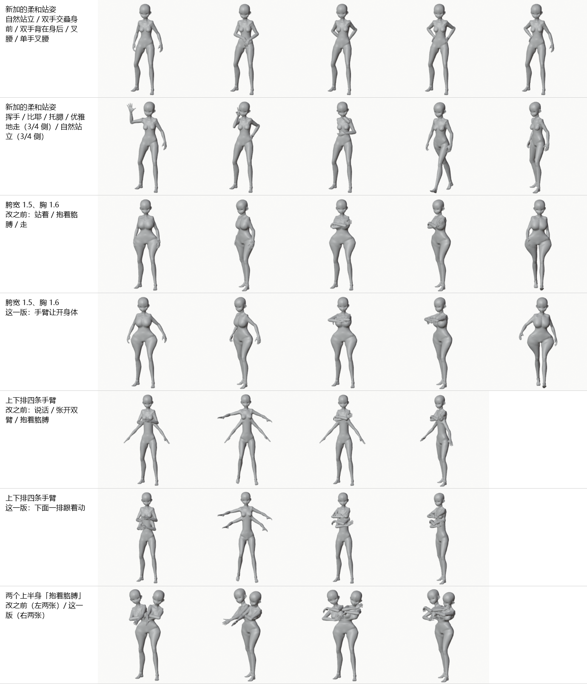

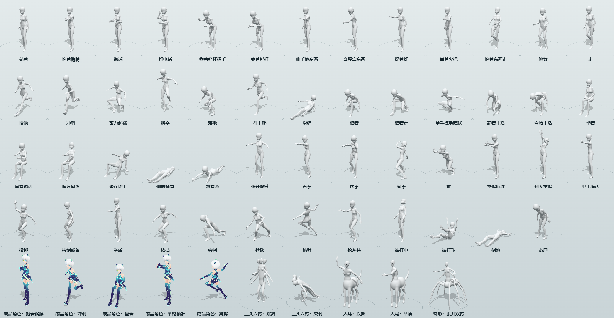

- 这些姿势是给普通人形做的。多出来的头、尾巴、翅膀保持自己静止时的样子（多出来的头跟着身体走）；多出来的手臂见上面一条。
- **肩部聚拢的几条手臂**（挤在同一个肩膀上）不是只摆第一对：先看这个姿势里的手臂和哪一条静止时的方向最接近，那一条正好摆成这个姿势。姿势和它静止时差不多的（站着、走、坐着这类，上臂、前臂都差不到 35°），别的几条跟着转同样多，还是原来那样散开着；差得多的（抱着胳膊、打电话、举枪这类），只摆那一条，别的保持静止时的样子。以前只摆第一对：它被摆成垂着的样子，和本来就垂在肩膀上的最后一条叠在一起。

  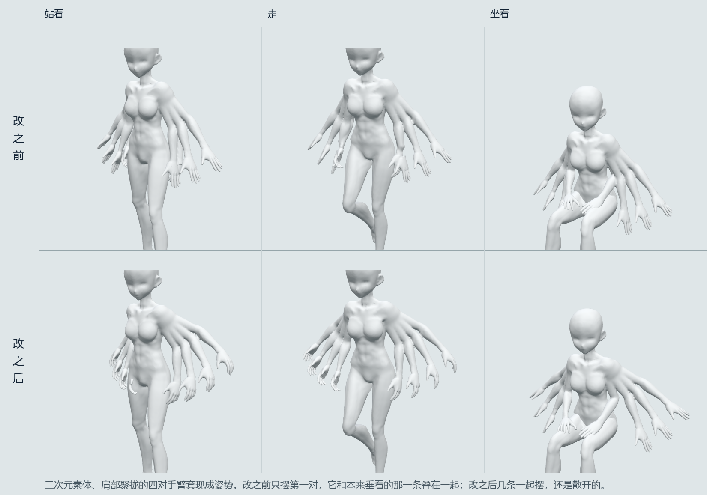

- **表情和视线不动**：现成的姿势里没有脸，套上去以后脸上原来的表情、眼睛看的方向都留着。
- **手指也跟着摆**。素材里特意摆过手的（握方向盘、出拳、拿剑的那只手、打电话、张开双臂）照它的来；素材里很多动作没有摆手、只是攥着拳（站着、走路、靠着栏杆这类），这些换成了自然放松的手。不满意就到「手势」一栏里另点一个。
- **人马、蛛形只套腰以上**：马腿、蜘蛛腿和胯保持静止的样子（「坐着」「仰面躺着」这类靠腿的姿势在它们身上不合适）。人腿人马、前后串联的前一副腿照着摆，后面的不动。
- **腿左右并排、胯部聚拢、横排多胯时每条腿都照着摆**：多出来的几对是同样的腿排在旁边、挤在后面，左边的都照左腿的样子摆，右边的都照右腿（三种身体样式都是；横排多胯是每副胯自己的左腿、右腿）。之后想让哪条腿不一样，拖它脚上的圆点就行。
- **长在中线上的腿不照着摆**：单足、单数条并排正中的那条、前后排最后那条，套现成的姿势时保持站着；它们有自己的圆点（叫「脚 中」「脚 中 2」），拖着摆。
- 除了最前面 8 个柔和的站姿，姿势取自 Quaternius 的 Universal Animation Library 和 Universal Animation Library 2（都是 CC0），是从动作里一帧一帧取出来的，所以有些是动作的中间一瞬（「腾空」「跳劈」「被打飞」）。柔和的站姿是 `tools/build-soft-poses.ts` 摆出来的，写在 `src/pose/softPoses.json`。素材的出处、怎么重新生成，见「开发」一节和 `assets/source/README.md`。

### 镜头和灯光

面板里的「镜头和灯光」一栏（「造型」「摆姿势」里都有），是给截图、当画画参考用的，只影响屏幕上和截图里的样子，不影响导出的模型：

- **从哪边看**：正面、左侧、右侧、背面、俯视、仰视、斜侧。（3D 视图左下角那四个按钮还在。）
- **透视**：镜头的视角，10°–80°，原样是 32°。越大近大远小越夸张（像广角镜头，适合仰拍、伸手到镜头前这类构图）；越小越平（像长焦）。拖的时候镜头会自己退远、拉近，画面里的角色还是原来那么大。
- **灯光左右 / 灯光高低**：主灯绕着角色转多少度、抬多高。影子跟着变。
- **显示地面的影子和参照圈**：关掉以后背景是干净的。
- **透视和灯光恢复原样**。

这几项记在这个浏览器里，不进配置文件、不进撤销。姿势文件里另外存着保存那一刻的镜头位置和透视，载入时摆回去。

## 导出

面板最下面的导出栏有五个按钮。点了以后等下面那行字提示导出完成（融合模式要现算精细网格，一般不到一秒，部件很多时一两秒），文件在浏览器的下载文件夹里。

| 按钮 | 文件 | 里面有什么 | 什么时候用 |
| --- | --- | --- | --- |
| 导出白模（GLB） | `oc_basemesh.glb` | 网格 | 拿去雕刻，最常用 |
| 带骨骼 GLB | `oc_basemesh_rigged.glb` | 网格 + 骨架 + 刷好的权重 | 想直接摆姿势、做动画，或者接着做成 VRM |
| OBJ | `oc_basemesh.obj` | 网格，保留四边面 | 想要四边面的布线，或者对方软件不认 GLB |
| STL | `oc_basemesh.stl` | 网格（三角面） | 3D 打印 |
| 截图 | `oc_basemesh.png` | 当前视角的图，透明背景 | 发给别人看，或者给出图的模型当参考 |

- 融合模式下，每种模型文件里都是一整块封闭的网格 `OC_BaseMesh`；分部件模式下是每个部件一个物体（STL 没有「物体」的概念，所有面写在一起）。
- 单位都是米。GLB 和 OBJ 是 Y 轴朝上、角色面朝 +Z，Blender 导入时会自动转成它自己的 Z 轴朝上。
- STL 是个例外：STL 文件里不记哪个轴朝上，Blender 和切片软件都默认 Z 朝上，所以 STL 直接按 Z 朝上写。切片软件一般把数字当毫米读，导进去要放大 1000 倍。
- 截图里没有地上的圈、选中的高亮、操纵杆、骨骼线和摆姿势的圆点。浏览器窗口越大，截出来的图越清楚。
- **看到什么导出什么**：在「造型」里导出的是静止姿势；在「摆姿势」里（而且真的摆过）导出的是摆好的样子，提示那行字里会写「摆好的姿势」。
  - 白模摆好以后还是一整块封闭的网格，STL 可以直接拿去打印一个摆好姿势的小人。
  - 「带骨骼 GLB」里骨架也是摆好的：摆好的样子就是它的静止姿势，进了 Blender 骨骼都不带旋转，可以接着摆。
  - 分部件模式下，摆过姿势的「导出白模（GLB）」里每个部件还是一个物体，但不再分父子（一个部件自己里面弯过了，比如手肘）。

## 导入 Blender

1. 打开 Blender，菜单 **文件 → 导入 → glTF 2.0 (.glb/.gltf)**，选中下载的 `oc_basemesh.glb`，点「导入 glTF 2.0」。
   OBJ 是 **文件 → 导入 → Wavefront (.obj)**，STL 是 **文件 → 导入 → STL (.stl)**，都用默认设置。
2. 模型出现在世界原点，脚踩在网格地面上。按小键盘 `1` 切到前视图，角色正对着你。

导入后的样子（融合模式，默认）：

- 大纲视图里只有一个物体 `OC_BaseMesh`，是一整块封闭的网格，面的大小很均匀（GLB 只能存三角形，所以每个四边形被对半切开了；要四边面就导 OBJ）。选中它，左上角的模式切到「雕刻模式」就能直接雕，不需要再做体素重构。
- 单位是米，身高和网页左上角的读数一致；物体的缩放是 1，不需要再「应用缩放」。
- 标准人形大约十几万个三角面，部件多的角色会到几十万。觉得太密可以加一个「精简」修改器，或者在雕刻模式里用「重构网格」把体素调大一点。
- 眼睛在网页里只是位置标记，不在导出的网格里。

分部件模式导出的样子：

- 大纲视图里最上层是 `OC_BaseMesh`，下面每个部件是一个独立物体：`Torso`、`Head_01`、`Arm_02_L`、`Chest_01_R`、`Leg_01_L`、`Tail_03`、`Wing_01_L`……
  `_L` / `_R` 是角色自己的左 / 右；眼睛、角、耳朵挂在各自的头下面（`Head_02_Horn_01_L`）。
- 想合成一块：在 3D 视图里点一下躯干，按 `A` 全选，按 `Ctrl + J` 合并；然后在修改器面板里加「重构网格」，模式选「体素」，体素大小填 `0.01` 左右，点「应用」。

### 带骨骼的文件

导入 `oc_basemesh_rigged.glb` 的步骤一样。导进去以后：

- 大纲视图里是一副骨架 `OC_Rig`，网格 `OC_BaseMesh` 挂在它下面，已经带着「骨架」修改器和每根骨骼对应的顶点组（权重）。
- Blender 默认把导入的骨骼画成关节处的一个个小圆球，同时多出一个隐藏的集合 `glTF_not_exported`（里面的 `Icosphere` 就是那个小圆球的形状），不用管它。想看到常见的八面锥骨骼，导入时在对话框右侧展开「骨骼与蒙皮」，勾上「禁用骨骼形状」。
- 骨骼的名字照 VRM / Unity Humanoid 的习惯起，`_L` / `_R` 是角色自己的左 / 右：

| 部位 | 骨骼（从根往末端） |
| --- | --- |
| 脊柱 | `Hips` → `Spine` → `Chest` → `UpperChest` → `Neck` → `Head` |
| 手臂 | `Shoulder_L` → `UpperArm_L` → `LowerArm_L` → `Hand_L` |
| 手指 | 每根三节，都接在 `Hand_L` 上：`Thumb1_L` → `Thumb2_L` → `Thumb3_L`（拇指的第一节是埋在手掌里的掌骨），`Index`（食指）、`Middle`（中指）、`Ring`（无名指）、`Little`（小指）也是 1 → 2 → 3。并指的手也有这些骨骼，四指的骨骼并排在那一片里 |
| 腿 | `UpperLeg_L` → `LowerLeg_L` → `Foot_L` → `Toes_L`（马腿、蛛腿没有 `Toes`）。长在中线上的腿不分左右：`UpperLeg` → `LowerLeg` → `Foot` → `Toes`，第二条是 `UpperLeg.002` …；它的部件叫 `Leg_01`、`Leg_02` … |
| 多出来的同类部件 | 加序号后缀：第二对手臂 `UpperArm_L.002`（它的手指是 `Index1_L.002` …），第二个头 `Neck.002` / `Head.002`，第二对腿 `UpperLeg_L.002` |
| 上下排的多对手臂、多排胸 | 胸腔每多一排多一节 `Chest.002`、`Chest.003`……第二排手臂接在 `Chest.002` 上 |
| 尾巴 | 每条 5 节：`Tail_01_01`（尾根）… `Tail_01_05`（尾尖）；第二条是 `Tail_02_01` … |
| 翅膀 | 每只一根：`Wing_01_L`、`Wing_02_R` … |
| 兽耳 | 每只一根：`Ear_01_L`；第二个头上的是 `Ear_01_L.002` |
| 人马、人腿人马、前后串联、胯部聚拢的腿 | 身后一串 `LowerBody_01`、`LowerBody_02` …，后面的腿和尾巴接在上面（成品角色的前后串联、胯部聚拢也是这样；它的人腿人马不一样：后面那一份是 `Hips.002` → `Spine.002` → `Chest.002` 和 `UpperLeg_L.002` …） |
| 蛛形 | 腹部一根 `Abdomen`，尾巴接在上面；腿都接在 `Hips` 上 |
| 左右并排的腿 | 都接在 `Hips` 上；从中线往外是 `UpperLeg_L`、`UpperLeg_L.002`、`UpperLeg_L.003` …，右边同样 |

角、胸、眼睛没有自己的骨骼：角和眼睛跟着头，胸跟着脊柱。

### 检查骨骼

点一下骨架，在右边的属性面板里找到「物体数据属性」（绿色小人图标）→「视图显示」，勾上「名称」和「在前面」。骨骼的名字就显示出来了，隔着身体也看得见。

### 检查权重

两个办法：

1. **摆个姿势**：点骨架，按 `Ctrl + Tab` 进入「姿态模式」，点一根骨骼，按 `R` 转一转，看网格是不是跟着动、别处有没有被带歪。看完按 `A` 全选、`Alt + R` 把旋转清掉。
2. **看颜色**：点网格，把左上角的模式切到「权重绘制」，在属性面板的「物体数据属性」（绿色三角图标）→「顶点组」列表里点骨骼的名字。红色是完全跟着这根骨骼动，蓝色是不跟。

这里的权重是按「顶点属于哪个部件、离哪根骨骼近」自动算的，够摆姿势检查用，要做正式的动画得在权重绘制模式里再修一修。工坊自己只在两个地方用它：拖着圆点时屏幕上跟手的那张预览，和「带骨骼 GLB」。摆好姿势以后屏幕上换上的、不带骨骼导出的，是照姿势重新融合的（见「摆姿势」开头），不靠权重。

**在 Blender 里关节弯得厉害时会瘪**（举过头顶的肩、腿根、肘弯）：Blender 的骨架修改器默认用的是线性混合。点网格，在属性面板的「修改器」（蓝色扳手图标）里找到「骨架」，勾上**「保持体积」**，就和工坊里摆出来的一样了（工坊里的白模一直是照这个办法摆的）。这一项存不进 GLB 文件，所以要自己勾一下；不勾也能用，只是弯得多的地方细一些。

几条规矩，看权重图的时候对得上：

- **部件交界的地方是过渡**（肩头、腿根各占一些），过渡只沿着连在一起的表面传几厘米。两个部件只是挨得近、表面并不连着的地方（两条小腿的内侧、垂在胯旁边的前臂）互不相干：左小腿上找不到右腿骨骼的权重。
- **垂着的手臂是先平举着摆开再融合的**（A-pose 的所有手臂；T-pose 下「肩部聚拢」的几条也是）：手臂垂着的时候贴着躯干，聚在一个肩膀上的几条还互相挨着，照这个样子直接融合的话，腋下、相邻的上臂之间长长的一段是长在一起的一张皮，一举起来就扯出一片蹼。所以要权重的时候（摆姿势、导出带骨骼的模型）先把手臂平举着摆开——只有一对、上下排的就是平举；聚在一个肩膀上的几对在水平面里前后排成一把扇子——照这个样子融合、算权重，再照权重转回静止的位置。得到的还是一整块封闭的网格，手臂只在肩头和别处连着；导出以后不用在 Blender 里再合并什么。平举正好在「垂着」和「举过头顶」中间，往哪边摆都不用转太多。

  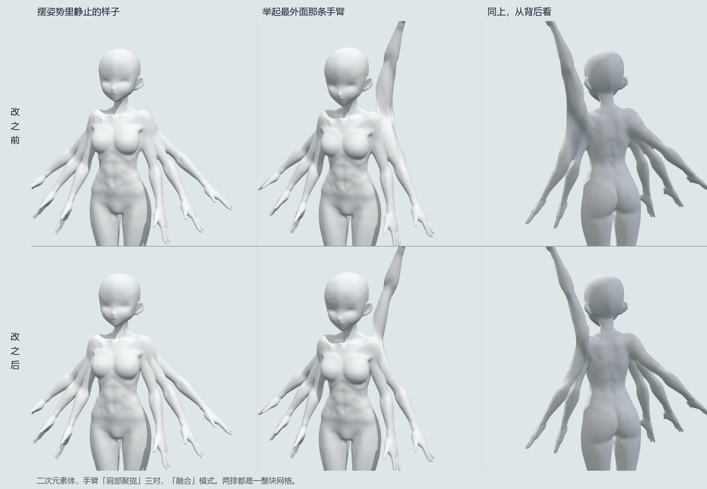
- **同类的部件挤在一起的地方让给父骨骼**：两条腿中间那一道跟着 `Hips`；聚在一个肩膀上的几条手臂，根部融在一起的那一团跟着 `UpperChest`，手臂各自伸出去以后才各跟各的。
- **权重是连续的**：一根骨骼的权重是慢慢减到零的，不会在相邻两个顶点之间突然少一截（那样一摆姿势，那里就裂一道缝）。每个顶点最多 4 根骨骼。
- **分部件模式另有一套**，因为各个部件是互相插着的几块壳，不是一张皮，照一张皮那样过渡会把壳扯破：
  - 一个部件自己的网格只跟着它自己的骨骼，和它接在上面的那些部件的骨骼（腿根跟着胯）。反过来不算：躯干的壳不跟着手臂、腿动。别的手臂、腿就算插在它里面，也不带着它动。
  - 关节上垫着的球（肩、肘、膝）整个跟着从这个关节伸出去的那节骨骼，绕着球心转，看上去还是原地那个球。
  - 根上垫着球的部件（手臂；白模人台的腿）是球形关节：整条只跟自己的骨骼，绕着球心转，切口有球盖着。锁骨 `Shoulder_L` 在躯干里，手臂的网格上没有它的权重。
  - 手用的是手模型自带的权重，和融合模式一样。

  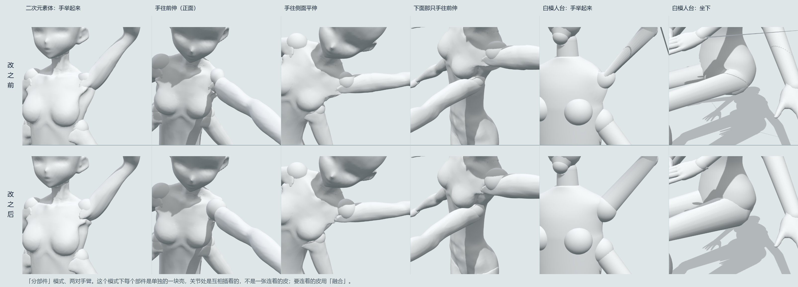

## 配合 Tripo 使用

白模没有脸、头发、衣服，这些细节还是要靠 Tripo 来生成。白模能帮上忙的地方有四处，按用得上的程度排。

### 1. 给出图当身体参考

多肢体的身体，出图的模型很容易画错：手臂的数量不对，或者每张图里接的位置不一样。先在这里把身体结构定下来，截图给它当参考。

1. 姿势切到 T-pose（身体图要「手臂张开」）。
2. 依次点「正面」「侧面」「背面」，每个视角点一次「截图」。
3. 把截图和角色设定一起交给出图的模型，说明「身体结构照参考图：几对手臂、接在哪里、几条尾巴」，再写清楚它只是结构参考，不要照抄白色、没有五官的外观。

截图是透明背景、带着头的。身体图不要头的话，让出图的模型去掉，或者自己裁掉。出图本身的要求（正方形、纯色背景、平光无投影、头 / 头发 / 身体分开出）照原来的流程。

### 2. 在 Blender 里当摆放的架子

Tripo 一次生成一个部件。多出来的手臂、头要自己复制、摆位，这时候把白模导进去当架子：

1. 导入 `oc_basemesh.glb`。用分部件模式导出的话，每条手臂、每个头都是独立的物体，名字（`Arm_02_L`、`Head_02`）和位置一目了然。
2. 把 Tripo 的部件缩放到和白模一样大，对到白模上相应的位置：小键盘 `1` / `3` / `7` 切视图，`G` 移动、`R` 旋转、`S` 缩放。
3. 对好以后按 `Ctrl + A` →「全部变换」。白模用完按 `H` 隐藏，或者删掉。

白模是按米做的、缩放是 1，所以拿它当标准，改 Tripo 的部件去配它。

### 3. 给多肢体的角色提供骨架和权重

Tripo 的自动绑定用的是标准人形的骨骼（VRM、Mixamo 那一类），多出来的手臂、头、尾巴没有对应的骨骼。这是按它提供的骨骼类型推断的，没有拿多肢体的模型实际试过。

这种角色可以反过来：用带骨骼的白模当权重的来源，把权重传给 Tripo 的身体。

1. 导入 `oc_basemesh_rigged.glb`，得到骨架 `OC_Rig` 和白模 `OC_BaseMesh`。
2. 把 Tripo 的身体对齐到白模上（大小、位置、姿势越接近越好），按 `Ctrl + A` →「全部变换」。
3. 点身体，在属性面板的「修改器」（扳手图标）里 **添加修改器 → 编辑 → 数据传递**。
4. 修改器里：「源物体」选 `OC_BaseMesh`；勾上「顶点数据」，点亮下面的「顶点组」；「映射」选「最近的面插值」；点「生成数据层」。
5. 点修改器右上角的小箭头 →「应用」。
6. 先点身体，再按住 `Shift` 点骨架 `OC_Rig`，按 `Ctrl + P` →「骨架形变」（不要选带「自动权重」的那几项，那样会把刚传过来的权重冲掉）。
7. 按上面「检查权重」的办法摆几个姿势：抬手、弯腰、转头。白模用完隐藏或者删掉。

这套步骤用一个布线完全不同、大小差 2% 的网格在 Blender 5.2 里试过，权重能传过去，骨骼能带着它动；没有拿真正的 Tripo 模型试过。衣服和身体离得远的地方（裙摆、宽袖子）传过去的权重不会好，要自己修。

尾巴的 `Tail_01_01` … `Tail_01_05` 和兽耳的 `Ear_01_L` 本来就是一节一节的，之后做会晃的尾巴、耳朵时可以直接拿来用。

### 4. 把白模直接上传给 Tripo

用不带骨骼的 `oc_basemesh.glb`：一整块封闭的网格，单位是米。

Tripo 官网写的是可以上传 OBJ、FBX、GLB、STL 格式的模型。这一步没有实际上传试过，面数和文件大小的上限以它页面上的提示为准。白模有十几万到几十万个三角面，嫌大的话先在 Blender 里加「精简」修改器降一降。白模没有 UV，也没有贴图。

## 常见问题

**终端里说「npm 不是内部或外部命令」。** Node.js 没装好，或者装完以后没有重开终端。装好以后把终端关掉重开。

**浏览器没有自动打开，或者打开的不是 5173。** 看终端里 `Local:` 后面的地址，照着在浏览器里打开。5173 被别的程序占着时，它会自动换成 5174 之类的。

**切到「二次元素体」或「成品角色」时提示「没载入成功……连不上工坊的程序」。** 页面还开着，但工坊的程序已经关了（终端里的 `npm run dev` 停了，或者 exe 的黑色窗口被关掉了）。这两种样式的数据是用到时才取的，程序关了就取不到；白模人台不用取数据，所以还能动。把程序重新打开，回到这个页面，它会自己再试一次。

**左边是空的，写着没能启动 3D 显示。** 浏览器的 WebGL 没开。换新版的 Edge 或 Chrome，或者在浏览器设置里打开「硬件加速」。

**模型比滑块慢半拍。** 融合网格是在后台算的。部件少的时候几乎跟手；部件很多时（比如九尾六翼再加几对手臂）要等零点几秒到一秒。界面本身不会卡。想摆位的时候跟手一点，可以先切到「分部件」模式，摆好再切回来。

**算细的网格时 CPU 一下子占满。** 细一点的网格（停下来以后的预览、摆姿势松手以后、导出）是几个线程一起算的：电脑上是 CPU 核数减 2、最多 6 个帮手，再加上本来那个线程；手机上最多 3 个帮手。算完就闲下来。同时开着游戏之类很吃 CPU 的程序时，两边都会慢一些。

**想知道拖滑块时有多少帧。** 在地址后面加上 `?fps`（也就是打开 http://localhost:5173/?fps ），左上角的读数里会多出一格帧率。

**读数后面出现「网格分成了 N 块」。** 有部件没连上身体，多半是手动微调把它拽开了。把它挪回去，或者在「手动微调」里点「全部还原」。

**导出的文件在哪。** 在浏览器的下载文件夹里（一般是「下载」）。

**Blender 里骨骼是一个个小圆球。** 这是 Blender 导入 glTF 时的默认画法，见上面「带骨骼的文件」。

**想从头开始。** 点预设里的「标准人形」，体型滑块不会跟着复原，要自己拖回去。想彻底清空的话，在页面上按 `F12`，切到「控制台」，输入 `localStorage.clear()` 回车，再刷新页面。

## 已知的限制

- **脸很简单**：白模人台只有眼窝、鼻子的一点凸起和下巴，没有嘴，人耳只是两个小鼓包；二次元素体的眼睛是两个浅碟，嘴是一道浅痕。白模是雕刻的起点，不是成品。
- **眼睛只是位置标记**：融合模式下不在导出的网格里；分部件模式下是独立的小物体。
- **拖动时的预览比导出的粗**：拖滑块、改数量时屏幕上是粗的一张，细的地方（耳朵尖、角尖、眼睛、嘴）会发糊、有锯齿；停下来四分之一秒后换成细的一张（和导出的一样细；部件特别多的身体、手机上细得少一些）。手、二次元素体的脚是缝上去的现成网格，什么精度下都是分开的手指、脚趾。
- **权重是简单算的**：够检查、够摆姿势，做动画要再修。手指的权重也是自动算的：相邻两根手指一根弯着一根直着的时候，指缝那里的皮会被拉成薄薄的一片；拇指张得很开时虎口也是。
- **手动微调不拦人**：把部件拽进别的部件里、拽离身体都不会被阻止，只有左上角的提示。
- **白模摆好以后的关节像球形关节的人偶**：手臂、腿的每一段是整段转过去的，关节处补一个圆，没有肌肉、肩胛的造型；二次元素体的手臂抬高以后，肩头换成一个圆肩头（没抬高时还是本来的肩膀），它和躯干之间有一道折，躯干上原来接手臂的那一圈边不太平整。躯干是顺着弯的，弯得很厉害时肚子那一侧会挤出一道折。拿去雕刻的话这些地方要自己补。
- **二次元素体只有手臂选了「肩部聚拢」的才重新融合**；一个肩膀上只有一条手臂的还是照权重弯的那一张。重新融合的时候，腿是融合完以后照权重搬过去的，和拖动时看到的一样（弯得厉害的地方会鼓一点、里侧起一道折）。融合是照「腿还垂在胯下面」的样子做的：手臂要是正好穿过那个位置（腿抬走了，手却伸在腿原来垂着的地方），照做法会和还没搬走的腿融在一起，腿搬走以后那一处被扯出几条拉长的面。逐个试过 51 个现成姿势：肩部聚拢两对、四对时各有 25 个有这种面（蹲、坐、弓步、劈砍这类腿动得多的，最长 5–20 厘米），还没修。手腕插进了那条还垂着的腿里的手缝不上：这时不挖那条腿（挖了的话，挖掉的坑会跟着腿搬过去露在腿上），手就封好口叠在原处。
- **拖着圆点的时候看到的不是最后的样子**：那是静止的网格照权重跟着骨骼动的预览，肩头会鼓、手臂之间会扯着皮；松手以后不到一秒换成重新融合的那张才是准的（更细的一张要再等一两秒，部件多、姿势复杂时两三秒）。手机上更慢，没有实测过。
- **摆好以后插在一起的地方会并成一块**：手臂穿过了身体、两条腿叠在一起，重新融合时它们就是连着的（照权重扯的时候是互相穿过去）。
- **还有少数手缝不上**：51 个现成姿势里，白模人台 0 个、三对聚拢 1 个（丧尸）、二次元素体两对聚拢 3 个、四对聚拢 8 个有手没缝上（改之前是 1、5、14、21 个）。素体剩下的多半是手腕插在那条还垂着的腿里（见上面「二次元素体只有……才重新融合」那一条）。缝不上的手各自封好口叠在原处，和身体不相连——看上去差不多，但网格不止一块了，导出时会提示「分成了几块」，把手拿开一点就好。缝上了的，被挤的那一边留着一道贴着手腕的浅槽：深一厘米上下，边上是一道折线（抱着胳膊时压在另一条前臂上那种）。对比图：[docs/hands-carve.png](docs/hands-carve.png)。
- **「带骨骼 GLB」里的网格不是重新融合的那张**：它是静止的网格配上权重（摆过姿势的，是照权重搬过去的），这样网格、骨架、权重才是配套的，进了 Blender 能接着摆；关节转得多的地方就是「扯」出来的样子。要摆好的成品，导不带骨骼的 GLB / OBJ / STL；带骨骼的进了 Blender，在骨架修改器里勾上「保持体积」才和工坊里拖动时看到的一样（见「检查权重」），不勾的话举过头顶的肩会细一圈。
- **手动把手臂拉长、加粗，手不跟着变形**：手只跟着手腕挪过去，大小照手腕那里的粗细等比变：只拉长、缩短时手不变，加粗 1.5 倍手也大 1.5 倍（2026-10-31 以前是照拉伸的平均倍数，拉长 1.8 倍手大两成，手臂缩短很多时手腕接不上手）。更早的时候手也被拉成 1.8 倍长，手指成了几根细长条，一握拳就拧。对比图：[docs/hand-stretch.png](docs/hand-stretch.png)。二次元素体的脚同理（以脚底为中心变）。
- 成品角色摆姿势用的是她自带的权重（照线性混合画的），混合的办法和白模一样是对偶四元数：关节弯得厉害时不会被挤瘪，但个别地方会比她本来的样子鼓一点。拼她的时候那一步（头、胸要缩放）还是线性混合。
- **分部件模式的关节是互相插着的壳**：手臂举得很高时肩头的球会露出来一块，二次元素体的上臂根部和肩口之间有一道折；这是这个模式本来的样子（像球形关节的人偶）。要一张连着的皮，用「融合」。
- **白模拖动时的预览（和导出带骨骼的模型）用的网格，和造型里的不是同一张**：手臂是先平举着摆开、融合好、再转回原位的（见上面「检查权重」里的说明），所以手臂垂着时肩头、腋下的样子和「造型」里略有不同；「肩部聚拢」时几条上臂是各自分开、叠在一起的。松手以后换上的那张没有这个差别。
- **同一个肩膀上的几条手臂共用一团肩头**：重新融合以后各条摆开了的手臂是分开的，只在根部（离肩关节 8 厘米以内）融在一起；还挨着、叠着的几条（没动的、一起抬的）是并在一起的，和「造型」里一样。拖动时的预览和带骨骼的导出里，只举起其中一条时，它和旁边那条之间会带起一小片皮（几厘米到十厘米，手臂越多越明显）。它们的锁骨也基本不帮忙（最多转 8°），所以往高处够的时候是脊柱在弯；想耸肩可以自己点肩膀上的圆点转。
- **融合模式下，静止时就贴在一起的地方摆开以后也是连着的**：比如把胯调得很宽、手臂调得很长，手垂下来碰到了大腿，融合时两处就长在了一起。左上角有「部件重叠」的提示时留意一下。
- **表情只有成品角色有**，而且只有角色文件里带的那几种；导出以后是烘在网格上的，进了 Blender 不能再当形态键拖。`> <` 那种眼睛是另一片贴上去的图，离得很近、从侧面看是平的。
- **十个成品角色只有默认的那个各种形态都细看过**；另外九个是一批批拼出来看的（单人、三头六臂、三张脸、人马、蛛形、人腿人马、加尾巴翅膀、换发型染发、摆姿势和表情），大毛病没有，长裙长发接多个头时穿模比短发的多。
- **成品角色的体型是硬拉的**：肩宽、腰宽、胯宽、四肢粗细、手臂长短直接改顶点，衣服的花纹会跟着拉宽；胯宽调到很大时裙摆撑成一把伞。
- **腿胯部聚拢时大腿根挤成一束**：几对腿的大腿上半截叠在一起，到膝盖往下才分开（穿模检查只查膝盖以下）；腿多了侧面看屁股往后厚一些，五六对时脚铺开一米多宽。成品角色的几副胯是一层层叠着的，侧面看得到后面几层短裤、裙摆的边。
- **摆姿势没有关节限位，不防穿模**（只有拖指尖的时候，手指的后两节有限位）；握拳时拇指是压在四指前面的，手大手小不一样，会压进去一点或者悬着一点；头发、裙摆、尾巴不会自己垂下来、甩起来，要一个个摆。
- **姿势换到别的角色身上是照骨头的方向对的**：手臂朝向一样，但每个角色的胳膊、腿长短不同，手脚落的位置会差一点（原来手扶着腰的，换过去可能离腰一指宽）；腿、脊柱、头是照「从静止姿势转了多少」对的，两个角色静止时站姿略有不同，腿的方向会差一两度。左右对称只认名字里带 `_L` / `_R` 的骨骼：多个头、多条尾巴之间不会互相对称。
- **摆姿势时屏幕上的网格比平时细**（最细和导出的一样；部件特别多的身体、手机上细得少一些），导出时仍然另算一张；刚点进「摆姿势」时要等一下（一两秒）圆点和网格才对得上、手指才分得开。触屏上的拖动只在电脑里模拟过，没有拿真机试过。
- **成品角色不是白模**：各块互相插在一起、不融合，接缝生硬；人马、蛛形的兽身是另外捏的单色部件，和她不是一种画风；人腿人马身后那截腰是把她的腰拉长了折过去的；前后串联的腿是几副胯互相插着排的，一副胯上三条以上腿时胯中间那一段是复制排开的；手动微调是照骨骼挪顶点，挪远了连着身体的地方会拉长。详见「成品角色」一节。
- **二次元素体的体型是在素体上拉的**：滑块拖到两头（四肢粗到两三倍）时样子很卡通，大腿、膝盖贴在一起；多个头时多出来的脖子、第二排以后的手臂这些地方比较粗糙；穿模检查对它只是粗略地查。详见「二次元素体」一节。
- **体型滑块全部同时拉到最小**（体格、肩宽、腰宽、胯宽、四肢粗细、手臂长短、腿长短都到头）时，二次元素体配蛛形、胯部聚拢下身，会有一只手或一只脚缝不上（各自封好口叠在原处，网格多出一块）。单拉哪一个、拉到最大都缝得上：随机加极端的 448 个组合里只有这 2 个。
- **二次元素体手动缩放、挪动「躯干」时大腿根有一圈接缝**：素体原装的两条腿和胯是严丝合缝拼上的，胯（「躯干」）单独放大一两成、挪一点，大腿根那一圈就对不齐了。要改胯的宽窄用「胯宽」滑块。
- **二次元素体的脚是 Kotori 的（CC BY）**：导出的模型发出去时请署名「脚部网格 © Fox Jump（Kotori），CC BY」，见「二次元素体」一节。
- **多个头只有两种长法**：凑成一簇，或者一个头几张脸。凑成一簇时头和头之间压着的那一道是一条凹缝，里侧的耳朵没有了；四五个头时每个头小一圈，挤得也更紧。一个头几张脸时，白模人台和二次元素体上朝两边的脸只是从头的侧面鼓出来的一张脸的轮廓，要进 Blender 再雕。想要别的样子（比如头上下叠着、长脖子的九头蛇）得自己在 Blender 里改。
- **人腿人马只有站着的样子**：四条腿都是直直站着的，后腿和前腿一模一样；白模人台和二次元素体上，中间那截腰是一段光滑的体块，没有肋骨、肚子的造型。
- **兽身只有大的体块**：马身有前胸、腰身、后臀和带关节的腿、蹄子，蜘蛛身有头胸部、腹部和分节的腿，都没有肌肉、甲壳的细节。马没有鬃毛，尾巴要自己加（加一条尾巴就长在马身后端，是往上翘的那种，不是垂着的马尾）。
- **头发只有四副现成的**：不能一缕一缕地改，也不能像 VRoid 那样自己画。白模上的头发是从面片转过来的一层壳，细的发丝并在了一起，垂在肩前、背后的发梢会插进肩膀和后背里（融合以后连成一体）；戴了长发、双马尾，转头时头发是整个跟着头转的，不会自己垂下来。头发和头皮之间封着的空腔去掉了，但从发梢底下往里看（比如波波头的后颈）还是看得到头发和头之间的空隙。
- **好几个上半身是新做的**：两种白模上两三个上半身 ×（头 1–5、手臂 0–4 对、胸 0–4 对、上下排 / 肩部聚拢、A / T）都查过不穿模，各种腿的排法在四条腿以内也查过；六条以上的腿（蛛形、左右并排）配上体型滑块拉到最大时，个别靠下那排的手臂会碰到蛛腿、加宽的胯（左上角会提示）。里侧的手臂是往前伸着的，几个上半身中间连着的地方（V 字的底）是一道折；体格很大、肩很宽时上半身歪得多，腰两侧往外张得比较急。成品角色的两份上半身在腰上、背后中间是互相插着的，衣服花纹在那一带交叉；里侧的手臂是往前伸着的，宽袖子会在胸前挤在一起。
- **横排多胯是新做的**：两副胯并在一起的地方，白模人台背后正中那道缝看不出来（躯干自己的胯盖在上面）；单数条腿时正中那副单腿的胯窄，二次元素体上露出素体自己的胯下，和两边的胯不太像；腿多了手臂往外张开（让开很宽的胯）。成品角色的几层裙摆叠在一起。
- **两个人并成一个宽躯干只在二次元素体、横排两副胯（4 条腿）、一个上半身、两个头时**：白模人台、成品角色，三个头、6 条腿这些还是原来的样子。肚脐被横着拉宽到差不多两倍，两副胯在胯下正中接上的地方有一道浅沟；手臂上下排时胸腔加长，躯干看着像一个长方块。
- **套姿势时让开身体只管手臂**：腿、尾巴、头发不管；手臂之间只管多出来跟着动的那几条；让开是整条手臂绕肩膀转，有时手离开原来扶着的地方一点。好几个上半身时里侧的手臂大多做不下现成的动作，保持静止时往前伸的样子。
- **两个上半身时胸跟着躯干一起分**：融合多花两成左右的时间（只有二次元素体两个、三个上半身时）。
- **没有试过的事**：没有用 VRM 插件实际转过 VRM，没有把模型实际上传到 Tripo；Blender 里的检查是用脚本做的（导入、查网格、查骨骼和权重、摆姿势渲染），没有逐项在界面上点过。

## 开发

```powershell
npm test          # 单元测试（1242 个）
npm run typecheck # 类型检查
npm run build     # 打包到 dist 文件夹
npm run pack      # 打成一个 exe 和 zip，放在 release 文件夹（见「安装和运行」）
npm run apk       # 打成安卓安装包，也放在 release 文件夹（见「安卓手机：打成安装包」）
node tools/run.mjs tools/build-poses.ts   # 重新从动作素材里取现成的姿势（平时不用跑）
node tools/build-anime-body.mjs   # 重新生成二次元素体的数据（平时不用跑）
node tools/run.mjs tools/build-hand.ts   # 重新从素体上取那只手（平时不用跑）
node tools/build-hair.mjs         # 重新从样例模型里取头发（平时不用跑）
```

**穿模检查**：用 `npm run dev` 运行时，每次参数停下来都会自动检查有没有部件明显插进别的部件里（超过 2 cm）。有的话，左上角读数后面会多出一条橙色的「开发提示：N 处穿模」，浏览器控制台（`F12`）里有完整的清单。部件在连接处本来就长在一起（肩膀埋在躯干里、尾巴根埋在臀部里），这些不算；多个头是脸贴着脸、互相压着一点的，也不算（一个头压进另一个头三成以上才报）。自动测试里也会把各种部件数量、排法和极端体型都跑一遍。这个检查是近似的：把部件当成一串圆棒来比，不查翅膀和眼睛。

**监控测试接口（给 agent 用）**：开发服务器上有一组 `/__agent/` 接口，`npm run agent -- model` 读页面里正在跑的模型，`npm run agent -- server` 看开发服务器，`eval` 在页面里跑一段 JS，`shot` 截 3D 视图，`logs` 看服务器和页面的日志；浏览器面板藏着也能用。只认本机的请求，打包出来的网页、exe、apk 里没有它。说明见 [docs/agent-monitor.md](docs/agent-monitor.md)。

**约定**：单位米，Y 轴朝上，角色面朝 +Z；`_L` / `_R` 是角色自己的左 / 右。解析、摆位、网格、骨骼、文件写出都是不碰界面的纯函数，放在各自的文件夹里，界面只在 `src/main.ts` 和 `src/view/`。

| 路径 | 内容 |
| --- | --- |
| `src/model/spec.ts` | `BodySpec` 数据模型：部件数量、体型、排布、手动微调；读入 / 保存 |
| `src/model/presets.ts` | 12 个预设 |
| `src/model/overrides.ts` | 修改手动微调的小工具（改一项、对侧镜像、还原） |
| `src/model/history.ts` | 撤销 / 重做 |
| `src/model/partLabel.ts` | 部件名 → 中文名字（`Arm_02_L` → 「手臂 2 左」） |
| `src/parser/` | 文字 → 部件数量（`parse.ts`），部件数量 → 规范中文描述（`describe.ts`） |
| `src/geometry/layout.ts` | 摆位：`BodySpec` → 一串部件实例（位置、朝向、由哪些基本体组成、带哪些骨骼） |
| `src/geometry/bodyPlan.ts` | 多头、多臂的身体怎么长：三种身体样式共用的规矩（头怎么凑成一簇、脖子怎么接、头多了小多少、一个头上的几张脸各朝哪边、扇形聚拢的肩关节放哪、胯部聚拢的腿往外散多少） |
| `src/geometry/head.ts` | 头：颅骨、下颌、鼻子、眼窝，以及贴着头表面放的眼睛、角、耳朵；戴了头发，角和耳朵改贴着头发的外面放 |
| `src/geometry/wig.ts` | 白模人台和二次元素体头上的头发：照这个头的颅骨套上去，调长短和蓬松 |
| `src/geometry/tweak.ts` | 把手动微调套到摆好的部件上（位置、角度、大小；子部件跟随） |
| `src/geometry/clash.ts` | 穿模检查：找出明显互相穿插的部件 |
| `src/geometry/figure.ts` | 摆位结果的数据结构 |
| `src/geometry/torso.ts` | 躯干截面 |
| `src/geometry/partsMesh.ts` | 把部件做成网格（分部件模式，v1 的做法） |
| `src/sdf/field.ts` | 把部件编译成有符号距离场（SDF），不同类部件之间用 smooth-min 融合；同类部件平时是硬接，标了「只在根部圆滑」的（聚在一个肩膀上的几条手臂）在根部互相融合、往外逐渐变回硬接 |
| `src/sdf/surfaceNets.ts` | Surface Nets：从距离场取出一整块封闭的四边形网格。网格分成 8×8×8 的小块，每个小块只算离它不远的基本体（斜着放的按它自己那个斜的盒子判断）。分三段：分小块（`planBlocks`）、在格点上求值（`evaluateBlocks`）、补实取面；先在别处算好的小块经 `BlockMemo` 交进来照抄（`keepBlocks`），同一个场挖开几处再融合一遍时，离那几处远的小块也照抄上一遍的值 |
| `src/sdf/mesh.worker.ts` | Web Worker：在后台线程里做融合和蒙皮，拖滑块不卡界面。大活里格点求值那段分给帮手线程一起算，算到一半作废了就停下 |
| `src/sdf/eval.worker.ts` | 帮手线程：照任务自己编译场、准备算权重要用的那些，替网格 Worker 在分给它的小块上求值、算分给它的那段顶点的权重（`parallel.ts` 的 `helperDesk`）。几个网格 Worker 共用一组（电脑上核数减 2、最多 6 个，手机上最多 3 个），在 `meshClient.ts` 里建 |
| `src/sdf/parallel.ts` | 怎么分：小块一份一份地分，谁空了谁拿；都分出去以后，没交回来的那份网格 Worker 自己也算（帮手慢、出错、没了都不会卡住）。拖动时那种粗的小活不分。要权重的，权重的第 1、3 步也按顶点分段分出去 |
| `src/sdf/job.ts` | 后台线程接的一个融合任务（照姿势融合、带权重、只要网格）：分成「编译出场」和「收尾」前后两半（`stageJob`），中间可以先把场的小块拿到别处算好再交回去，结果逐个顶点一样 |
| `src/sdf/pick.ts` | 点选：融合网格上的一点属于哪个部件 |
| `src/sdf/fork.ts` | 好几个上半身从胯上分出去的那种变形：部件整个转、挪过，但从胯往上渐渐才转足、挪足；挪和转可以各有各的一段；求距离时找回分开之前的那一点（带导数的牛顿法，跳出范围就二分），距离照那一点附近被拉伸、压扁了多少缩一缩（同一个导数直接算出来）。采样好的格子、放样的躯干都用它 |
| `src/sdf/grids.ts` | 采样好的形状：存在三维格点上的距离场，求值时在格点之间插值（镜像、加长、切掉一截并把切口的棱倒圆、弯一下、斜过去、两块之间混合；头发那种只有一层面片的，按离面片多远算成一层壳）。占的范围按表面实际占的地方算，不算格子四周的留白 |
| `src/anime/body.ts` | 二次元素体：把数据登记成一块块形状；关节、切口的位置在 `bodyMeta.json` |
| `src/anime/hand.ts` | 现成的手：白模人台（分指）和二次元素体共用的那只手的网格、权重、关节（数据在 `handMesh.json`，由 `tools/build-hand.ts` 从素体上取下来） |
| `src/sdf/graft.ts` | 把现成的手缝到融合出来的身体上：在手腕处切开身体，把开口照手的切口收一收，两圈之间缝一圈三角面。两只手腕长在一起的一起切、中间加隔梁分成两圈；找不到开口的把切口往手肘挪，中间接一段管子 |
| `src/hair/shapes.ts` | 白模戴的头发：把数据登记成形状，一副一份，用到时才取；尺寸在 `hairMeta.json` |
| `src/geometry/animeLayout.ts` | 二次元素体的摆位：各块怎么拼、多出来的头和手臂接在哪 |
| `src/character/source.ts` | 成品角色：从 VRM 文件里读出网格、贴图、骨骼和蒙皮 |
| `src/character/pose.ts` | 照蒙皮权重给骨骼摆姿势，并把摆好的样子定成新的静止姿势。两种混法：线性混合（成品角色）和对偶四元数（白模，关节转得多也不瘪） |
| `src/character/face.ts` | 成品角色的表情和视线：一张脸的表情 → 脸上每个顶点挪多少（头被复制、转过方向、放大过的，位移跟着换算）；视线 ↔ 两只眼睛的骨骼转多少；看向一个点 |
| `src/character/tweak.ts` | 成品角色的手动微调：照骨骼分出部件（和白模人台同名），把微调套上去（顶点照权重挪，骨骼、表情的脸跟着转），点选、选中高亮 |
| `src/character/assemble.ts` | 成品角色的拼装：换发型、染发，复制头、脸、手臂、胸，拉长躯干，去掉腿接上兽身，或者在身后再接一副腰、胯和腿（人腿人马），或者把胯和腿复制几份前后排（前后串联），一副胯上三条以上腿时把胯中间那一段照原样复制几份排开（左右并排），摆姿势，整理骨架 |
| `src/character/extras.ts` | 成品角色身上另外捏的尾巴、翅膀、角、兽耳 |
| `src/character/beast.ts` | 成品角色的兽身（马身、蜘蛛身）：照白模人台的做法捏出来，融合成一块网格，算好蒙皮，记下来反复用 |
| `src/character/export.ts` | 成品角色写成 GLB / OBJ / STL 用的数据 |
| `src/character/hair.ts` | 换发型用的头发文件怎么读：一块头发网格，加上原主人的头有多大、头的关节在哪 |
| `src/character/roster.ts` | 能选的角色清单：每个的文件、原名、作者、许可、来源，自带的兽耳是哪种材质、染发改哪种材质 |
| `src/character/load.ts` | 取角色和头发的文件（选到哪个取哪个，内存里最多留三个）；量头发的颜色；染发用的浅色贴图 |
| `src/io/glbSlim.ts` | 给角色文件瘦身：用不到的贴图换成占位图（`tools/build-characters.ts` 加工角色文件时用） |
| `src/io/glbRead.ts` | GLB 读取器（读成品角色的文件用） |
| `tools/build-anime-body.mjs` | 把 `assets/source/` 里的素体加工成数据：只取皮肤、磨圆、按骨骼权重拆块、封口、采样，另外做出平胸的躯干和去掉人耳的头，写出 `public/anime/body.bin` |
| `tools/build-hand.ts` | 从同一个素体上取下左手的网格：手腕往外的面、焊接重复的顶点、去掉指甲、细分一次，连权重写成 `src/anime/handMesh.json` |
| `tools/build-hair.mjs` | 从 `assets/source/` 里的几个样例模型上取头发：只留头发的网格、材质、贴图和骨骼，量好原主人的头，写出 `public/character/hair/*.glb`；再把同一副头发摆到素体的头上，算出到面片的距离，写出 `public/hair/*.bin` 和 `src/hair/hairMeta.json` |
| `tools/pack.ps1`、`tools/launcher/` | 打成 exe：启动器的源码（`Launcher.cs`）、给别人看的 `使用说明.txt`、打包脚本 |
| `tools/apk.ps1`、`tools/android/` | 打成安卓安装包：外壳的源码（`MainActivity.java`：一个铺满屏幕的网页视图，文件从安装包里取，替网页往手机里存文件）、资源、签名用的钥匙、打包脚本 |
| `src/rig/skeleton.ts` | 骨架：把各部件里的骨骼收集起来，连成一棵树 |
| `src/sdf/posedField.ts` | 摆好姿势以后的距离场：各部件的形状照骨骼搬过去再融合（整个搬、分段加楔形、顺着弯三种），手臂和腿只在根部和身体融合；哪些身体这么办（`refusable`）；二次元素体的腿融合时留在胯上（`heldLegs`）。`fuseParts` 带上姿势就用它 |
| `src/sdf/posedFuse.ts` | 照摆好的姿势融合的入口（`fusePosed`）：二次元素体多一步，融合完照蒙皮权重把腿搬过去 |
| `src/sdf/bindPose.ts` | 摆姿势用的网格：垂着的手臂先平举着摆开再融合、算权重，然后照权重转回静止的位置（融合时的姿势和静止姿势分开），摆开以后不扯蹼，还是一整块。摆成什么样在 `layout.ts` 的 `bindAngles` |
| `src/rig/skin.ts` | 自动蒙皮：每个顶点跟着哪几根骨骼动、各占多少。部件之间的过渡只沿着连着的表面传（挨得近、不连着的部件互不相干），同类部件挤在一起的地方让给父骨骼，权重在表面上连续；并排的几根手指各算各的；分部件模式下每个部件的壳只认自己和它接在上面的部件的骨骼，关节上的球整个跟一节骨骼，手用它自带的权重 |
| `src/pose/posing.ts` | 姿势数据：每根骨骼又转了多少、整个人挪了多少，按骨骼名记；整理读进来的数据，左右对称、翻转 |
| `src/pose/rig.ts` | 摆姿势用的骨架：每根骨骼相对父骨骼转了多少 → 每个关节摆好以后在哪、朝哪，蒙皮矩阵，摆好以后的骨架 |
| `src/pose/solver.ts` | 一副骨架摆姿势要用的全部东西（骨架、手臂和腿、每根骨骼从哪算起）；姿势数据 ↔ 这副骨架上的姿势（不依赖静止姿势的那套换算在这里）；左右对称 |
| `src/pose/library.ts`、`library.json` | 现成的姿势（数据是 `tools/build-poses.ts` 生成的） |
| `src/pose/fit.ts` | 现成的姿势套到肩部聚拢的几条手臂上：挑最接近的那一条正好摆成这个姿势，别的跟着转或者不动 |
| `src/pose/retarget.ts` | 把别的骨架上的一个姿势换成工坊的姿势数据（取现成姿势时用） |
| `tools/build-poses.ts`、`tools/poses.json`、`tools/run.mjs` | 从 `assets/source/quaternius-animation/` 的两个动作素材里取姿势（连手指）：`poses.json` 列着每个姿势取自哪个动作、放到第几成的地方、攥着拳的手要不要换成放松的（`"hands": "relax"`），改它就能增删姿势；`run.mjs` 是运行 TypeScript 工具脚本用的（借 Vite 来读，不用另外装东西） |
| `src/pose/limbs.ts` | 从骨架里找出手臂和腿（多出来的、马腿、蜘蛛腿都算），定下肘、膝往哪边弯 |
| `src/pose/fingers.ts` | 手指：从骨架里找出每只手的五根手指，手掌和手指从哪算起；手势（每一节弯多少度）↔ 骨骼的旋转；面板上六个滑块的换算；16 个现成的手势；直接在姿势数据上读、写手势 |
| `src/pose/solve.ts` | 全身 IK：拖手脚、拖肘膝、拖胯、带着骨头转过去、用旋转环转；够不着时身体怎么跟过去（挤在一个肩膀上的锁骨少帮一点），钉着的手脚怎么留在原地 |
| `src/pose/handles.ts` | 关节上有哪些圆点、每个点拖的时候做什么、点一下转哪根骨骼；指尖的点；尾巴、翅膀、头发、裙摆这些一串一串的怎么找 |
| `src/pose/math.ts` | 摆姿势用到的几个四元数小工具 |
| `src/view/` | 3D 视口（`viewport.ts`）、两种模式在场景里的模型（`fusedModel.ts`、`partsModel.ts`）、点选和操纵杆（`gizmo.ts`）、骨架示意线（`boneOverlay.ts`）；摆姿势的圆点和旋转环（`poseHandles.ts`）、让屏幕上的网格跟着骨骼动（`posedMeshes.ts`） |
| `src/io/` | 存文件（`download.ts`：浏览器里是下载，安卓安装包里交给外壳写进手机）；GLB（`glb.ts`，带骨骼和蒙皮；`exportGlb.ts`，分部件模式不带骨骼时用）、OBJ 和 STL（`meshFiles.ts`）的写出 |
| `src/main.ts` | 页面 |
| `tests/` | Vitest 单元测试 |
| `oc-basemesh-v1.html` | v1 原型，留作对照 |

开发是按 8 步做的，全部完成：

- [x] 1. Vite + TS 工程，解析器模块与测试
- [x] 2. `BodySpec` + v1 拼接几何体，复现 v1 全部功能
- [x] 3. SDF 融合 + Web Worker 网格化
- [x] 4. 细化躯干、头、手，穿模检查
- [x] 5. 兽耳、男女体型、头身比、T-pose
- [x] 6. 手动微调、撤销 / 重做
- [x] 7. 骨骼、自动蒙皮、各导出格式
- [x] 8. 完整说明、界面打磨

之后在这上面加的「摆姿势」，分几期做：

- [x] 第 1 期：「造型 / 摆姿势」两个模式，关节上的圆点、全身 IK、旋转环，钉住手脚，对称、翻转、落到地面，带着姿势导出
- [x] 第 2 期：尾巴、翅膀、头发和裙摆的圆点，镜头和灯光，51 个现成的姿势，姿势单独存成文件、套到别的角色上；姿势的记法改成不跟着 A-pose / T-pose 变
- [x] 第 3 期：手指和手势——三种身体样式都有手指骨骼，16 个现成的手势、每根手指的滑块、指尖的圆点；现成的姿势带上了手指；姿势的记法里手掌和手指也不跟着静止姿势变
- [x] 第 4 期：成品角色的表情、视线和体型——七种表情、眨眼、嘴型、尖牙，每个头（每张脸）各摆各的；视线的滑块和「看镜头」；体型的肩宽、腰宽、胯宽、四肢粗细对她管用了，另加手臂长短
- [x] 第 5 期：多个成品角色可选——十个角色（五个 pixiv 的 CC0 样例、三个 VRoid Hub 上的、两个 itch.io 上的），「体型」里一排头像点着换；新版 VRoid 导出的文件也认；角色自己戴的兔耳、狼耳；深色头发也能染浅；要署名的角色导出时自动带上署名

五期之后按要求加的：

- [x] 成品角色的腿「左右并排」：每对腿带一副完整的胯，并排接在同一截腰下面
- [x] 成品角色的腿「前后串联」：一副胯紧挨着一副排在身后，没有横着的腰。多对腿的五种排法成品角色到这里都拼得了
- [x] 腿按条数算，可以是单数（白模人台）：单足、并排的正中一条、前后排的最后一副胯正中一条；人腿人马可以选每副胯几条腿（「前三后三」）。旧的配置文件里的对数自动换成条数
- [x] 二次元素体的单数条腿、人腿人马每副胯几条腿：中线上的腿用左腿转直；单足时胯底下留着原来两条腿的根、中间那条粗一圈
- [x] 前后串联也能选每副胯几条腿
- [x] 成品角色的腿左右并排改成一副胯撑开、中间补腿：胯是一整块，没有了几副胯并排插着的竖缝
- [x] 载入自己的 VRM：VRM 0.x、1.0 都认，别的软件做的照人形骨骼对照表认骨骼；存在这台设备的浏览器里，下次打开还在
- [x] 成品角色的单数条腿、人腿人马每副胯几条腿：单数时把两条腿并成一条（外侧一半拼起来，里侧一半压扁藏在里面），一副胯上三四条时胯往两边撑开、中间补复制的腿。十个角色都拼过
- [x] 手：白模人台（分指，改成了默认）和二次元素体的手换成现成的网格，在手腕处缝到融合出来的身体上，手指一根根分开
- [x] 白模摆姿势时的蒙皮：权重只沿着连着的表面过渡（两条腿、垂在胯旁边的手臂不再互相拽），去掉了权重的硬截断（腿一动表面不再裂缝）
- [x] 肩部聚拢的手臂摆姿势不再扯蹼：先张开再融合，权重算好以后转回原位；导出的还是一整块，不用进 Blender 合并
- [x] 白模摆好姿势以后照姿势重新融合（照「隐式蒙皮」的思路：骨骼带着形状场走，不是扯静止的网格）：肩膀、腿根是融合出来的，几条手臂各是各的；导出摆好的 GLB / OBJ / STL 也用它。白模人台都是；二次元素体是手臂肩部聚拢的（它的腿在融合完以后照权重搬过去，和拖动时一样）
- [x] 现成的姿势套到肩部聚拢的手臂上不再让两条手臂叠在一起（几条一起摆，或者只摆最接近的那一条）
- [x] 白模人台摆好以后手腕插进大腿、别的手臂里：手腕周围空出一圈再融合，手照样缝得上
- [x] 手动把手臂拉长、加粗时手不再跟着被拉成细长条
- [x] 白模的手臂举过头顶肩头不再瘪（拖动时的预览、带骨骼的导出）：摆姿势改用对偶四元数混合；垂着的手臂一律先平举着摆开再融合（腋下不连皮，同一个肩膀上的几条往上举不用互相穿过去）；挤在一个肩膀上的锁骨少帮一点
- [x] 成品角色的手臂上下排：宽松袖子（开衫）的切口收进躯干里，不再悬在外面
- [x] 分部件模式摆姿势时的关节：手用自带的权重（不再粘在大腿上），部件不跟不相干的骨骼，躯干的壳不被手脚拽走，关节上的球保持是圆的，手臂是球形关节
- [x] 融合提速（2026-10-30）：每个小块只算离它不远的部件（采样形状不算四周的留白、斜着的部件按斜盒子判断），手腕空出来再融合的第二遍只重算手腕附近；融合出来的网格和以前逐个顶点一样。二次元素体四对手臂：导出用的精细网格 1.7 秒 → 0.6 秒，摆姿势松手后重新融合快了三到五成
- [x] 多线程融合（2026-10-30）：细一点的网格里最费时的那段（各小块的格点上求值）分给几个帮手线程一起算，结果和一个线程算的逐个顶点一样；还在算的时候又动了姿势，旧的那张中途停下。28 核的电脑上，二次元素体四对手臂「坐着」：松手后预览 1.2 秒 → 0.5 秒，细的那张 4.5 秒 → 1.5 秒；导出精细网格 0.9 秒 → 0.5 秒。手机上没实测
- [x] 成品角色摆姿势（屏幕上、导出摆好的样子）改用对偶四元数（2026-10-30）：膝盖弯到 150° 时不再被挤成一个尖；现成姿势那种弯法看起来差不多。对比图：[docs/character-dual-quat.png](docs/character-dual-quat.png)
- [x] 肩部聚拢的手臂摆开一点以后，松手重新融合时几条手臂之间扯出一片蹼：根部圆滑相接的范围从离肩关节 6–15 cm 收到 4–8 cm（2026-10-30）。「造型」里静止时的样子、拖着时那张基本不变；所有现成姿势下网格的块数、开口都和以前一样。对比图：[docs/fan-root-blend.png](docs/fan-root-blend.png)
- [x] 摆姿势时手腕插进别处、两只手腕挨在一起的手也缝得上（2026-10-30）：二次元素体也挖开手腕周围再融合（照直挖一遍，不行再圆个圆角挖一遍）；两只一起切、中间加隔梁；切口往手肘挪、接一段管子。51 个现成姿势里有手没缝上的：白模人台 1 → 0、三对聚拢 5 → 1、素体两对聚拢 14 → 3、四对聚拢 21 → 8。收开口时离轴远出一截的点（长在一起的胸口、大腿）不再跟着收，不再扯出长刺（草稿精度的手腕上原来也有）。对比图：[docs/hands-carve.png](docs/hands-carve.png)
- [x] 二次元素体的体型滑块（2026-10-30）：肩宽、腰宽、胯宽、四肢粗细、体格都能调（以前只有身高、头身比、胸部大小）。对比图：[docs/anime-shape.png](docs/anime-shape.png)
- [x] 挪腿时胯跟着变（2026-10-30）：成品角色胯上离这条腿近的那片跟着平移；白模人台、二次元素体腿根上垫的胯照盖着的腿重新定宽窄
- [x] 成品角色也能手动微调（2026-10-30）：部件和白模人台同名，照骨骼分；在模型上点选、拖操纵杆、填数字都行，挪过的样子导出、摆姿势、表情都跟着；微调单独记一份（`characterOverrides`）
- [x] 修了几种只在极端组合下才有的穿模（2026-10-30）：二次元素体腿左右并排时，手臂垂下来要让开胯底下垫的那副加宽的胯（以前只让开了素体自己的胯），蛛形下身时要从两侧拱起的蛛腿膝盖上面过去（以前只管「至少张开 45°」，一对手臂、上下排的手臂连这个也没管）；素体给手臂留的余量跟着手臂粗细变。五个大头挤在窄肩膀上时最紧只挤到头宽的 0.66（以前 0.6，头压进隔壁太深），宁可脖子长一点。人腿人马最后那副胯的臀变大时，尾根跟着往后挪。穿模检查把又宽又扁的椭球照实际形状算：以前用一根等粗的圆棒代替，两头会高出椭球一截，报出不存在的穿模。随机 24000 个组合（一半尾巴多、体型调到极端）查下来一个穿模都没有。对比图：[docs/clash-fixes.png](docs/clash-fixes.png)
- [x] 多条尾巴改成扇面（2026-10-30）：最多散开 72° → 54°，外侧的翘得低、往外多伸一点。原来尾巴多了会和肩部聚拢往后摆的手臂、二次元素体左右并排的胯穿模：随机 3000 个尾巴多的组合里，和尾巴穿模的 31 个 → 0 个。对比图：[docs/tails-fan.png](docs/tails-fan.png)
- [x] 腿的新排法「胯部聚拢」（2026-10-30）：胯还是一个人那么宽，几副胯一副紧贴一副，腿往下一对比一对往外散开，正面看像一把扇子；三种身体样式都有，「左右并排」照样保留。对比图：[docs/legs-gather.png](docs/legs-gather.png)
- [x] 成品角色一副胯上三条以上腿（左右并排，人腿人马、前后串联每副胯三四条）改成照原样复制胯中间那一段排开（2026-10-30）：衣服花纹、褶子不再被横着拉宽（胯那一圈，四条腿时贴图在身上宽出四成 → 不到一成），kuro 短裤后面的裆部开口没了；中间的腿是两条腿的里侧一半拼的，不再单独复制补腿；蝴蝶结、飘带这些小配件整块留着。对比图：[docs/hips-tile.png](docs/hips-tile.png)
- [x] 权重也拆开算（2026-10-30）：自动蒙皮的第 1 步（每个顶点离哪些部件近）、第 3 步（摊到骨骼上）按顶点分段分给帮手，第 2 步（沿着表面量远近）还是一个线程；权重和一个线程算的逐个数一样。带权重的细网格（进摆姿势、导出带骨骼的）又快了一到三成
- [x] 几个头分开染（2026-10-31）：成品角色几个头凑成一簇时，「染哪个头」点一个头只染它，头发、头皮那层、兽耳各用自己那一份材质（导出到 Blender 里材质名带上是哪个头的）。对比图：[docs/hair-per-head.png](docs/hair-per-head.png)
- [x] 新手引导（2026-10-31）：第一次打开自动出来，可以跳过，标题下面的「新手引导」再看一遍。截图：[docs/tour.png](docs/tour.png)、[docs/tour-mobile.png](docs/tour-mobile.png)
- [x] 屁股缝（2026-10-31）：两种白模露在外面的屁股，一副胯几条腿就几瓣，相邻两条腿中间往上一道缝（挖掉的椭球，上浅下深）。对比图：[docs/butt-cleft.png](docs/butt-cleft.png)
- [x] 好几个上半身（2026-10-31，白模人台、二次元素体）：从腰那里分开，左右并排往两边张开；头、手臂、胸、翅膀每个上半身各一份，中间的手臂往前伸。草稿：[docs/torsos-draft.png](docs/torsos-draft.png)；做好的：[docs/torsos.png](docs/torsos.png)
- [x] 好几个上半身：成品角色（2026-10-31）：腰以上整个复制，摆姿势那样从腰弯开；骨骼名字、排法和两种白模一样；分开染照全身第几个头；手动微调每个上半身一个部件。十个角色都拼过。对比图：[docs/torsos-character.png](docs/torsos-character.png)
- [x] 顺手修了缝手的一个越界：两只手腕之间加了隔梁、手又缝不上要自己封口时，封口的顶点会写到数组外面去（以前的组合碰不到，新的手臂摆法碰到了）
- [x] 二次元素体好几个上半身时，里侧的手臂扯成长条（2026-10-31）：里侧手臂静止时是往前伸着的、两条交叉，自动蒙皮把两边的权重混在一起；改成融合前先把里侧手臂抬到身前分开（权重混着的顶点 1750 → 167），上半身往外张开的角度照躯干实际的宽窄定。
- [x] 好几个上半身的胯（2026-10-31）：胯不再加宽，几个上半身从胯上像树杈一样分出去（距离场里新加的一种变形：从屁股缝顶上起渐渐转开、挪开，到胸下面分足，见 `src/sdf/fork.ts`）。腰上那一圈鼓包、侧面的台阶、肚子上的褶子、屁股缝顶上的坑都没了；两种白模、两三个上半身都这样。对比图：[docs/torsos-hips.png](docs/torsos-hips.png)
- [x] 好几个上半身的胯照画里的画法再改（2026-10-31）：胯宽一成；二次元素体先在低处挪开、再往上歪，歪得少（分开的那一段挪和转各有各的一截，`Fork.shiftFrom` / `shiftTo`）。分开那一段求「分开之前那一点」改成带导数的牛顿法，拉伸倍数照导数直接算，好几个上半身时融合快了一倍。对比图：[docs/torsos-hips-art.png](docs/torsos-hips-art.png)
- [x] 体型滑块范围放宽（2026-10-31）：体格、肩宽、胸、腰、胯、四肢粗细、手臂长短、尾巴都能拉得更开，新加「腿长短」（0.5–1.8）；腿长短不改身高（整个人照比例缩放），三种身体样式都这样。手动微调最多挪 3 米、转 ±180°、大小 0.05–10 倍。摆姿势时骨盆、脊柱、锁骨帮着转得更多，手指能多弯、往手背翘 25°。顺手修了拉到极端时断开、陷地的：白模人台腿很细时脚和小腿断开、很粗时脚踝戳到地下；蛛形下身体格小时上半身和头胸部断开；手臂很短时手腕接不上手（手的大小改成照手腕的粗细变）、很细时一只原样大的手接在细棍上（手跟着小一点）；二次元素体四肢很粗时大腿根鼓出一圈（渐变拉长）；人马的蹄子腿拉长后悬空。随机加极端的 448 个组合里 446 个是一整块、脚踩在地上。对比图：[docs/shape-extremes.png](docs/shape-extremes.png)
- [x] 二次元素体两个上半身从胯上就分开（2026-10-31）：往两边挪开的那一段放在胯顶上下各 7 厘米，胯的上半截跟着加宽，中间那道 V 一直开到胯顶；往外歪的那一段一直延到腋下，胸跟着躯干一起分（`Fork.frame`），渐变改成两头连弯的程度都是 0 的那种（肋骨下沿那道横台阶没了）；手动挪过的照实际挪的量加宽胯。对比图：[docs/waist-bust.png](docs/waist-bust.png)
- [x] 大胸的胸型（2026-10-31）：胸往大调过 1.1 渐渐换成工坊自己拼的大胸（下半截饱满、往下坠，背面实心），1.6 换足；以前小胸照原样放大，背面那块薄盖子从锁骨上、腋下露出来像个空壳。
- [x] 大胸换成现成素体的胸型（2026-10-31 晚）：他说大胸「形状有问题，找现成的免费素材」，用的是 Death Joe Productions 的 CC0 素体（他自己从 Gumroad 下的），`tools/build-bust.ts` 取下左胸（乳头换成球面、等比缩到和素体的胸廓相称、只留胸的底座、底座以外压进躯干）。两个胸各自圆、胸下有褶，不再并成一大块。他接着说「参考原素材，现在的胸型有点奇怪」：头一版左右压扁成了竖着的水滴、磨乳头把胸尖一带磨平了、胸根外面那一圈和躯干贴着（换大小时鼓包、胸口起伏），都照上面的办法改了，和原素材同一个位置比，各个高度往前凸的量差不到一厘米。对比图：[docs/bust-large.png](docs/bust-large.png)
- [x] 横排多胯（2026-10-31）：新的腿排法，几副完整的胯左右并排，每副两条腿；三种身体样式都有。对比图：[docs/legs-abreast.png](docs/legs-abreast.png)
- [x] 两个头、横排两副胯的二次元素体并成一个宽躯干（2026-10-31，照他给的参考图）：两个人从肩到胯并成一整块，两根脖子、一排四个胸、手臂在两边外侧，腰腹一整块、往下分成两副胯（`GridShape.twin`）。他看了说腰腹胯「凹得太过」，腰上拉开的量改成和胯、胸一样、拉开的范围收到腰以内，腰侧每边比胯收 5 厘米多一点（原来近 10 厘米）。对比图：[docs/twin-torso.png](docs/twin-torso.png)
- [x] 现成的姿势（2026-10-31）：新加 8 个柔和的站姿和「优雅地走」，「走」换了一帧；套上去时手臂让开身体；多出来的手臂跟着原来的那条动。对比图：[docs/poses-soft.png](docs/poses-soft.png)
- [x] 二次元素体优化（2026-10-31）：表面磨平（肚子上的「腹肌」、背上的竖棱、肩头的包没了），眼睛凹成浅碟、嘴一道浅痕，脖子粗一点，肩头不再顶着一个球，第一排胸不再鼓起一层、边上一圈棱，脚换成 Kotori 带脚趾的脚（缝在脚踝上面，和手一样）。屏幕上停下来以后换成细网格（以前只有摆姿势时才换）。对比图：[docs/anime-body-before-after.png](docs/anime-body-before-after.png)
- [x] 帮手开几个、每份多大逐个比过（2026-10-30，i7-14700HX、Node 的线程）：2 个帮手就快近 3 倍；超过 6 个以后二次元素体不再变快（剩下的是只能一个线程做的收尾），只有人马那种部件特别多的还能再快两三成，不值得多占内存。每份 24、48、96 块差不多。定为核数减 2、最多 6 个（手机最多 3 个），每份 48 块

- [x] 二次元素体曲面校正（2026-11-01）：手脚缝合后再让身体表面贴合距离场，锁定缝合圈及邻面，保护面连接和权重；保持原来的身材比例。只作用于静止的预览/精细网格，复杂模型增加计算时间。验证与对比：[docs/anime-quality.md](docs/anime-quality.md)

- [x] 按 DJP 原素材调整胸型（2026-11-01）：默认胸换为 Anime Base Sculpt，大胸保留 Free Base Mesh 01 的可见表面；胸根适配平胸躯干。原素材／改前／改后对照与验证：[docs/bust-reference.md](docs/bust-reference.md)。
- [x] 修两个上半身胸调大时上半身崩坏（2026-11-01）：他截图「上半身出现了明显的崩坏」（两个上半身、肩部聚拢、胸 2.2）。原因：大胸型那一块另外再放大 1.25 倍，两个上半身挨着的那一侧量胸多大时照放大以后的算，判成挤不下、里侧的胸被去掉（每个上半身只剩外侧一个胸，里侧手臂抬起来互相穿模）；取胸时底座越过正中线带进右胸内侧一条，平常被另一个胸盖着，里侧的胸一没就成了胸口上几根碎片。改成大胸型照「胸调到 1.76 是原大」生成、放大倍数和滑块一样，取胸时在正中线切开。同样设定下四个胸都在、没有碎片、穿模 0 处
- [x] 胸不再照融合的圆角和身体融（2026-11-01）：他说「胸部形状非常奇怪，可以让胸部不适用于融合算法吗」（截图：两个上半身时里侧两个胸被抹成一大团横在中间）。二次元素体的胸改成当躯干的一部分取并集，只留 5 毫米圆角（`BUST_ROOT`）：胸就是取下来的那个形状，挨着的几个胸各是各的。取胸的工具跟着改：胸外圈往里压 5 厘米（原来 2 厘米，胸一放大就顶出来一圈边）；大胸后面超出躯干侧面的那一截切掉（那个素材胸廓宽，背面那一刀切出的平面露在侧面，像一块板子；只切侧面以外，胸根正前方不切）。躯干现在一直是平胸，第一排胸往小调时不再缩小（缩成一个小疙瘩），而是整个往胸口里沉，调到最小正好平（`BUST_SINK`）。没有改成单独的网格（像眼睛那样）：那样导出的是叠在一起的两块，3D 打印、蒙皮都要另外处理
- [x] 优化多胸、多上半身的胸、背、腰（2026-11-01）：他说「优化多胸多上半身下的胸部和背部腰部」（他当时的设定：二次元素体两个上半身、横排两副胯、两对胸、胸 2.2）。横排两副胯时每个上半身坐在自己那副胯上（胯是两份素体自己的胯，不再垫一大块六十多厘米宽的胯，腰胯那圈台子和腰侧的直线没了，背面两个腰都是素体原样的弧度）；两排以上的胸：胸腔加长挪到腰和胸之间、拉得缓，胸大时两排隔得远一点，下排胸沿乳线往里收、变小。新测试一条（`tests/torsos.test.ts`）。他自己那组微调（上半身横向 1.41、纵向 0.9）下肩胛一带还是疙疙瘩瘩、腰上往两边张得急，是那个放大本身带来的，没改。对比图：[docs/torsos-seat.png](docs/torsos-seat.png)
- [x] 下排胸和第一排一比一、胸腹背加起伏（2026-11-01）：他说「下面的胸初始状态应该是一比一和上面一样的 再搜几个精细的人体白模 优化胸部 腹部 和背部」。下排胸改成和第一排一模一样。搜了素材让他选，他三个都选了：Blender 官方 Human Base Meshes（CC0，我下的）、已有的 DJP 素体、Sketchfab 的欧洲女性白模（要登录，得他自己下，许可栏写的是 Free Standard、和作者说的 CC0 对不上，还没用）。新工具 `tools/build-torso.ts` 把前两份（三个模型）上的起伏搬到素体躯干上（见上面「胸口、肚子、后背的起伏」）；`tools/export-human-base-meshes.py` 用 Blender 从 .blend 导出两个女性全身。对比图：[docs/torso-detail.png](docs/torso-detail.png)
- [x] 胸根贴肉、大胸后视的重量感（2026-11-01）：他说胸根和腋下、肋骨的衔接生硬、没有「贴肉感」，大胸从背后像单纯往外胀、没有往下往侧的重量。改了：
  - 胸根外下侧（往腋下、肋骨那边）圆滑地融进躯干：融合里的「只在根部圆滑」那种做法加了两样——圆角的中心可以是部件里另给的一点（`fadeAt`），出了范围回到一个小圆角（`fade` 第三个数）而不是硬接；胸以胸根外下方一点为中心、按 9 毫米 × 胸的大小融（`animeLayout.ts` 的 `FLESH`），内侧、上缘还是 5 毫米，两个胸照样分得开。圆角再大的话，胸那一块格子里离胸较远、埋在躯干里一两厘米的那一圈也被拉出来鼓一点，到格子边上一下子没了，侧面一圈方框（试到 1.6 厘米时就这样）。
  - 大胸往外下方坠（`build-bust.ts` 的 `SAG`）：照离胸壁多远、离胸根中心多远，把胸往外挪（越靠下越多，贴着胸壁那一圈也挪一些，背后看到的是它）、往下坠（越靠前越多），相当于在 Blender 里用晶格把胸的前半截往外下方拉。胸 2.2 时从背后两侧能看到胸、下缘是圆的；手臂垂下来（「自然站立」）不穿。下坠的那一下在 `src/anime/bustSag.ts`（测试照它比原素材）。下排胸贴胸口摆时，除了胸根中心再量外侧、下侧两点照最靠后的摆（`ROW_REACH`）：下排落在腰上、胸根往外摊以后不飘在外面。对比图：[docs/bust-flesh.png](docs/bust-flesh.png)
  - 胸下往侧面的那道浅折痕是素体原来就有的，这次圆角让它淡了一点，没完全去掉。
  - 他下的 Sketchfab 模型是 Fly_jkey 的「Woman」（CC BY 4.0，不是我推荐的那个欧洲女性），加进了躯干起伏的参考，署名写进导出文件（`TORSO_CREDIT`）。
