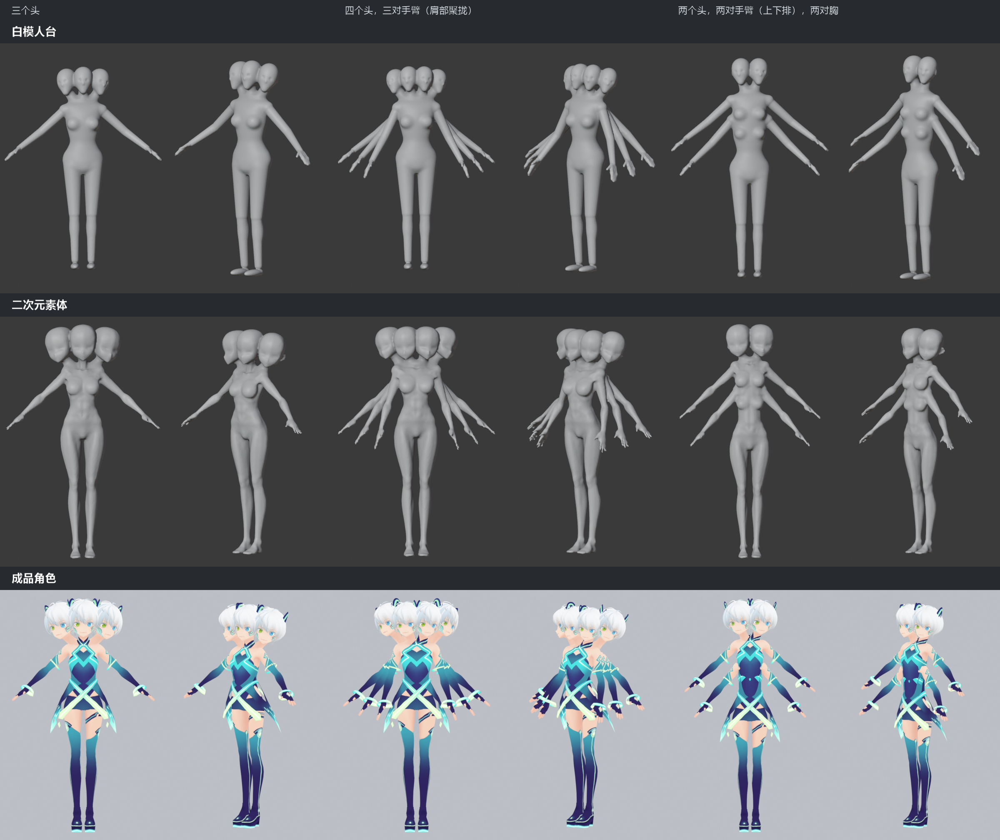
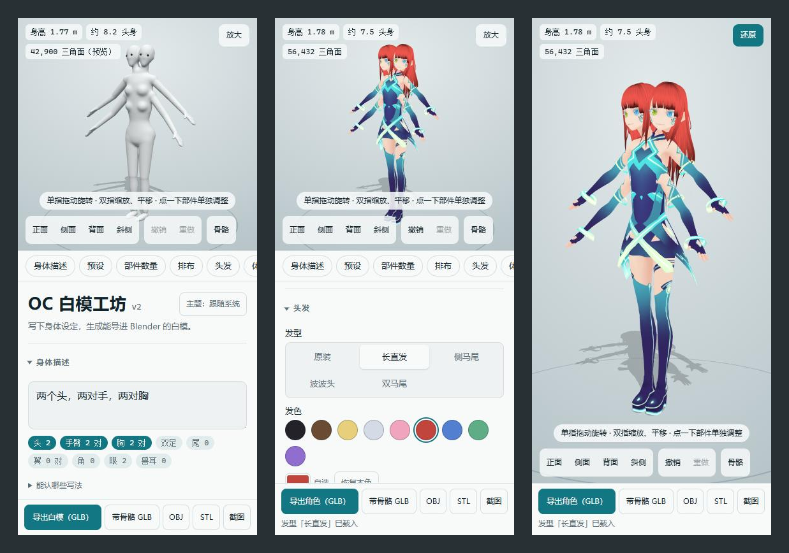
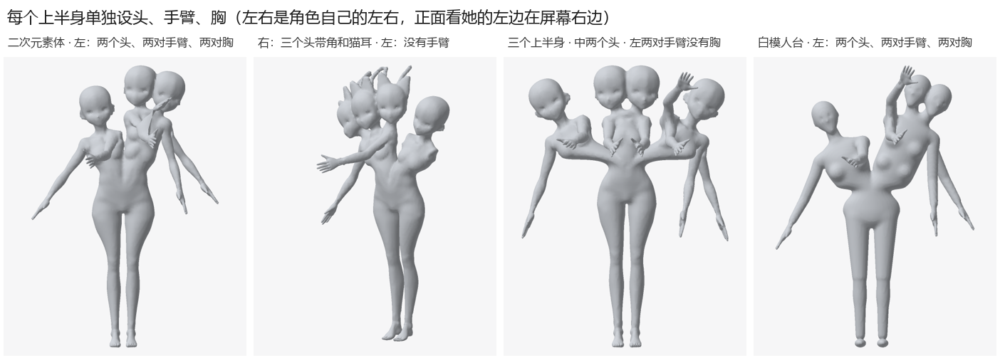
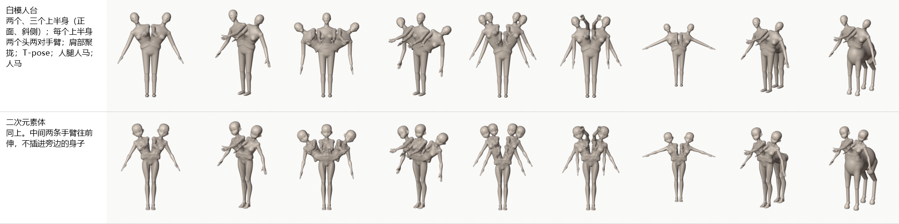
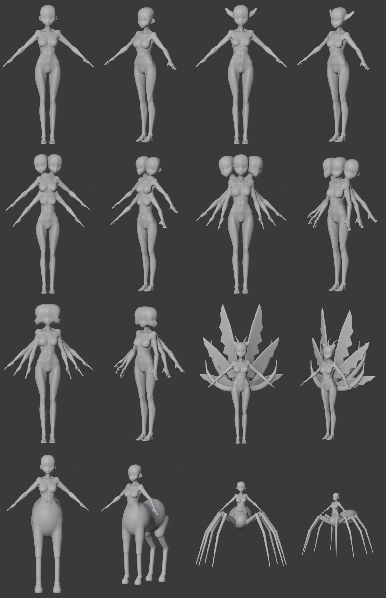
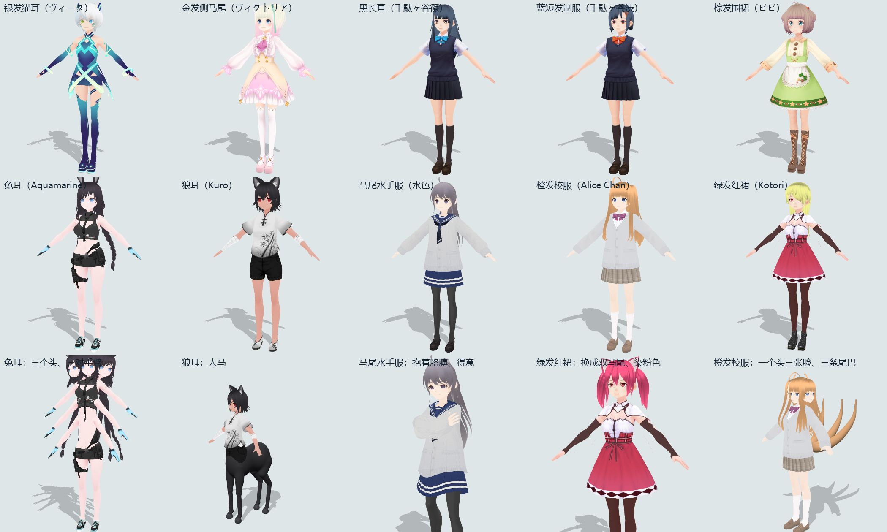
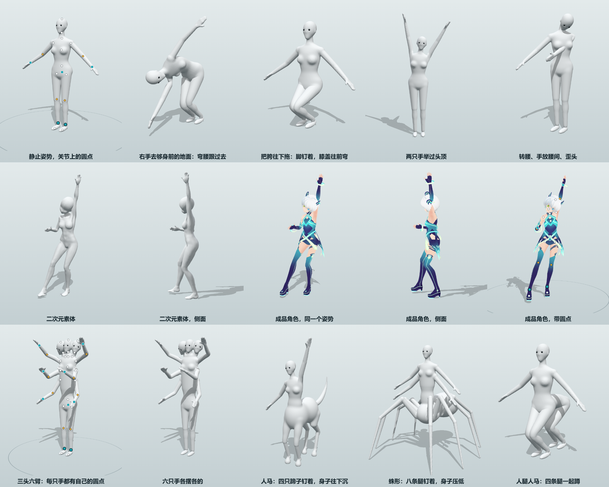

# OC 白模工坊 v2

[中文](README.md) · [English](README.en.md) · [日本語](README.ja.md)

多肢体角色白模生成器。写一句身体设定（「两个头，两对手，两对胸」「阿修罗」「九尾 六翼」），得到一个可以导入 Blender 的白模：一整块封闭的网格，拿来就能雕刻；需要的话还带着骨架和权重。身体定好以后，还能直接在这里拖着关节给它摆姿势。



- **三种身体样式**：白模人台、二次元素体、成品角色（十个现成的 VRoid 角色，也能载入自己的 VRM）。
- **部件**：上半身 1–3 个，头 1–5 个，手臂 0–4 对，胸 0–4 对，腿 1–12 条，尾巴、翅膀、角、兽耳；人马、蛛形、人腿人马等下身。
- **调整**：体型滑块，单独挪、转、缩放任意部件，撤销 / 重做。
- **摆姿势**：拖关节摆，60 个现成的姿势、16 个手势；成品角色还有表情和视线。
- **导出**：GLB（可带骨骼和权重）、VRM、OBJ、STL、透明背景的截图。
- **在哪用**：电脑浏览器、打包成 exe、安卓安装包，或者放到网上用手机打开。

说明是按「Blender 新手、用 Windows」写的，每一步都给出菜单路径或按键。

- [安装和运行](#安装和运行)
- [界面](#界面)
- [造型](#造型)
- [三种身体样式](#三种身体样式)
- [手动微调](#手动微调)
- [摆姿势](#摆姿势)
- [导出](#导出)
- [导入 Blender](#导入-blender)
- [配合 Tripo 使用](#配合-tripo-使用)
- [常见问题](#常见问题)
- [已知的限制](#已知的限制)
- [素材和署名](#素材和署名)
- [开发](#开发)

## 安装和运行

1. 装 [Node.js](https://nodejs.org/)：下载页上选 LTS 版（20 以上），一路「下一步」装完。
2. 在这个文件夹里打开终端：用资源管理器进到这个文件夹，在地址栏里输入 `pwsh` 回车。
3. 第一次运行前装依赖（只需要做一次，要联网）：

   ```powershell
   npm install
   ```

4. 启动：

   ```powershell
   npm run dev
   ```

   浏览器会自动打开 http://localhost:5173 。用完回到终端按 `Ctrl + C` 停止。

以后每次用只需要第 2、4 步。

### 不装 Node.js 的用法

| 想要 | 命令 | 得到 |
| --- | --- | --- |
| 发给别人的 exe | `npm run pack` | `release` 里的 `OC白模工坊.exe`（约 13 MB，双击就能用，不用安装、不用联网）、`使用说明.txt` 和把两样压在一起的 zip |
| 安卓安装包 | `npm run apk` | `release` 里的 `OC白模工坊.apk`（约 17 MB，安卓 10 以上） |
| 放到网上，手机打开 | `npm run build` | `dist` 文件夹是纯静态网页，传到 GitHub Pages、Cloudflare Pages、Netlify 这类托管就能用，苹果手机也行 |

- exe 没有数字签名，第一次双击可能弹出「Windows 已保护你的电脑」，点「更多信息」→「仍要运行」。对方需要 Windows 10 / 11 和 Edge、Chrome、Firefox 之一。
- 安卓安装包装的时候要允许「未知来源的应用」。它不申请任何权限，导出的文件存在手机「下载」文件夹的「OC白模工坊」里。
- 打安卓包要装 JDK（环境变量 `JAVA_HOME`）和安卓 SDK 里的 `build-tools`、`platforms`（环境变量 `ANDROID_HOME`），不用 Android Studio。签名钥匙 `tools/android/sign.keystore` 是第一次打包时生成的，别弄丢：丢了以后新包盖不上旧包。
- 只在家里试：手机和电脑连同一个 Wi-Fi，电脑上运行 `npx vite preview --host`，手机浏览器打开它印出来的 `http://192.168.….…:4173/`。
- 改了工坊以后要重新打包。

## 界面



- **左边是 3D 视图**。左上角「造型 / 摆姿势」切换在做哪件事，下面是身高、头身比、面数的读数，后面出现橙色的字是在提醒有问题。左键拖动旋转，滚轮缩放，右键拖动平移，点一下部件选中它。左下角是视角（正面 / 侧面 / 背面 / 斜侧）、撤销 / 重做、显示骨骼。
- **右边是设定面板**：身体描述、预设、部件数量、排布、头发、体型、手动微调、网格、镜头和灯光、参考图、配置。每一栏的标题点一下折叠。导出按钮钉在面板最下面。
- **新手引导**：第一次打开时自动出来，先选语言，再一步步指给你看几块地方；讲 3D 视图、单独调整肢体、摆姿势的几步可以直接在模型上试。可以跳过；想再看一遍，点标题下面的「新手引导」。
- **手机竖屏**：上半是 3D 视图，下半是设定，整页一起滚。单指拖动旋转，双指捏合缩放、拖动平移。

## 造型

### 写描述

在「身体描述」的框里写身体设定，停笔约 0.3 秒后模型自动更新。下面那排标签里亮起来的是认出来的部件，点开「能认哪些写法」可以看每一段是怎么认的。

| 写法 | 例子 |
| --- | --- |
| 部件 + 数字 + 量词 | 「两个头」「三对手臂」「九条尾巴」「每个头四只角」「6 只眼睛」「三张脸」「两个上半身」「左边的上半身两个头、两对手臂」 |
| 没有某个部件 | 「没有尾巴」「无角」「平胸」 |
| 成语和关键词 | 「三头六臂」「三面六臂」「九尾」「六翼」「阿修罗」「半人马」「人腿人马」「蜘蛛女」「猫耳」「革律翁」 |
| 英文标签 | `four_arms` `multiple_tails` `centaur` `humantaur` `three_faces` `1boy` |
| 身高和头身比 | 「身高 165」「八头身」 |
| 性别和姿势 | 「男性」「少年」「少女」；「T-pose」「双臂平举」「A-pose」 |
| 发型和发色 | 「双马尾」「马尾」「长直发」「波波头」；「金发」「银色长发」「黑长直」；`twintails` `blonde_hair` |
| 腿的排法 | 「左右并排」「胯部聚拢」「横排多胯」「前三后三」 |

### 预设和部件数量

- **预设**：12 个现成的组合，点一下就换过去。
- **部件数量**：上半身 1–3 个，头 1–5，手臂 0–4 对，胸 0–4 对，腿 1–12 条，尾巴 0–9，翅膀 0–3 对，每个头的角 0–4、眼睛 1–6、兽耳 0–2 对。好几个上半身时，头、手臂、胸、翅膀是每个上半身各长这么多；上面多出一排「改哪个上半身」，选左、右（三个时还有中）以后，头、手臂、胸、角、眼睛、兽耳只改那一个上半身（左右是角色自己的左右），选「全部一样」改的是所有的，单独设过的也改成一样（单独设过的那一行数字后面有个星号）。成品角色不分，每个上半身都照「全部一样」的数。
- 点预设、加减数量以后，描述框会被改写成一句规范的中文，方便接着改。

### 排布

- **多个头**：
  - 凑成一簇（默认）：照二次元多头角色的画法，身体还是一个人的，头脸贴着脸凑成一簇，每个头有自己的脖子。四五个头时每个头小一圈。
  - 一个头几张脸：佛像里阿修罗「三面六臂」那种，只有一个头、一根脖子，多出来的脸各朝一边。
  - 宽躯干：只在二次元素体、两个头、横排两副胯时起作用，两个头各有脖子和肩膀，并成一个两人宽的躯干。
- **多对手臂**：「沿躯干上下排」（每多一排躯干加长一截），或者「肩部扇形聚拢」（多出来的从肩膀后面长出来，正面看是一层层的扇面）。
- **腿**按条数算，可以是单数。三条以上时有这几种排法，选「自动」时 4 条是人马，6 条以上是蛛形，单数是左右并排：
  - 人马、蛛形：上半身坐在马身、蜘蛛身上（这两种腿只能成对，单数时多补一条）。
  - 人腿人马：身后横着一截人的腰，再接一副人的胯和腿。
  - 前后串联：骨盆拉长，几对人腿前后挤在一起。
  - 左右并排：腰以下张宽，腿横着等距排成一排。
  - 胯部聚拢：胯还是一个人那么宽，几副胯一副贴着一副，腿往下一对比一对往外散开。
  - 横排多胯：几副完整的胯左右排成一排，每副两条腿。
  - 人腿人马、前后串联可以选每副胯上几条腿（「前三后三」）。
- **好几个上半身**（1–3 个）：一副胯上从腰往上分出两三个上半身，左右并排、往两边张开，像希腊神话里的革律翁（二次元素体是直立并排：两个时里侧贴在一起，三个时分得开、从胯上面就各是各的腰）。每个上半身照设定各长一份头、手臂、胸、翅膀，中间的手臂往前伸。头、手臂、胸、角、眼睛、兽耳可以每个上半身单独设（见「部件数量」）；两个上半身配横排两副胯本来并成一个宽躯干，两边数量不一样时改成两个上半身各自直立。

  
- **多条尾巴**从尾根往两边扇形散开。
- **手**：「分指」（默认）是一只现成的手，手指一根根分开；「并指」是一整片手掌加拇指，只适合当粗略的起点。



### 体型

- **身体样式**：白模人台（默认）、二次元素体、成品角色，见下一节。
- **性别**：女性（默认）或男性，只对白模人台起作用。
- **姿势**：A-pose（默认）或 T-pose。要绑骨骼、给出图的模型当参考时用 T-pose 更方便。
- **滑块**：身高、头身比、体格、肩宽、胸部大小、腰宽、胯宽、四肢粗细、手臂长短、腿长短、尾巴蓬松和长度。拉到两头是很夸张的卡通身材。手臂、腿拉长时手脚不跟着变形；腿长短不改身高（整个人照比例缩放）。
- 多排手臂、人马、蛛形会让实际身高更高，以左上角的读数为准。

### 头发

三种身体样式都能戴四种现成的头发：长直发、侧马尾、波波头、双马尾（取自 VRoid 旧版的 CC0 样例）。

- 白模人台、二次元素体默认光头。选了发型，头发转成没有颜色的一层壳，和头融合成一整块，照样能直接雕。头发没有自己的骨骼，整个跟着头动。
- 成品角色默认是她原装的头发，可以换成这四种，也可以染色；几个头凑成一簇时还能每个头分开染。
- **长度**（60%–150%）管垂在鼻尖以下的那一段；**蓬松**（97%–120%）是整副头发放大缩小。

### 网格

- **融合成一整块**（默认）：所有部件融合成一张封闭的网格，交界处是圆滑的过渡。「融合圆角」调过渡的宽窄。
- **分部件**：每个部件是独立的物体，互相插着、不融合。
- 屏幕上是较粗的预览，停手以后换成细的；导出时另外算一张精细的。

### 撤销和保存

- 撤销 / 重做：左下角的按钮，或者 `Ctrl + Z` / `Ctrl + Y`。刷新页面以后撤销记录清空，设定本身还在。
- 所有设定（包括手动微调和摆的姿势）自动存在这个浏览器里。
- 「配置」栏里的「保存配置」另存成 `oc_config.json`，「载入配置…」读回来。

## 三种身体样式

### 白模人台

默认的样式。按部件拼出大的体块，融合成一整块，脸只有眼窝、鼻子的凸起和下巴。适合当雕刻的起点。

### 二次元素体

头、躯干、胸、手臂、腿换成一个现成的二次元少女素体的形状：细长的四肢、尖下巴的头、带手指的手、带脚趾的脚。仍然是没有颜色、没有衣服的白模。第一次切换时要载入约 6 MB 的数据。



- 多头、多臂、多胸、尾巴、翅膀、各种下身、手动微调、骨骼、全部导出格式都照常能用，导出的也是一整块封闭的网格。
- 体型滑块是在素体原来的样子上拉宽、压窄；性别、手的样式对它不起作用。
- **胸部大小** 0.3–2.3：往小渐渐变平，往大在素体的小胸和另一个素体的大胸两种胸型之间渐变。
- 手和脚是现成的网格，融合完以后在手腕、脚踝处缝上去，所以什么精度下手指、脚趾都是分开的。
- **导出的模型发出去时要署名**，见[素材和署名](#素材和署名)。

### 成品角色

显示和导出的是一个带头发、衣服、脸和贴图的现成二次元角色。多出来的头、手臂、胸是把她自己的那一片（连衣服、贴图）复制一份接上去；多出来的腿是把她的胯和腿复制排开；兽身、尾巴、翅膀、角、兽耳是另外捏的单色部件。



「身体样式」下面有一排头像，点哪个换哪个；换角色只换人，部件数量、体型、发型、姿势、表情原样套过去。每个角色 9–14 MB，选到哪个才载入哪个。

| 名字 | 原名 | 作者 | 许可 |
| --- | --- | --- | --- |
| 银发猫耳（默认） | ヴィータ | VRoid 项目（pixiv） | CC0 |
| 金发侧马尾 | ヴィクトリア・ルービン | VRoid 项目（pixiv） | CC0 |
| 黑长直 | 千駄ヶ谷篠 | VRoid 项目（pixiv） | CC0 |
| 蓝短发制服 | 千駄ヶ谷渋 | VRoid 项目（pixiv） | CC0 |
| 棕发围裙 | ビビ | VRoid 项目（pixiv） | CC0 |
| 兔耳 | Preset Only Rabbit - Aquamarine | 七百屋（なおしま） | VRoid Hub 条件 |
| 狼耳 | Kuro（Preset Nekomimi Girls） | 七百屋（なおしま） | VRoid Hub 条件；不许用于性表现 |
| 马尾水手服 | 水色（ポニーテルの女の子） | 白い白米 | VRoid Hub 条件 |
| 橙发校服 | Alice Chan | edisonlee55（yuna0x0） | CC BY-SA 4.0 |
| 绿发红裙 | Kotori | Fox Jump | CC BY |

**载入自己的 VRM**：头像下面的「载入自己的 VRM…」选一个 VRM 文件（0.x、1.0 都行，VRoid Studio 捏的最好），它就成了第十一个角色，多头、多臂、摆姿势、表情、换发型都照常能用。文件只存在这台设备的浏览器里，换了设备要重新选。别的软件做的 VRM，骨骼照人形骨骼对照表认，皮肤、衣服、头发照 VRoid 的材质名认，认不全时说明里会提醒。

和白模不一样的地方：

- 各块是互相插在一起的，不融合：导出的不是一整块封闭的网格，不适合直接雕刻或 3D 打印。
- 体格、性别、手的样式、眼睛数量、去掉手臂不起作用；「网格」那一栏也不管用。
- 肩宽、腰宽、胯宽、四肢粗细、手臂长短是把身体连衣服一起拉的，调得多了花纹会跟着变形。
- 手动微调照骨骼分部件，挪远了连着身体的地方会像橡皮一样拉长。它的微调和白模的分开记。

### 成人部件（默认关）

「数量」里的「显示成人部件」开关默认关着，只记在这台电脑、这个浏览器里，不跟着配置文件走。打开以后白模人台和二次元素体可以加阴茎（每副胯 0–6 根，左右并排、上下叠、扇形、几乘几）和阴囊；摆姿势有自己的一组圆点，带骨骼导出时每根三节骨骼。素材要求署名，见[素材和署名](#素材和署名)。

## 手动微调

自动摆出来的位置不满意时，可以单独调某一个部件：某条手臂、某个头、某条尾巴、某只角……

1. **选中部件**：在模型上点一下它（或者在「手动微调」栏的下拉列表里选）。它罩上一层青色，关节处出现操纵杆。
2. **调整**：在模型上拖操纵杆（面板里切换「移动 / 旋转 / 缩放」），或者在面板里填位置（厘米）、角度（度）、大小（倍数）。
3. 点空白处、按 `Esc`，结束调整。

- 方向：X 是角色自己的左手边，Y 朝上，Z 朝前。转动和缩放以关节为中心（手臂绕肩膀，腿绕髋）。
- 「同时调整对侧」开着时，左右成对的部件一起改，镜像。
- 躯干带着脖子、头、手臂、胸、翅膀；头带着眼睛、角、耳朵。脚始终踩在地上。
- 调过的部件列在「已微调」里。「还原这个部件」只还原选中的，「全部还原」清掉所有微调；点预设也会清掉（可以撤销）。
- 调得太狠（把手臂拽离身体）网格会断开，左上角会提示「网格分成了 N 块」。

## 摆姿势

点 3D 视图左上角的「摆姿势」，关节上会亮起一批圆点，拖它们就能摆。点「造型」回去接着改身体。「造型」里看到的、导出的一直是静止姿势；「摆姿势」里看到的、导出的是摆好的样子。三种身体样式都能摆。



**圆点**：拖它，这个点跟着鼠标走；点一下，出现旋转环，转的是从这个关节往外的那一段。

| 圆点 | 是哪里 | 拖它 |
| --- | --- | --- |
| 青色大圆点 | 手、脚、胯 | 拖手脚，手肘、膝盖自己跟着弯，够不着时身体跟过去；拖胯，整个人走，脚钉在原地 |
| 黄色菱形 | 手肘、膝盖 | 手脚不动，手肘（膝盖）转到你拖的那一边 |
| 白色小圆点 | 腰、胸、脖子、头、肩、大腿根、脚尖 | 带着那节骨头转：弯腰、歪头、耸肩（拖远了上身跟着歪）、踮脚 |
| 末梢上的小圆点 | 尾巴尖、翅膀尖；成品角色的发梢、裙摆、袖口 | 整串朝那边弯过去 |

**「姿势」栏**：

- **显示哪些圆点**：圆点太多挡着时，把用不上的几组收起来。手指、头发和衣摆两组默认收着。
- **钉住**：脚默认钉在地上，手默认跟着身体走；选中某只手、脚可以单独钉住或放开。
- **左边 → 右边 / 右边 → 左边、左右翻转、落到地面**。
- **自然下垂**：躺下、弯腰、坐下以后点它，成品角色的头发、裙摆、袖子照重力垂下来，碰到身体、地面就停在外面。勾上「尾巴也垂」，尾巴一起垂。
- **保存姿势 / 载入姿势…**：存成 `oc_pose.json`，可以套到别的角色、别的身体样式上（按骨骼名字对）。

**手势**：两只手、左手、右手，或者某一对手臂；16 个现成的手势（握拳、剪刀手、OK、竖大拇指……），五根手指各一个滑块；打开「手指」圆点可以直接拖指尖。

**表情和视线**（只有成品角色有）：七种表情、闭单眼、嘴型、尖牙；视线滑块和「看镜头」。几个头可以各摆各的表情。

**现成的姿势**：60 个（8 个柔和的站姿，以及站、走、跑、跳、蹲、坐、躺、出拳、挥剑……），点一下就套上并落到地面，「随便来一个」随机挑一个。点之前可以选：

- 套到哪些部位（头、躯干、左右手臂、腿），没勾的保持现在的样子；
- 手臂套给哪一对（几对手臂可以各点各的姿势）；
- 强度 10%–100%。

人马、蛛形只套腰以上；多出来的手臂跟着同一边的第一对动。

几条规则：

- 骨头的长度不变；没有关节限位，也不拦穿模。
- 白模（白模人台，以及手臂肩部聚拢、好几个上半身的二次元素体）松手以后，会照摆好的姿势重新融合一张网格（不到一秒，再过一两秒换成更细的）。拖着时看到的是预览，肩头会鼓、手臂之间会扯着皮，以松手以后的为准。

### 镜头、灯光和参考图

只影响屏幕上和截图里的样子，不影响导出的模型：

- **镜头和灯光**：从哪边看、透视（10°–80°）、主灯的方向和高低、地面的影子。
- **参考图**：把自己画的正面、侧面设定图竖着垫在模型后面，对着它调体型、摆姿势。选图时自动对齐到和模型一样高，白纸底会抠成透明；可以调大小、位置、不透明度，或者盖在模型上面比轮廓。图只存在这个浏览器里。

## 导出

面板最下面的导出栏。点了以后等下面那行字提示完成，文件在浏览器的下载文件夹里。

| 按钮 | 文件 | 里面有什么 | 什么时候用 |
| --- | --- | --- | --- |
| 导出白模（GLB） | `oc_basemesh.glb` | 网格 | 拿去雕刻，最常用 |
| 带骨骼 GLB | `oc_basemesh_rigged.glb` | 网格 + 骨架 + 权重 | 想直接摆姿势、做动画 |
| VRM | `oc_basemesh.vrm` | 网格 + 骨架 + 权重 + 人形骨骼，T-pose | 给 VTuber 软件、VRoid Hub、Unity 用 |
| OBJ | `oc_basemesh.obj` | 网格，保留四边面 | 想要四边面，或者对方软件不认 GLB |
| STL | `oc_basemesh.stl` | 网格 | 3D 打印 |
| 截图 | `oc_basemesh.png` | 当前视角，透明背景 | 发给别人看，给出图的模型当参考 |

成品角色的文件名是 `oc_character…`，带贴图（OBJ、STL 除外）。

- 单位是米。GLB、OBJ 是 Y 轴朝上、面朝 +Z，Blender 导入时会自动转好；STL 直接按 Z 朝上写，切片软件一般当毫米读，要放大 1000 倍。
- 在「造型」里导出的是静止姿势，在「摆姿势」里导出的是摆好的样子。白模摆好以后还是一整块封闭的网格，STL 可以直接打印。
- **VRM**：点了会弹一个小框填名字、作者和许可。导出的是 VRM 0.x，静止姿势是 T-pose；只有第一对手臂、第一个头、第一对腿进人形骨骼表，多出来的部件跟着身体走；尾巴是弹簧骨骼，会晃。成品角色带着原角色的贴图、表情、会晃的头发和裙摆，许可照原角色的条件写。分部件模式、没有手臂、只有一条腿的身体导不了。
- 要求署名的素材（见下面「素材和署名」）导出时自动写进文件。

## 导入 Blender

1. 打开 Blender，菜单 **文件 → 导入 → glTF 2.0 (.glb/.gltf)**，选中 `oc_basemesh.glb`。OBJ 是 **文件 → 导入 → Wavefront (.obj)**，STL 是 **文件 → 导入 → STL (.stl)**，都用默认设置。
2. 模型在世界原点，脚踩在地面上。按小键盘 `1` 切到前视图。

- 融合模式下只有一个物体 `OC_BaseMesh`，一整块封闭的网格，缩放是 1。选中它，左上角切到「雕刻模式」就能直接雕。
- 一般十几万个三角面，部件多的到几十万。嫌密可以加「精简」修改器，或者用「重构网格」。
- 分部件模式下每个部件是一个物体（`Torso`、`Head_01`、`Arm_02_L`……）。想合成一块：点躯干，按 `A` 全选、`Ctrl + J` 合并，再加「重构网格」修改器（体素，大小 `0.01` 左右）并应用。
- 成品角色的贴图要把视图切到「材质预览」或「渲染」才看得到。

### 带骨骼的文件

导入 `oc_basemesh_rigged.glb` 以后是一副骨架 `OC_Rig`，网格挂在它下面，带着「骨架」修改器和权重。骨骼导进来是一个个小圆球，想要八面锥骨骼，导入时在右侧「骨骼与蒙皮」里勾上「禁用骨骼形状」。

骨骼照 VRM / Unity Humanoid 的习惯起名，`_L` / `_R` 是角色自己的左 / 右：

| 部位 | 骨骼 |
| --- | --- |
| 脊柱 | `Hips` → `Spine` → `Chest` → `UpperChest` → `Neck` → `Head` |
| 手臂 | `Shoulder_L` → `UpperArm_L` → `LowerArm_L` → `Hand_L` |
| 手指 | 每根三节：`Thumb1_L` → `Thumb2_L` → `Thumb3_L`，`Index`、`Middle`、`Ring`、`Little` 同样 |
| 腿 | `UpperLeg_L` → `LowerLeg_L` → `Foot_L` → `Toes_L`；中线上的腿不带 `_L` / `_R` |
| 多出来的同类部件 | 加序号：第二对手臂 `UpperArm_L.002`，第二个头 `Head.002`，第二对腿 `UpperLeg_L.002` |
| 尾巴 | 每条 5 节：`Tail_01_01` … `Tail_01_05` |
| 翅膀、兽耳 | `Wing_01_L`、`Ear_01_L` |
| 身后的下身 | `LowerBody_01`、`LowerBody_02` …（人马、人腿人马、前后串联、胯部聚拢）；蛛形的腹部是 `Abdomen` |
| 好几个上半身 | 每个上半身一串脊柱：`Spine_L`、`Chest_L` …，右边的带 `_R` |

**检查权重**：点骨架，`Ctrl + Tab` 进入「姿态模式」，点一根骨骼按 `R` 转一转，看网格跟不跟着动；看完 `A` 全选、`Alt + R` 清掉旋转。或者把网格切到「权重绘制」模式，在「顶点组」里点骨骼名字看颜色（红色是完全跟着动）。

- 权重是自动算的，够摆姿势检查，做正式动画要再修一修。
- 关节弯得厉害时会瘪：在网格的「骨架」修改器里勾上**「保持体积」**，就和工坊里摆出来的一样。这一项存不进 GLB，要自己勾。
- 关节里侧挤出折痕的，可以在「骨架」修改器下面加一个「纠正平滑」修改器磨平。

## 配合 Tripo 使用

白模没有脸、头发、衣服，这些还要靠 Tripo 生成。白模能帮上忙的地方：

1. **给出图当身体参考**：多肢体的身体，出图的模型很容易画错手臂数量和接的位置。切到 T-pose，依次点「正面」「侧面」「背面」各截一张图，和角色设定一起交给它，说明只照它的身体结构，不照抄白色、没有五官的外观。
2. **在 Blender 里当摆放的架子**：Tripo 一次生成一个部件，多出来的手臂、头要自己复制摆位。导入分部件模式的白模，每条手臂、每个头都是独立的物体，把 Tripo 的部件缩放、对到相应的位置（`G` 移动、`R` 旋转、`S` 缩放），对好后 `Ctrl + A` →「全部变换」。
3. **给多肢体的角色提供骨架和权重**：Tripo 的自动绑定只有标准人形的骨骼。可以把带骨骼白模的权重传给 Tripo 的身体：
   1. 导入 `oc_basemesh_rigged.glb`，把 Tripo 的身体对齐到白模上，`Ctrl + A` →「全部变换」。
   2. 点身体，**添加修改器 → 编辑 → 数据传递**：「源物体」选 `OC_BaseMesh`，勾「顶点数据」，点亮「顶点组」，「映射」选「最近的面插值」，点「生成数据层」，再应用这个修改器。
   3. 先点身体，再按住 `Shift` 点骨架 `OC_Rig`，`Ctrl + P` →「骨架形变」（不要选带「自动权重」的）。
   4. 摆几个姿势检查。衣服离身体远的地方（裙摆、宽袖子）要自己修。

   这套步骤在 Blender 里用别的网格试过，没有拿真正的 Tripo 模型试过。
4. **直接上传给 Tripo**：用不带骨骼的 `oc_basemesh.glb`。没有实际上传试过，面数上限以它页面上的提示为准。

## 常见问题

**终端里说「npm 不是内部或外部命令」。** Node.js 没装好，或者装完以后没有重开终端。

**浏览器没有自动打开，或者打开的不是 5173。** 看终端里 `Local:` 后面的地址，照着在浏览器里打开。

**切到二次元素体或成品角色时提示「连不上工坊的程序」。** 页面还开着，但 `npm run dev` 或 exe 的窗口已经关了。重新打开程序，回到这个页面，它会自己再试一次。

**左边是空的，写着没能启动 3D 显示。** 浏览器的 WebGL 没开。换新版的 Edge 或 Chrome，或者打开浏览器的「硬件加速」。

**模型比滑块慢半拍，或者 CPU 一下子占满。** 融合网格是在后台几个线程一起算的，部件很多时要等零点几秒到一秒，算完就闲下来。想跟手一点，可以先切到「分部件」模式摆好再切回来。

**读数后面出现「网格分成了 N 块」。** 有部件没连上身体，多半是手动微调拽开的。挪回去，或者点「全部还原」。

**想从头开始。** 点预设里的「标准人形」，体型滑块要自己拖回去。想彻底清空，按 `F12` 打开控制台，输入 `localStorage.clear()` 回车，再刷新页面。

## 已知的限制

- **脸很简单**：白模人台只有眼窝、鼻子和下巴，二次元素体的眼睛是两个浅碟、嘴是一道浅痕。眼睛在网页里只是位置标记，不在导出的网格里。白模是雕刻的起点，不是成品。
- **权重是简单算的**：够摆姿势检查，做动画要再修。「带骨骼 GLB」里是静止的网格配权重，关节转得多的地方是扯出来的样子；要摆好的成品，导不带骨骼的 GLB / OBJ / STL。
- **摆好以后的关节像球形关节的人偶**：手臂、腿每一段整段转过去，关节处补一个圆，没有肌肉的造型。插在一起的地方（手臂穿过身体）重新融合时会并成一块。少数姿势下手缝不上，会单独叠在原处，导出时提示网格分成了几块。
- **摆姿势不防穿模，没有关节限位**。「自然下垂」是一步算出来的，不是布料模拟，头发和头发之间会互相穿过去。
- **多出来的部分比较粗糙**：多出来的脖子、第二排以后的肩头、兽身、人腿人马中间那截腰都只有大的体块，要进 Blender 再雕。
- **成品角色不是白模**：各块插在一起不融合，体型是硬拉的，兽身和她不是一种画风。表情导出以后是烘在网格上的，不能当形态键再拖。
- **头发只有四副现成的**，不能一缕一缕地改。
- **没有试过的事**：导出的 VRM 只在 Blender 的 VRM 插件里检查过，没有在 VSeeFace、Warudo 这些软件里打开；没有把模型实际上传到 Tripo；安卓安装包只在模拟器上试过，手机网页只在电脑里模拟过版面，都没有拿真机试过。

## 素材和署名

工坊里用到的现成素材都允许再分发，原件的下载地址、许可和校验值记在 [`assets/source/README.md`](assets/source/README.md)，成品角色的清单在 `src/character/roster.ts`。

**要署名的**（导出的文件里已经自动写上，发出去时请照样带上）：

| 用到时 | 署名 |
| --- | --- |
| 二次元素体 | 脚部网格 © Fox Jump（Kotori），CC BY；躯干起伏参考了 Fly_jkey 的「Woman」，CC BY 4.0 |
| 成品角色「橙发校服」 | Alice Chan © edisonlee55，CC BY-SA 4.0（改过的东西再发出去也要用 CC BY-SA 4.0） |
| 成品角色「绿发红裙」 | Kotori © Fox Jump，CC BY |
| 成人部件 | 阴茎、阴囊取自「DJP Male Base Mesh Mark 03」© Death Joe Productions，CC BY 4.0 |

**不用署名的**：二次元素体、前五个成品角色和四副头发取自 VRoid Studio 旧版的样例（pixiv，CC0）；现成的姿势取自 Quaternius 的 Universal Animation Library 1、2（CC0）；胸型、躯干起伏还参考了 Death Joe Productions 的素体和 Blender 官方的 Human Base Meshes（CC0）。兔耳、狼耳、马尾水手服三个角色照作者在 VRoid Hub 上设的条件：可改、可再分发、可商用、不用署名（狼耳不许用于性表现；马尾水手服的作者另写了不许用于 NFT、政治和宗教）。

## 开发

```powershell
npm run dev        # 开发服务器
npm test           # 单元测试（Vitest）
npm run typecheck  # 类型检查
npm run build      # 打包到 dist
npm run pack       # 打成 exe 和 zip，放在 release
npm run apk        # 打成安卓安装包，放在 release
npm run accept -- <输出目录>   # 验收图，见 docs/accept/README.md
```

`tools/` 里的 `.ts` 脚本用 `node tools/run.mjs tools/<脚本>.ts` 运行，`.mjs` 的直接 `node tools/<脚本>.mjs`。素材加工脚本平时不用跑，素材原件（`assets/source/`）不在仓库里：

| 脚本 | 生成 |
| --- | --- |
| `build-anime-body.mjs` → `build-torso.ts` → `build-chest.ts --write` | 二次元素体 `public/anime/body.bin`（要依次跑） |
| `build-hand.ts`、`build-foot.ts` | 现成的手、脚 |
| `build-hair.mjs` | 头发 |
| `build-characters.ts` | 瘦身后的成品角色 `public/character/*.vrm` |
| `build-poses.ts`、`build-soft-poses.ts` | 现成的姿势 |
| `build-genital.ts` | 成人部件 |

只在开发服务器上有的东西（打包出来的网页、exe、apk 里都没有）：

- **穿模检查**：参数停下来以后自动查部件有没有明显插进别的部件，有的话左上角多一条橙色的「开发提示」，清单在浏览器控制台里。
- **监控测试接口**：`npm run agent -- model|eval|shot|logs` 读正在跑的页面，见 [docs/agent-monitor.md](docs/agent-monitor.md)。
- **问题单**：3D 视图左下角的「标注」，画红圈存进 `notes/`（不进仓库），`npm run agent -- notes latest` 查看。

**约定**：单位米，Y 轴朝上，角色面朝 +Z；`_L` / `_R` 是角色自己的左 / 右。解析、摆位、网格、骨骼、文件写出都是不碰界面的纯函数，界面只在 `src/main.ts` 和 `src/view/`。

| 路径 | 内容 |
| --- | --- |
| `src/model/` | `BodySpec` 数据模型、预设、手动微调、撤销 / 重做 |
| `src/parser/` | 文字 ↔ 部件数量 |
| `src/geometry/` | 摆位（`layout.ts`、多头多臂的规矩 `bodyPlan.ts`、二次元素体 `animeLayout.ts`）、头、头发、穿模检查、分部件模式的网格 |
| `src/sdf/` | 距离场融合：编译场、Surface Nets 取网格、后台线程和帮手线程、摆好姿势后的重新融合、把手脚缝到身体上 |
| `src/anime/`、`src/hair/` | 二次元素体、现成的手和脚、成人部件、白模戴的头发 |
| `src/character/` | 成品角色：读 VRM、拼装、换发型染发、表情、微调、兽身、写 GLB / VRM |
| `src/rig/` | 骨架、自动蒙皮 |
| `src/pose/` | 摆姿势：姿势数据、全身 IK、圆点、手指、现成的姿势 |
| `src/io/` | GLB、OBJ、STL、VRM 的读写，下载 |
| `src/view/` | 3D 视口、操纵杆、摆姿势的圆点 |
| `src/dev/` | 只在开发服务器上有的监控接口、问题单 |
| `tools/` | 素材加工、打包（exe、apk）、验收图、监控接口的命令行 |
| `tests/` | 单元测试 |
| `docs/` | 截图、对比图，以及几项大改动的计划（`rework-plan.md`、`vrm-plan.md`、`genital-plan.md`、`perf-plan.md`） |
