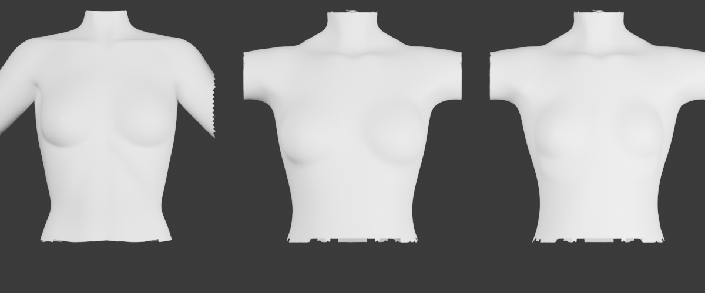
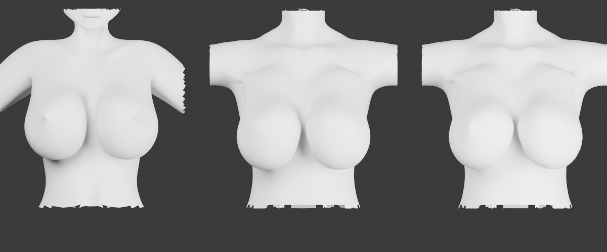

# 原素材胸型对照（2026-11-01）

参照用户提供的 DJP 文件调整二次元素体胸部，原文件不修改。

- 默认胸：DJP Anime Base Sculpt.obj；DJP Anime Sculpt BaseMesh 01.blend 的对象为 DJP Anime Sculpt Base，属于同一 Sculpt 素体版本。
- 大胸：DJP CC0 Free Base Mesh 01.obj；00.obj 作为丰满版本对照，已渲染核对。
- 四份原件与 assets/source/djp 的副本保留。非胸部的距离场格子逐字节一致。

## 结果

默认胸不再使用 VRoid 的小胸形状，新增 bustReference，保留 Sculpt 素材轮廓；大胸重新采样 01，保留原素材可见表面和胸尖。两份均接在平胸躯干上，避免原 VRoid 胸型从下面顶出并改变轮廓。小胸按原素材胸尖定位底座，避免依据目标躯干的凸起范围裁取而把底座推向腋下、削窄。

适配仍有平移和大胸等比缩放（0.85）；隐藏胸根沉入躯干，网格采样会损失比体素更小的细节。未把整个躯干换成 DJP，胸廓、肩线因此与原件不同。大胸设置约 1.76 时，等效缩放 2.2，与生成采样时对齐的源胸尺寸相符。

下图每张从左至右为 **对齐后的原素材 / 改前 / 改后**；Blender 5.2 在相同相机、材质和灯光下渲染，裁切边界不是模型破洞。

默认胸：

大胸：

斜侧：[默认胸](bust-reference-small-oblique.png)、[大胸](bust-reference-large-oblique.png)。

## 验证

- tests/bust.test.ts 独立读取原 OBJ 的三角面，沿射线求前表面；默认胸和大胸各 9 个可见轮廓采样点：平均误差小于 6 mm，每点小于 12 mm（适配后的模型单位）。这不代表整个胸面误差上限。
- 胸型、二次元素体、多上半身、双头双胯、曲面校正：72 项通过。
- 蒙皮、绑定姿势、缝手脚、摆姿势距离场、任务与并行：110 项通过。
- npm run build 通过，存在原有的大包体积提示；没有宣称整个项目全部测试通过。
- Playwright：默认胸和 1.76 大胸均生成精细预览，大胸 GLB 下载完成，界面报告一整块网格。
- 原素材和本轮开始时的项目文件备份均保留；未提交改动。
