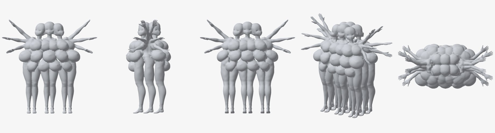

# 楚云萱用体块拼（方案）

2026-11-16 起。分支 `feature/chu-blocks`（工作目录 `F:\Downloads\多tool-chu`），从 `rework/torso-bust` 的 bea4ea8 分出。

## 现状（2026-11-17）

- 六期都做完了，他逐期看过：第 1–4 期他都答了「可以」或提了修改后认可；第 5 期他答「可以，做第 6 期」；第 6 期（收尾）做完以后他说「修手」，也修了（见「修手」）。
- 他说「提交并合进主线」「推上去」「打包并发版 2.8.2」：提交 0717426，已在 GitHub main 上，随 2.8.2 发布（2026-11-17）。
- 做成的样子：预设「楚云萱」在二次元素体上是 `model/chu.ts` 的 `chuSpec` 拼出来的体块（下图）；白模人台、成品角色上还是「围成一圈」的前后排。
- 没做：白模人台版（摆出来不对，要单独调一轮）、成品角色版（体块组装本来就不支持成品角色）。

## 为什么

试用的人说现在的楚云萱（「前后排」）没法用：摆动作时肢体拉丝、里面全是拼接的躯干没法调、关掉融合没法看。
根子在「前后排」的做法：六个整人、三个空上身、九个下半截，再加芯子、垫子、填缝，全叠在一起融合（`src/geometry/ring.ts`）。
他定的：**用体块拼，参考原来的图**（彩色正面 + 侧面，`refs/rows-front-side.jpg`）。

他以前定的规矩照旧：三排胯每副都是完整的（胯、臀、腰、腿不削，要分开只能挪位置）；所有腿朝正前，只有腰以上转过去；脖子各是各的。

## 拼法

都是体块组装（`docs/blocks-plan.md`）里已有的东西，没有新的几何：

| 体块 | 几块 | 怎么摆 |
|---|---|---|
| 胯和小腹（各带一双腿） | 9 | 前、中、后三排，每排三副，都朝正前；前排、后排连腿一起往中间斜一点（侧面是「人」字） |
| 胸腔（各带头、脖子、手臂、胸） | 6 | 前排、后排每副胯上一个，后排的转过去；绕腰往后靠到两排头背对背，两头的往外转、往中间歪 |
| 光胸腔（不带头、手臂、胸） | 3 | 中间一排每副胯上一个，夹在两排后背中间；两头的后背朝外 |
| 手臂 | 12 | 只留两头的胸腔朝外那一侧的三条，朝整个身子的正侧面排成上、中、下 |
| 胸 | 30 | 前后两面各 15 只，从上到下 6、5、4 只、隔一排错开半只；都是整只的原胸型，挂在离它最近的那个胸腔上 |

代码：`src/model/chu.ts` 的 `chuSpec(设定)`（先换成楚云萱的数量和体型 `CHU_BODY`，再 `chuBlocks` 拼体块），返回一份带体块的设定；摆位的数都在 `CHU` 里。
出图：`node tools/run.mjs tools/try-chu.ts --name v1`（`--old` 出旧的前后排，`--pose 序号` 套现成姿势）；
和参考图并排：`python .harness-tmp/chu/cmp.py <新图名> old`。

## 分期

每期做完先给他看，再做下一期；提交、合并、发版等他说。

1. **摆位第一版**（做了，他看过，答「照参考图修体型」）：上表的体块摆出来，静止融合是一整块、没有穿模报警。
2. **照参考图修体型**（做了；返工三轮，第三轮等他看）：见下面「第 2 期」「第 2 期返工」「第 2 期再返工」「第 2 期三返工」。
3. **接进工坊**（做了，他说可以）：见下面「第 3 期」。
4. **摆姿势**（做了，他说可以）：见下面「第 4 期」。
5. **分部件和调整**（做了，等他看）：见下面「第 5 期」。
6. **收尾**（做了，等他看）：见下面「第 6 期」。

## 第 2 期（照参考图修体型）

- **大腿粗细**：新的体型滑块 `shape.thighs`（0.7–1.8，默认 1；白模人台、二次元素体，成品角色不跟着变）。只动大腿，脚踝、骨骼不动，叠在四肢粗细上面。
  做法是旧前后排里现成的那套，抽到 `src/geometry/thigh.ts`，旧前后排改用它（出来的形状和以前一样）。楚云萱取 1.45。
- **胯**：参考图是三副正常宽的胯加粗大腿，不是加宽的胯（胯宽调到 1.5 时一副胯 46 厘米，三列分得太开）。胯宽留在 1，
  相邻两副胯隔多远照实际量出来的宽、厚定（`hipBulk`），正好贴着：每副胯、臀、腿都是完整的，不叠、不留空。
- **头**：要落在哪直接给（`CHU.headApart` 左右 15 厘米、`CHU.headBack` 前后 10 厘米），往哪歪是反算出来的（`aimed`），体型变了也落在那。
- **手臂**：方向照整个身子定（正侧面，上 34°、中 6°、下 −22°），不照歪着、转过的胸腔定——照胸腔定时前后两排举着的手臂会交叉。
- 全套测试 2082 项过。

他看了图提了三条（11-16 晚），当晚照改，见下一节。

## 第 2 期返工（他提的三条）

原话：「1. 上半身过长，大腿根其实是在下排胸接近一半的位置　2. 胸型用原胸型做，胸这里不用太还原，优先保证美观　3. 中间的厚度参考原来的模型，比原来的模型稍微薄一点点」。

量出来第 1、3 条是同一件事：三排胸把胸腔拉长了近半米（每多一排长一截，最下面一排在本来的胸口那么高，见 animeLayout.ts），
整个人 2.15 米高、髋关节只在 41% 的高度上；旧前后排是 1.60 米、55%。并排图是缩到同一身高比的，所以看着又长又薄。

- **胸腔坐进胯里**：往下坐到最下面一排胸的中心比髋关节低 3 厘米（`CHU.chestLow`，裆正在那一排胸的一半上下）。
  坐进去的那一截从底下截掉、只留 10 厘米在胯里（缝合新加的 `Attached.trim`，`CHU.ribDeep`）——不截的话会从裆底下、两条大腿中间露出来。
  现在总高 1.71 米、髋关节在 51%；头比只有一排胸时高 5 厘米。
- **九个胸腔都整块接在胯上**（`Attached.whole`）：从胯上渐渐分出去的那种接法坐不下去；转了半圈的后排用那种接法腰还是渐渐拧的，
  贴在那一段上的胸被拧歪。
- **胸全是原胸型**：前后两面各三排、每排六只，一只不删、不挪，胸围 2.5。试过的都不行：
  几排往一起叠（互相切成小块，像腹肌）；一对里删一只（另一只在正中线上的切面露出来）；挪过自己那块胸腔的正中线（切掉半只）；
  单独复制一只（是圆包，不是原胸型）。所以没有 6、5、4。
- **前后厚度**：缩短以后量大腿那一段，旧的 0.54–0.55 米，现在 0.50–0.53 米（`CHU.fitZ` 1.06，排与排之间留一厘米），比旧的薄一点。
  「中间的厚度」我理解成整个身子侧面看的前后厚度，没有再问他。
- 下面两排胸就在胯前面，开发模式的穿模提示会报「胯 × 胸」，是挨着、不是穿模（测试里不算）。
- 静止融合 1 厘米格子 9 秒左右（第 1 期 43 秒：胸腔短了、后排不拧了）。

还差的：手是张开的手掌（摆姿势的事）；腿占身高比参考图（56%）还少一点；最下面一排胸的下沿有几处小毛边，页面里没看。

他看了答「上面的改动都没问题」，接着提了下一节的两条。这一节里「胸腔坐进胯里、截掉一截」「三排、每排六只」的做法下一节换掉了
（`Attached.trim`、`CHU.ribDeep` 都删了）；身高比例、前后厚度、大腿粗细照旧。

## 第 2 期再返工（正面连成一片、胸 6、5、4 交错）

原话（配了一张正面胸口的截图，三列胸之间露着白缝）：「上面的改动都没问题 在此基础上 从正面看身体中间有缝隙和空洞 填上 是一整个上半身 然后把胸型改成654交错」。

- **缝是怎么来的**：胸贴在各自胸腔的表面上，三个胸腔是三根柱子，下面两排的高度上柱子之间是空的。
- **胸不再贴在胸腔上**：每个胸腔只留正中一只（一排单数个胸时正中那只：左右对称、没有正中线上的切面），照它整只复制
  （体块新加的 `AddedBlock.piece`：复制出来的还是原胸型、只取胸根以内，不换成圆包），前后两面各 15 只排成一片：
  从上到下 `CHEST_ROWS` = 6、5、4 只，一排里隔 `CHU.chestGap`（15 厘米），隔一排错开半只。
  胸腔上不排胸，也就不拉长：不用再往胯里坐，身高回到 1.61 米（旧前后排 1.60 米），髋关节在 54%（旧的 55%，参考图 56%）。
- **每只坐在哪**：量没有胸、没有手臂的身体，在这一排的高度上从正面照过去，取它左右半只宽以内最靠外的那一点，胸根沉进去 2 厘米；
  上一排最多比下一排缩进去 1.5 厘米（后背的腰窝比屁股凹好几厘米，不垫出来下一排的上沿整圈露着）。
  脸朝那里的表面朝的方向，越靠两头越往外撇（`chestFan`），顺着表面上下仰一点（`chestPitch`）。
  最下面一排的中心比髋关节低 3 厘米（他上一轮定的「大腿根在下排胸接近一半的位置」），最上面一排比本来的胸口高 5 厘米。
- **大小**：胸围 3 的胸型缩到 75%（`chestScale`）。试过胸围 2.5 不缩（挤成方块）、缩到 80%（一排排分得开，排与排之间露着身体）。
- **胸腔怎么接**：没转多少的（前排三个、中间一排正中）还是从胯上渐渐分出去，腰是顺的；转过去的（中间一排两头、后排）整块接（`Attached.whole`）。
- 前后两排同一侧的手臂根上只隔 6 厘米、朝同一个方向会叠在一起：各往自己那一排偏 10°（`CHU.armFront`）。
- 试过不行的：靠挪贴在表面的胸凑 6、5、4（一排三只时每只缩到八成、又瘪又有毛边）；胸根底下垫一块圆垫（毛边是胸根那一圈切口本身，垫了没用）；
  照胸根一圈最低的地方多沉（排与排之间分开了，后背露出臀缝）。
- **还有的毛病**：背面最下面一排两头那只，胸根的外沿正好压在两头那副胯的臀缝上，露出一点小翘边；胸根那一圈切口近看有细锯齿。
  静止融合 1 厘米格子 43 秒（上一轮 9 秒）：量了一下，六成多花在第一次把这只胸型烤成格子上（格子粗细换了也是这么久）；
  应用里烤过一次会记着、还分给几个线程，实际多快要到第 3 期接进页面再量，放在第 5 期。
- 测试：`tests/chu.test.ts`（排数、间隔、错开、朝向、高度）、`tests/clone.test.ts`（`piece`）。

他看了答「胸的样子没问题了」，接着提了下一节。这一节里「每只坐在哪」那一条（从正面照过去、排成一片平的）下一节换掉了
（`chestFace`、`chestPitch`、`chestSpan`、`chestStep` 都删了）。

## 第 2 期三返工（外扩）

原话（配的是上上轮「三排、每排六只」那张五个角度的图）：「胸的样子没问题了 然后保持当前数量和排布 改成原来的那种外扩的样子就ok」。

我的理解（没再问他）：原来那张里胸是贴在各自胸腔上的——两头的胸腔往外转了 40°，它们的胸跟着朝外、绕到身子两侧，从侧面也看得见；
胸腔往中间歪着，越往下的一排越往外。上一轮排成了一片平的，贴在前后两面上，侧面是光的。

- **每一面是绕着三个胸腔的一圈**：正中的胸腔朝正前，过了交界就拐到两头那个胸腔的正前方。每只照它那个胸腔的朝向、歪法摆
  （顺着那个胸腔的正前照到身体表面上坐下，脸朝它的正前、再照离它中轴多远往外撇 `chestFan`），落在交界上的两边各算一遍、渐渐换过去。
- **每排都排满**：一排从这一头到那一头等间隔，两头那只落在两头胸腔中轴外面 `chestEnds`（2、0、−10 厘米）的地方。
  越往下三个胸腔分得越开，下面的排只数又少，间隔跟着变大：下面两排的胸放大到 1.12、1.25 倍（`chestGrow`），不然排不满、露着身体。
  这一条动了「胸的样子」，是我定的，要当面说。
- 还是 6、5、4、隔一排错开；高度照旧（最下面一排比髋关节低 3 厘米）。两头最上面那只多绕 2 厘米就碰到最下面的手臂，所以是 2 厘米。
- 落在交界上的那几只挨着旁边的胸腔，开发模式的穿模提示会报「胸腔 × 胸」，和「胯 × 胸」一样不算。
- 出图：`.harness-tmp/chu/d4.png`、`cmp-d4.png`、`楚云萱-胸外扩-*.jpg`。全套测试 2085 项过。

他看了答：「还可以再外扩一点 看参考图 有一些是接近于快到侧面了」。照参考图量：上面两排两头那只是侧着的（乳头在轮廓线上），最下面一排两头的四十多度。

- **过了两头那个胸腔的中轴就绕着它往侧面拐**（`chestWrap` 每米 450°，也就是绕着一根半径十二三厘米的柱子——和胸腔差不多粗）：
  上面两排两头那只落在中轴外面 8 厘米（`chestEnds` 8、8、0），脸朝外 77°；最下面一排两头的 40° 上下。
- 最下面一排放大到 1.35 倍（原来 1.25）：绕得远了、间隔更大。
- **手臂抬高了**（`arms` 34、6、−22 → 40、16、−8；`armFront` 10、10、10 → 10、5、0）：最上面一排两头那只胸绕到了肩膀底下，
  最下面那条手臂照原来的角度是从它里面穿过去的（穿模 7 厘米多），抬到差不多水平、从它上面伸出去。手臂根和那只胸的胸根还挨着 4 厘米，
  躲不开（参考图里手臂也是从胸后面伸出来的），测试里不算穿模。**手臂的角度他上上轮说过没问题，这次是我改的，要当面说。**
- 出图：`.harness-tmp/chu/f1.png`、`cmp-f1.png`、`楚云萱-再外扩-*.jpg`；`try-chu.ts` 新加 `--chu '{…}'` 临时改 `CHU` 里的数。

他看了答：「这次没问题 最下面一排的胸不要放大 其他的都没问题」（手臂抬高、第二排放大他都看过了）。
最下面一排改回和第一排一样大（`chestGrow` 1、1.12、1），位置没动：四只排到两头，相邻两只中间隔着六七厘米、露着身体。
出图 `g1.png`、`cmp-g1.png`、`楚云萱-最下排不放大-*.jpg`。

他看了答：「把下排的胸往中间移不留空隙 就ok了」。最下面一排两头那只往中间收到一只挨一只（`chestEnds` 8、8、−12 厘米：
没到两头胸腔的中轴，脸朝外 57°），四只隔 18 厘米。出图 `h1.png`、`cmp-h1.png`、`楚云萱-最下排收拢-*.jpg`。

## 第 3 期（接进工坊）

他说「做第 3 期」，三件事怎么定是我自己拿的主意，没问过他，报告里都说了：

- **预设**：`Preset` 多了一项 `build`（数量、排法、体型套好以后再把设定加工一遍），`applyPreset` 最后调它。「楚云萱」的 `build` 在二次元素体上
  返回 `chuSpec(spec)`（体块版，`ring` 回到 `none`），别的样式原样返回——所以预设里旧的前后排那几项（`ring: 'rows'` 等）还留着，
  白模人台、成品角色点了还是旧的那一套。
  - 只给二次元素体：摆位的数（`CHU`）都是照素体量的。白模人台上试过，三列身子分开、最下面的手臂朝下穿进身体、胸之间有空，
    四条测试不过（穿模 6.9 厘米、左右不对称、骨骼出了身体）。要用得单独调一轮，放到第 5 期。成品角色拼不了体块。
  - 套预设以前手工加的体块、微调不带过来（`chuBlocks` 从空的 `blocks`、`overrides` 起）。
- **旧的「前后排」选项留着**，没动。删掉的话旧存档打开就变样了，而且白模人台、成品角色还要用它。
- **旧存档不转**：存着 `ring: 'rows'` 的照旧打开、照旧显示。要体块版的再点一次预设（会盖掉现在的设定，能撤销）。
- **素体数据还没到时点预设**：`chuBlocks` 要量素体的身体，数据没取回来（刚切到二次元素体、刚打开页面）量不了。`chu.ts` 的 `buildable`
  这时原样返回；页面上（`main.ts` 预设按钮）先等 `loadAnimeBody` 回来再套，不然套出来的是旧的前后排。取不回来（断网）就照旧的套。
- **穿模检查**：整只搬过去的胸（`piece`）带 `rootFree: PIECE_FREE`（10，照 `ring.ts` 的 `EMBEDDED`），和胯、旁边的胸腔、肩膀底下的手臂根
  挨着不算。测试里原来那两条放行的过滤去掉了，现在是一条都不许有。

页面里看过的（自己的 5179，二次元素体）：点预设 2 秒出粗略预览、5 秒出预览（28.5 万三角面），没有穿模提示；切到二次元素体的同时点预设
也是体块版。身体描述和「部件」里的数量显示的是底下那副身体的（一个头、三对手臂、一个胸）——别的都是复制出来的体块，那里不算。

没看的：导出（精细网格）要多久；在页面里选中、挪动某一块（面板藏着时点不中，留到第 5 期）；改「部件」数量以后体块会怎么跟着变。

## 第 4 期（摆姿势）

他说「可以，做第 4 期」。出图 `node tools/run.mjs tools/try-chu.ts --pose 序号 [--skin] [--voxel 0.02]`（`--skin` 是不重新融合、照权重弯，
页面上拖着时看到的样子；`--poses` 列姿势）。给他看的图 `.harness-tmp/chu/楚云萱-现成姿势.jpg`（挥手、叉腰、张开双臂、蹲着、坐着）。

**现成姿势怎么套**（`src/pose/ring.ts`，测试 `tests/chuPose.test.ts`）：照「围成一圈」的办法，没另起一套。

- 原来：复制出来的骨骼都跟着照着复制的那根、照世界的方向转——朝后的三个人往自己背后弯，手臂穿过身体，九副胯一起歪。
- `isRingRig` 多认一种：用体块拼的（有手工复制出来的脊柱）、有两个上半身背对背的（脸朝的方向差 90° 以上）。脸朝哪直接照脊柱和脖子两根线量
  （`facingOf`；复制的胸腔是整块转过去的，量出来不会反：前排 0°、±39°，后排 180°、±142°）。并排朝前的几个胸腔不算，照旧。
- `fitRing` 认好几副胯（`Hips`、`Hips.101` …，`peopleOf`）：胯都不转、背不弯、整个人只上下挪；每个头照自己的朝向；手臂照整个身子的左右
  （右前、左后那两组是左手，另两组是右手）；一个肩膀上三条，最接近姿势的那条正好摆成那样、另两条转同样多。
- **腿都摆成一样（我定的，没问他）**：九副胯贴着，十八条大腿（粗细 1.45）一条挨一条融合成一整块。腿是先跟着胯融合、再照蒙皮权重搬过去的
  （`sdf/posedFuse.ts` 的 `skinLegs`），相邻两条摆得不一样，中间那层皮就被扯成一块板——原来「左半边套左腿、右半边套右腿」，正中那一列两条腿之间
  从裆到膝盖一整块板，走路时侧面拉出一大片。现在髋关节挨着（水平离得不到大腿长的 0.6 倍）、连成一片超过两条的腿（`packedLegs`）都套左右两条的平均：
  蹲、坐照做，走、跑这类一前一后的腿不动。要走路的样子只能接受那块板，或者把大腿改细。
- 页面（`main.ts` 的 `fittedRing`）、出图工具（`tools/overview.ts` 的 `fittedPosing`）都接上了。

**手臂让开身体**（`src/pose/clear.ts`）：原来十二条手臂套什么姿势都退回静止的样子。两个原因：

- 一个肩膀上扇开的三条，上臂根部本来就挨着，被算成互相插着：同一个肩膀上的只让开别人的前臂和手（`rodsBeside`）。
- 手臂静止时就夹在绕到身侧的胸中间，量出来比允许的（6 毫米）插得深（最下面那条插着 4 厘米）：不比静止时插得更深就算让开了（`slack`）。
  只对体块拼的身体放宽（两个上半身的里侧手臂有测试守着）。
- 现在十个姿势里十二条手臂有 6–12 条跟着动；动不了的还是退回静止的样子。
- 这两处当时连围成一圈的身体也放宽了，「修手」那一轮（见下面）查出来它让老的前后排掉手，撤了：围成一圈的和主线一模一样。

**速度**（顺着查出来的，三处）：

- 三十只胸原来要烤十六种形状：`torsos.ts` 的 `refork` 给每只胸贴着的那块躯干记一个高度（`Fork.freeze`，照胸摆在多高），十五只长在
  「从胯上渐渐分出去」的胸腔上的各不一样；一种 13 MB，缓存（96 MB）装不下，每融合一次、每套一个姿势都重烤。`clone.ts` 的 `plainPieces`
  把那一段在那个高度上退回去的转动、挪动（不变形）算出来挪到部件的摆放上，形状里不留：三十只是同一种，摆出来和原来一样（出图逐像素比过，
  只有边缘的噪点；测试里照公式对过）。
- 松手重新融合时「胸那一带离躯干多远」的格子（`posedField.ts` 的 `torsoNearChests`）这种胸用不上，却照烤（胸绕了一圈，要烤 35 秒）：改成用到才烤。
- 结果：静止融合 1 厘米格子 43 秒 → 9.8 秒；照姿势编距离场第一次 90 秒 → 1.2 秒、之后 20 秒 → 0.02 秒；页面里点一个现成姿势主线程卡 1 秒
  左右（第一次 2 秒）。

**拖着的时候（照权重弯）**：有拉丝。挨在一起的头（六个头是融合在一起的）各往各的方向一转，中间的皮被扯成一片；手臂根上也有一点。
松手、点完现成姿势以后重新融合出来是干净的（页面里十几秒内换过来）。没治：这是照权重弯的通病，挨着的东西各动各的都这样。

**顺带看到的（没动）**：正面第二排两头那两只胸实际只撇到 35°（背面的是 77°）——它们长在从胯上渐渐分出去的胸腔上、摆在腰那么高，
那一段在这个高度上还没分足，把胸往回转了四十来度。他认可的图里就是这样，所以保持原样；要和背面一样的话把 `plainPieces` 里那个转动丢掉就行。

没看的：在页面里拖手、拖头、拖腿实际摆（面板藏着，鼠标拖不动）；套完姿势导出。

## 第 5 期（分部件和调整）

试验都用 `node tools/run.mjs tools/try-chu.ts --edit <名字>`（套完预设以后照页面上的做法动一下，名字见脚本里的 `EDITS`），
页面上在 5179 的预览里点过一遍（选中、删一只胸、删一副胯、撤销、拖大腿粗细、切到分部件）。

**关掉融合（分部件）**：90 块，每块都是完整的，样子没毛病。慢：三十只一样的胸、十八条腿各算了一遍网格，切过去要 12 秒多。
`view/partsModel.ts` 的网格原来按「部件名 + 形状」记，改成只按形状记，形状一样的部件共用一份——约 1.5 秒（页面里连等画面一共 4 秒多）。

**选中、挪、转、放大**：胸、胸腔、头、胯、手臂、腿各试了一种，都是一整块、没有穿模报警。胯带着腿和它上面的胸腔一起走。

**删**：
- 一只胸、一个胸腔（带走它的头、手臂和挂在它上面的十来只胸）、头、手臂、腿、中间一排的光胸腔：都对。
- **一副胯**：原来只去掉缝合，上面那个胸腔回到正中那副胯上和别的并排——身体正中间凭空多出一个上半身，三条手臂插在别的胸腔里。
  改成胸腔（连同头、手臂、胸）跟着胯一起拿掉（`model/blocks.ts` 的 `removeBlockAt`，页面的删除按钮走它）。**这是我定的**：
  想留着上半身只去掉腿的话删两条腿就行。
- 拿掉一块时，这一块里现在不在身上的部件（预设藏掉的手臂、原来那只胸）的微调，和照它们复制的块，原来留在设定里
  （那个号以后再用到会冒出来）。`removeBlock` 现在照号段认（左右一对共用一个号的不照号认）。

**面板**：预设自己藏了 54 个部件、微调了 48 个，「已删除」「已微调」摊开是一百多个名字，面板拉得老长。
多过 12 个时先收成一个「N 个，点开看」的按钮（`main.ts` 的 `TWEAKED_FOLD`），点一下展开、再点收起。

**套完以后拖体型滑块**：体块是照当时的体型量着摆的，不重摆的话大腿调细三列之间空出缝、调粗叠在一起。
`model/chu.ts` 的 `chuRefit`：体块还是预设摆出来的原样（照它自己的体型再拼一遍，和现在的一样；存档读回来去掉小数的差别不算）时，
照新的体型重新摆；手动挪过、删过、加过体块的不动（重摆会把这些冲掉）。拼一遍 27 毫秒，拖着滑块不卡。
头、手臂的数量改了也重摆（光胸腔不长头和手臂；手臂只留朝外那一侧的，条数不是三条时在最上、最下两个角度之间匀开）。
腿、胸的数量和排法改了**不重摆**：腿改成四条是换了一种下身，胸改成两只原来那只正中的胸就没了，预设的摆法套不上去——
这时照体块平常的规矩走：每副胯的腿跟着变；三十只整只的胸不见了（照它们复制的那只没了），换成每个胸腔上照数量长的普通的胸。
尾巴、翅膀是每副胯、每个胸腔各长一份，前排、中间一排的尾巴插在后面的身体里——没管。
胸部大小调小，胸跟着变小，6、5、4 的位置不变，所以之间露出身体——没管（位置是照 3 的胸围排的）。

**顺带修的**：二次元素体一条腿时，垫在腿根两边的两块（Hip_L、Hip_R）没有骨骼，`pelvis.ts` 的 `pelvisOf` 一律算在本来那副胯头上，
复制出来的也是——再复制一副胯就把它们又带一份，九副胯翻到 512 块。改成照名字里的号认是哪副胯的。和楚云萱无关，体块组装本来就有。

**导出用的精细网格（6 毫米）**：单线程 19 秒（预览用的 1.2 厘米 5.7 秒），页面里有几个线程一起算。样子没毛病。
放大看胸根、两条腿贴着的缝上有一圈细碎的明暗：是硬接的两张面相交的折线上一格宽的锯齿（平光看网格是干净的），
所有硬接的地方都有、一直都有，不是这一版的毛病。为它试过改整只胸的胸根（磨圆、收薄、加厚），都不相干，全撤了，胸型没动。

**没看的**：页面里用鼠标拖箭头、拖旋转环（预览面板藏着，鼠标拖不动；数是从面板的格子、脚本里改的）；白模人台版（见「没做的、不对的」）。

## 第 6 期（收尾）

- **使用说明三份**（`tools/launcher/` 的中、英、日）：「预设」下面写了楚云萱在二次元素体上是体块拼的、套完再调体型会重排；
  「手动微调」下面写了删胯连上半身一起删、名字多了先收着。README 三份、CHANGELOG「2.9（未发布）」在前几期已经写了，这次核对过。
- **回归**：改动碰了几处大家共用的代码（`pose/clear.ts`、`pose/ring.ts`、`sdf/posedField.ts`、`geometry/pelvis.ts`、`model/blocks.ts`、
  `view/partsModel.ts`）。拿分出来的那个提交（bea4ea8，主目录）和现在的代码各跑了一遍总览重测里的十种身体 × 五个姿势
  （A01、A03、A05、A14、A15、A17、A19、A27、M03、M08；自然站立、叉腰、张开双臂、弯腰拿东西、蹲着；1.2 厘米格子），
  每一行的网格块数、破口边、非流形边、走的是重新融合还是蒙皮、蒙皮拉长的倍数逐项比——结果见下面「回归比对」。
- **总览重测加了一种**：`tools/overview.ts` 的 A29「楚云萱（用体块拼的）」（`Case.make`），以后重测带着它。
- **换身体样式**（页面里走的时候发现的）：在白模人台上套了楚云萱再换成二次元素体，原来只是把前后排搬到素体上（旧的那种）；
  反过来在素体上套了再换成白模人台，是把素体的体块搬到人台上（摆出来不对）。现在 `model/presets.ts` 的 `styledPreset`
  认得出「还是刚套上去的原样」（把预设照现在的设定再套一遍，和现在的一样——数差在 0.006 以内算一样，存档读回来也认），
  是的话 `main.ts` 的身体样式开关照新的样式重新套一遍；套完改过任何东西的照旧只换样式。素体的数据还没下完时先照旧显示，到了再套。
  为了存档读回来还认得出，`chuBlocks` 写出来的微调先过一遍 `cleanOverride`（和读存档时一样去掉全零的项）。
  页面里走过：人台套预设（前后排）→ 换素体（体块，八副复制的胯）→ 换回人台（前后排，体块清空）→ 撤销、重做，都对，控制台没有报错。
- 全套测试、类型检查、`npx vite build`：见下面「测试」。
- 工具：`tools/try-chu.ts` 留在仓库里（出图、`--edit` 试改动、`--parts-mode` 分部件、`--measure` 量厚度）；`.harness-tmp/chu/` 里的零碎脚本不进仓库。

### 回归比对

- 十种身体 × 六行（静止 + 五个姿势）共 60 行，bea4ea8 和现在的逐项一样（只有用时不同）：共用代码的改动没有带歪别的身体。
- A29「楚云萱（用体块拼的）」，1.2 厘米格子：静止一整块，没有破口边、非流形边，没有穿模报警，6.4 秒。
  十个现成姿势都走的重新融合（每个 9–21 秒，单线程），八个是一整块；**「弯腰拿东西」是三块（两只手没缝到手腕上，各 3856 个三角形），
  「蹲着」是两块（一只手没缝上）**。手还在手腕的位置上，只是网格没连成一块；为什么缝不上没查，
  这次没修，记在「没做的、不对的」里。

  （后来修了，见下面「修手」。）

### 测试

2026-11-17 收尾时：`npx tsc --noEmit` 通过；全套 84 个文件、2108 条都过（其中 `tests/chu.test.ts`、`tests/chuPose.test.ts`、`tests/chuEdit.test.ts` 共 34 条）；`npx vite build` 能打出来。没重打 exe、apk。

## 修手（2026-11-17，第 6 期以后他说「修手」）

第 6 期量到「弯腰拿东西」「蹲着」有手没缝到手腕上。查下来是三件事，都在套姿势时手臂怎么让开上（`pose/clear.ts`），缝手的代码（`sdf/graft.ts`）没动：

1. **手腕能插进身体**。第 4 期的放宽是「整条手臂不比静止时插得最深的那一点更深就算让开」。静止时埋着的是上臂（夹在胸中间，四五厘米），
   这个数连手腕和手也用上了——弯腰拿东西有两只手腕的中心线在躯干里面 1.4 厘米，那里没有一圈干净的断口。
   改成分两截（`slack`）：手腕和手只让它们自己静止时插的那么多（多半是零），上臂、前臂照旧。
2. **手腕外面那一截没空出来也算让开**。别的身体是都摆好以后再补着推一下那一截（`freeStub`，最多 10°）；这种身体的手臂四周都是胸、胯、别的手臂，
   推不出来。体块拼的身体改成那一截也空着才算让开（`clearArms` 里的 `blocky`），让不开的换个角度、再不行退回静止。
   代价：蹲着、坐着各多一条手臂不动。补着推的时候原来推的是静止时就埋着的上臂（它插得最深），现在推的是那一截。
3. **融合时腿不在摆好的位置上**。二次元素体的腿是先跟着胯融合、缝完手再搬过去的（`sdf/posedFuse.ts`）；蹲下、迈开腿以后垂在胯旁边的手，
   照摆好的姿势量是空着的，融合时却贴着那条还直着的腿，腿又不许挖。体块拼的身体量手腕周围时两个样子都量（`sdf/posedBody.ts` 的 `wristBodyDist`）。

试过没用上的：手腕往手肘那边的一截也要求空着（没多缝上一只）；一个点一个数地放宽（大半手臂都退回不动了）。

**围成一圈的身体不动**。第 2、3 条给围成一圈的也用上的话，老的前后排（二次元素体）抡斧头缝上了、蹲着反而掉两只。再往回查，
第 4 期的两处放宽本身就让它叉腰、蹲着掉手（主线上十个姿势都是一整块）——所以围成一圈的全部恢复成主线的规矩（`ringOnly`），
放宽、加严都只给体块拼的。核对：老前后排（二次元素体、白模人台）、围成一圈（四个人）十个姿势的块数、不动的手臂数和主线逐项一样
（白模人台的老前后排在主线上就有六个姿势掉手，没管）。

**结果**（十个总览姿势，页面用的流程 `runJob`）：

| | 修之前 | 现在 |
|---|---|---|
| 导出精度（6 毫米） | 没测；把第 4 期的规矩大致还原了重跑，是四个姿势掉手 | 十个都是一整块 |
| 预览精度（1.2 厘米） | 弯腰拿东西掉两只、蹲着掉一只 | 抡斧头掉两只（最下面那两条的手腕离大腿一厘米，不到一格；导出精度缝得上），别的一整块；跳舞多了一条非流形边（导出精度没有） |
| 不动的手臂（十二条里） | 0–6 条 | 0–6 条，蹲着 5→6、坐着 2→3 |

- 回归：十种别的身体 × 六行又比了一遍，和 bea4ea8 逐项一样；全套 84 个文件、2109 条都过。
- 测试：`tests/chuPose.test.ts` 加了一条（弯腰拿东西、蹲着摆过去的手臂，手腕的中心线不在身体里）。
- 查的时候绕的弯：一开始拿 `fuseParts` 量（腿直接照姿势摆），和页面用的 `runJob`（腿先跟着胯）结果不一样，白比了两轮。量缝没缝上要用 `runJob`。

## 第一版量到的

- 96 个部件、366 根骨骼；静止融合 1 厘米格子 43 秒（旧的前后排 93 个部件、9.5 秒）——慢在哪还没查。
- 现成姿势「蹲着」：走的是重新融合，没有拉丝，但九副胯一起蹲、六个上身都往同一边倒，挤成一团。现成姿势不是给这种身体做的，第 4 期处理。

## 没做的、不对的

- （第 2 期已做：大腿粗细、上半身不拉长、胸全用原胸型、6、5、4 交错。）
- 旧「前后排」里填腰间空隙、垫胸底的那些这里都没有。
- 现成姿势「抡斧头」在预览精度下有两只手没缝到手腕上（导出精度缝得上，见「修手」）。只核对了十个总览姿势，别的五十个现成姿势没逐个跑。
- 白模人台看了，摆得不对（见「第 3 期」），预设里不用。要做得单独调一轮（三列身子分开、最下面的手臂插进身体、胸之间有空），等他说要不要。
