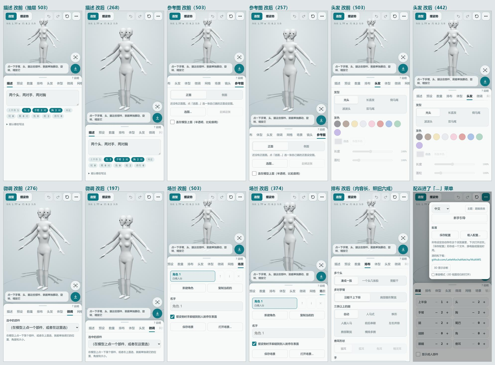

# 手机端界面重构方案

2026-11-04。只管手机竖屏、手机横屏、窄窗口；桌面的左右两栏版面不动，功能、设定、配置文件格式都不变。

## 现状（2026-11-09）

- 照第二版样稿 11-04 做完（ae718cc，分支 `ui/mobile`），同日快进合进 `rework/torso-bust`，随后推上 GitHub main；worktree `多tool-mobile` 和分支已清掉。
- 「没做 / 没验」里后来做了的：手机横屏 11-05 随电脑版重做改成栏目条 + 一次一栏（pc-ui-plan.md，0b5a7e4）；apk 从 2.7.3 起每版重打，在 MuMu 模拟器（WebView 110）上过过，vivo 真机（WebView 83）暴露的白屏、3D 空白修在 a0d0dc9、0322057。
- 之后手机版面上又加的：更新卡片铺在顶栏下面（update-plan.md 第 4 期）；角色条在读数下面一行、能左右滑（scene-plan.md）；顶栏撤销、重做旁的「初始化」（3990165）。
- 真没做的：数量加减号按住连加（「触屏细节」那条）；摆姿势竖屏按身高取景（现在照 T-pose 手臂宽度框人）。
- **11-10 再优化**（分支 `ui/polish`，电脑那边见 pc-ui-plan.md）：
  - 抽屉不再按栏目写死高度（原来描述、头发、场景、参考图内容只有 170–360 px 却拉到 503）：`phone.ts` 量这一栏的内容写进 `--sheet-fit`，样式里夹在 188 px 和六成屏之间；内容变了（选中部件、开「说明」）跟着重量。档位从 peek / low / tall / full 改成 peek / fit / full。375×812 时描述 503 → 268、参考图 503 → 257、微调 276 → 197。
  - 栏目名一排放不下时右边淡出去（`.jump.more`），提示能横着滑；「配置」挪进「⋯」菜单，栏目名 12 → 11 个。
  - 平板竖着拿（601–820 宽）：内容、摆姿势底栏和卡片、导出面板收在中间 600 宽。
  - 前后对比：

现状截图：`docs/mobile-ui/now-shape.jpg`（造型）、`docs/mobile-ui/now-pose.jpg`（摆姿势），375×812、触屏。

## 现在的问题（375×812 实测）

| 量到的 | 数 | 说明 |
|---|---|---|
| 3D 视图 | 365 px（45%） | 上面压着「造型/摆姿势」、三个读数牌子、「放大」；下面压着一句提示和三组按钮（视角 4 个、撤销重做、骨骼）。模型真正露出来的不到一半 |
| 栏目名那一排 | 49 px | 横滑，看不出后面还有几栏 |
| 导出那一排 | 57 px，常驻 | 6 个按钮挤一行，导出一次才用一回，却一直占着 |
| 留给设定的地方 | 约 340 px（42%） | 一屏只看得见一两行 |
| 整页长度 | 5478 px，约 6.7 屏 | 11 栏全排在一条长页里；「排布」一栏 766 px，大半是一段说明文字 |
| 标题区 | 每次滚到顶都在 | 标题、语言、主题、新手引导、GitHub 地址，用得很少却排在最前面 |

另外：

- 摆姿势时，底下那三组按钮和提示正好盖在脚上的圆点上，脚很难点到。
- 点中一个部件以后，「手动微调」在长页的后半截，要自己滚过去找。
- 「放大」是整页切换，放大以后什么都调不了，只能看。
- 状态那一行（「可以摆姿势了…」）有消息时把导出栏顶高一截，3D 视图下面那块又少一点。

## 新版面（竖屏）

一句话：**3D 视图铺满整屏，设定放进从底下拉上来的抽屉，一次只看一栏。**

```
┌───────────────────────────┐
│ [造型|摆姿势]   ↶ ↷   ⋯   │ ← 顶栏：薄、半透明
│ 1.77 m · 8.2 头身    ⌖ 视角│ ← 读数缩成一个小牌子；视角收成一个按钮
│                           │
│          （模型）          │ ← 模型自动挪到抽屉上面露出来的那块正中
│                           │
├────── ═══（拖把手）═══ ─────┤
│ 描述 预设 数量 排布 头发 … │ ← 栏目标签，点哪栏抽屉里就换成哪栏
│ ┌───────────────────────┐ │
│ │  这一栏的内容（只这一栏） │ │
│ └───────────────────────┘ │
│                    [导出] │ ← 导出：一个按钮，点了弹出导出面板
└───────────────────────────┘
```

1. **3D 视图铺满整屏**，不再和面板上下分。抽屉盖在它下半截上，相机照抽屉的高度把模型挪到露出来的那块正中（three.js 的 `setViewOffset`，不改模型、不改截图和导出）。
2. **抽屉三档**：只露栏目标签（约 15%，几乎整屏看模型，替代现在的「放大」）、半屏（默认）、几乎全屏（填长的东西）。拖把手或点标签切换；在 3D 视图上的手势照旧，不会误拖抽屉。
3. **一次一栏**：点标签只显示那一栏，不再一条长页。标签按模式各一套（造型 9 栏 / 摆姿势 4 栏 + 两边共用的「镜头和灯光」「参考图」）。抽屉里内容长了就在抽屉里面滚，3D 视图不动。
4. **顶栏**：造型/摆姿势、撤销、重做、「⋯」。「⋯」里放用得少的：语言、主题、新手引导、保存/载入配置、GitHub 地址。标题区在手机上就不再占地方。
5. **导出**：常驻的那一排撤掉，换成抽屉右下角一个「导出」按钮；点开是一张导出面板：大的「导出白模（GLB）」、其余 5 种、截图、那句「怎么导进 Blender」。状态消息改成从顶上冒一下的小条，不顶高任何东西。
6. **3D 视图上浮着的东西重排**：
   - 读数三个牌子并成一个小牌子，点一下展开。
   - 视角四个按钮收成一个「视角」按钮，点开一小排；骨骼开关放进去。
   - 提示只在第一次出现，碰一下模型就收起（现在也是这样，位置挪开不压模型）。
   - 选中部件的牌子（名字 + ✕）放在顶栏下面，不和脚抢地方。
7. **选中就跳过去**：造型时点中部件 → 抽屉自动到半屏、切到「手动微调」；摆姿势时点中关节 → 切到「姿势」。取消选择后回到原来那一栏。
8. **长说明收起来**：每栏的大段说明（排布、姿势、参考图那几段）改成栏标题旁边一个「?」，点开才显示。

## 横屏、平板

- 手机横屏（高 ≤ 520）：保持左右两栏，右栏也用「栏目标签 + 一次一栏」，导出同样收进按钮；顶栏照竖屏的。
- 平板竖屏（宽 600–820）：跟手机竖屏走（抽屉更宽一些，内容最宽 640 居中）。——见「要你定的」第 4 条。

## 触屏细节（顺手一起做）

- 抽屉、全屏层避开刘海和底部手势条（`env(safe-area-inset-*)`，安卓外壳里也要试）。
- 数量的加减号按住不放连着加。（没做。）
- 横排选项太多的（腿的排法 8 种、发型）在窄屏上换成两三行的格子或横滑，字不再挤成两行小字。
- 屏幕键盘弹出来：抽屉自动拉到全屏，正在打字的那一格露在键盘上面（现在的 `typing` 做法换成跟着抽屉走）。
- 安卓返回键的顺序：关「⋯」/导出面板 → 取消选择 → 抽屉从全屏退回半屏 → 退出。
- 旧安卓 WebView（110）照样能跑：不靠 `color-mix`，`dvh`/`svh` 有退路，拖抽屉用 pointer 事件不用新 API。

## 分期

每期做完：另起 5181 端口（不碰你的 5173），在 375×812、390×844、360×740、横屏 812×375 四个尺寸截前后对比图；`tsc` + `vitest` 过；桌面版面截一张确认没变。

| 期 | 做什么 | 主要改哪 |
|---|---|---|
| 0 | **出样子给你挑**：做一个只有样子、不接功能的静态样稿，三四张手机截图（半屏造型、选中部件、摆姿势、导出面板），你看过再动真的 | 样稿放 scratchpad，截图放 `docs/mobile-ui/` |
| 1 | 骨架：3D 视图铺满、底部抽屉三档、模型自动让到露出来的那块 | `index.html`、`style.css`、新的 `src/view/sheet.ts`、`viewport.ts`（加让位） |
| 2 | 栏目标签 + 一次一栏；顶栏和「⋯」菜单；导出面板和冒出来的状态条 | `index.html`、`style.css`、`main.ts` 里的折叠/跳转/导出那几段 |
| 3 | 3D 视图上浮着的东西重排；选中部件、关节自动切栏 | `main.ts`（`reveal`、选中、提示）、`style.css` |
| 4 | 内容瘦身：长说明收进「?」、选项多的横排换格子、加减号连按 | `index.html`、`style.css`、少量 `main.ts` |
| 5 | 横屏、键盘、返回键、新手引导改指新位置、英日译文补全；打 apk 在模拟器上过一遍 | `tour.ts`、`main.ts`、`i18n`、`tools/apk.ps1` 不改只跑 |

改动集中在界面这一层，不碰几何、融合、摆姿势的算法。新加的界面文字照规矩包 `t()`，补英文、日文。

## 第 0 期样稿（2026-11-04）

总图：`docs/mobile-ui/mockup.png`（上排造型、下排摆姿势，每排第一张是现在的样子），单张都放在 `docs/mobile-ui/new-*.jpg`。

样稿是在单独的 5181 页面上叠了一层样式和脚本（放在 scratchpad，源码没改），把真的栏目搬进抽屉，所以模型、按钮、数字都是真的。和上面的方案比，有三处做的时候改了：

- 选中部件/关节的小牌子不放在顶栏下面（会压住头），改放在抽屉上沿那一排的正中，选中时顶替读数。
- 抽屉拉到全屏时，上沿那一排（视角、读数、导出）收起来，不然会和顶栏撞上。
- 状态消息冒在顶栏下面会压住头：正式版里几秒后自己消失。

样稿没做到的：模型让位是直接把 3D 视图改矮（正式版用 `setViewOffset`，模型能画到抽屉后面）；抽屉换档没有动画；横屏、深色、英日文没截。

## 第二版样稿（2026-11-04）

他看了第一版，觉得留给模型的地方还小。第二版参考了捏人类（VRoid Mobile 一类：矮面板 + 改哪儿镜头凑哪儿）和摆姿势、雕刻类（Magic Poser、Nomad Sculpt：模型全屏、设定是弹出来的小卡片）的做法，两种模式分开处理。

三版对比图：`docs/mobile-ui/mockup-v2.png`（上排造型、下排摆姿势；每排依次是现在、第一版、第二版三张），第二版的单张在 `docs/mobile-ui/v2-*.jpg`。

| | 现在 | 第一版 | 第二版 |
|---|---|---|---|
| 造型时 3D 视图高度 | 365 px（45%） | 456 px（56%） | 562 px（69%） |
| 摆姿势时 3D 视图高度 | 365 px（45%） | 456 px（56%） | 750 px（92%） |

第二版的做法：

- **造型**：抽屉默认只占三分之一，栏目名一行，下面一屏内容。「数量」改成两列小格子，一屏看得到 8 项。「排布」「体型」「头发」「描述」「镜头」「参考图」这几栏内容长，点进去抽屉自动拉到六成高。点中部件后，镜头凑到那个部件跟前（截图里点的是第二个头），抽屉切到「微调」，「选中的部件」那一格省掉（左下角的牌子上写着）。
- **摆姿势**：没有抽屉，3D 视图几乎铺满。底下一条六个图标：姿势、手势、表情、现成、镜头、参考图，点哪个弹出哪张卡片，碰一下模型就收起来。点中关节时只弹一张两行的小卡片（关节名、还原、取消选择、「留在原地」），不挡脚上的圆点。
- **两种模式都有**：顶栏再压薄，读数改成顶栏下面一行小字（不再有底板）；视角、导出改成右边一竖排两个圆按钮。

样稿还差的：摆姿势下镜头还是照 T-pose 的手臂宽度框，竖屏里人只占画面一半高，正式版可以按身高框（手臂伸出画面边一点）；卡片打开时右边那两个圆按钮要跟着让开；凑近部件的镜头要有动画。

## 实现（2026-11-04，照第二版）

他说「照第二版做」。在 worktree `F:\Downloads\多tool-mobile`、分支 `ui/mobile` 上做（主目录有别的会话在用，不切分支）。成品截图：`docs/mobile-ui/done.png`。

- `src/view/phone.ts`：手机竖屏版面的状态都在这里——抽屉四档（`data-sheet`：peek / low / tall / full）、当前栏目（`section.tab-on`）、摆姿势的卡片（`data-card`：open / joint）、弹出层（`data-pop`：menu / export / views）、「说明」开关、状态小条。样子全在 `style.css` 的「手机竖屏」那一段，条件和 `PHONE_QUERY` 一样。
- `index.html`：撤销、重做加了图标（电脑上照旧写字）；加了「更多」、右边两个圆按钮、抽屉把手、垫底的一层、导出面板的标题；去掉了「放大」。「更多」菜单就是原来的标题区，导出面板就是原来的导出那一排，没有复制一份。
- `main.ts`：栏目名按钮换成短名字 + 图标，点了走 `reveal()`；`reveal`、换模式、选中部件 / 关节、安卓返回键、新手引导（视角、导出、最后一步先打开对应的浮层、面板、菜单）接到 `phone`。点中部件时镜头凑过去（`Viewport.focusOn`，手指一碰就停），取消时飞回原处。
- 译文：短栏目名用 `…@@栏目` 的键，英日文在 `src/i18n/*/phone.json`。
- 验过：375×812、360×740（深色）、英文版；点部件、取消、换栏、拖把手、摆姿势的卡片、点关节、导出面板、「更多」菜单、视角浮层、新手引导 13 步；电脑 1280×800 和手机横屏 812×375 还是原来的样子；`tsc`、全部 1622 个测试、`npm run build` 都过。
- 没做 / 没验：手机横屏还是原来的左右两栏（方案里横屏也用标签，这次没做）；摆姿势时镜头照 T-pose 的手臂宽度框人（竖屏里人只占一半高）；只在电脑浏览器里模拟过手机，没在模拟器、真机上试，安卓安装包没重打。（后来：手机横屏 11-05 随电脑版重做改成栏目条 + 一次一栏，0b5a7e4；apk 从 2.7.3 起重打多次，模拟器、vivo 真机都试过；摆姿势竖屏按身高取景仍没做。）

## 当初要你定的（2026-11-04 他选了都照推荐）

1. **大方向**：抽屉（上面这套，推荐）还是保留现在的「上面 3D、下面整页滚」只做修补（缩小浮着的按钮、导出收起、长说明收起）。
2. **一次一栏**还是**抽屉里还是一条长页**：推荐一次一栏，找东西靠标签。
3. **导出放哪**：抽屉右下角的按钮弹出面板（推荐），还是顶栏「⋯」旁边单放一个。
4. **平板竖屏**跟手机走（推荐）还是跟桌面两栏走。
5. **在哪个分支做**：新开 `ui/mobile`（从现在的 `rework/torso-bust` 切出来，推荐），还是直接在 `rework/torso-bust` 上接着提交。
